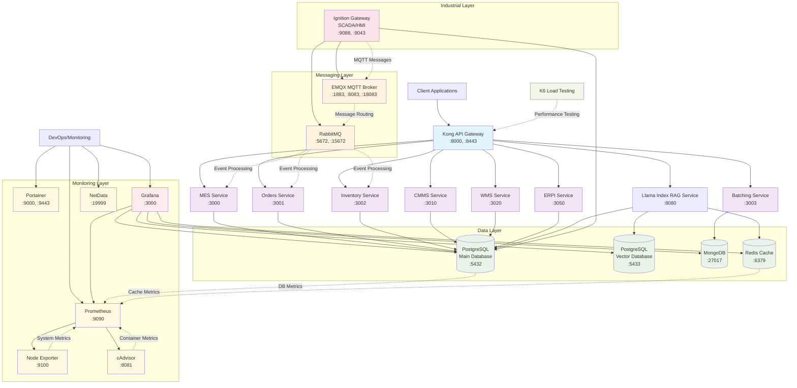

# WhiskeyHouse Services Architecture

## Overview

This repository contains the Docker Compose orchestration for the WhiskeyHouse manufacturing and enterprise systems. The architecture consists of multiple microservices, databases, message brokers, and supporting infrastructure components that work together to provide a comprehensive manufacturing execution system (MES), warehouse management system (WMS), and enterprise resource planning integration (ERPI).

## System Architecture Diagram



## Service Components

### API Gateway Layer

#### Kong API Gateway
- **Purpose**: Centralized API gateway for routing, authentication, and load balancing
- **Ports**: 8000 (HTTP), 8443 (HTTPS), 8001 (Admin), 8002 (GUI)
- **Features**:
  - Basic authentication
  - Proxy caching
  - Rate limiting
  - Request/response transformation
- **Configuration**: Declarative configuration via `kong_config/kong.yaml`

### Business Logic Services

#### Manufacturing Execution System (MES)
- **Port**: 3000
- **Purpose**: Core manufacturing operations management
- **Technology**: GraphQL API
- **Database**: PostgreSQL (main)

#### Orders Service
- **Port**: 3001
- **Purpose**: Order management and processing
- **Technology**: GraphQL/REST API
- **Database**: PostgreSQL (main)

#### Inventory Service
- **Port**: 3002
- **Purpose**: Inventory tracking and management
- **Technology**: GraphQL/REST API
- **Database**: PostgreSQL (main)

#### Batching Service
- **Port**: 3003
- **Purpose**: Batch processing and recipe management
- **Technology**: GraphQL/REST API
- **Database**: MongoDB (for flexible batch data)

#### CMMS (Computerized Maintenance Management System)
- **Port**: 3010
- **Purpose**: Equipment maintenance and asset management
- **Technology**: GraphQL/REST API
- **Database**: PostgreSQL (main)

#### WMS (Warehouse Management System)
- **Port**: 3020
- **Purpose**: Warehouse operations and logistics
- **Technology**: GraphQL/REST API
- **Database**: PostgreSQL (main)

#### ERPI (Enterprise Resource Planning Integration)
- **Port**: 3050
- **Purpose**: ERP system integration and data synchronization
- **Technology**: GraphQL/REST API
- **Database**: PostgreSQL (main)

### AI/ML Services

#### Llama Index RAG Service
- **Port**: 8080
- **Purpose**: Retrieval-Augmented Generation for natural language queries
- **Technology**: Python FastAPI with LlamaIndex
- **Features**:
  - Natural language querying of manufacturing data
  - Vector embeddings using OpenAI
  - Semantic search capabilities
  - Redis caching for performance
- **Dependencies**:
  - PostgreSQL (main database for source data)
  - PostgreSQL (vector database for embeddings)
  - Redis (caching)
  - OpenAI API (embeddings and completions)

### Data Layer

#### PostgreSQL (Main Database)
- **Port**: 5432
- **Purpose**: Primary relational database for business data
- **Features**:
  - WAL (Write-Ahead Logging) enabled for replication
  - Custom initialization scripts
  - Shared across multiple services

#### PostgreSQL (Vector Database)
- **Port**: 5433
- **Purpose**: Specialized database for vector embeddings
- **Features**:
  - pgvector extension for similarity search
  - Optimized for AI/ML workloads
  - Used by Llama Index service

#### MongoDB
- **Port**: 27017
- **Purpose**: Document database for flexible batch data
- **Features**:
  - Replica set configuration
  - Authentication enabled
  - Used primarily by batching service

#### Redis
- **Port**: 6379
- **Purpose**: In-memory cache and session store
- **Features**:
  - High-performance caching
  - Used by Llama Index for query caching
  - Session management

### Messaging Layer

#### RabbitMQ
- **Ports**: 5672 (AMQP), 15672 (Management UI)
- **Purpose**: Message broker for asynchronous communication
- **Features**:
  - Management plugin enabled
  - Custom configuration and definitions
  - Event-driven architecture support

#### EMQX MQTT Broker
- **Ports**: 1883 (MQTT), 8083 (WebSocket), 18083 (Dashboard)
- **Purpose**: IoT device communication and industrial messaging
- **Features**:
  - MQTT 5.0 support
  - WebSocket support for web clients
  - Integration with industrial devices

### Industrial Automation Layer

#### Ignition Gateway
- **Ports**: 9088 (HTTP), 9043 (HTTPS)
- **Purpose**: SCADA/HMI system for industrial automation
- **Features**:
  - Git integration for project management
  - MQTT Engine and Transmission modules
  - SSL/TLS enabled
  - Custom modules and configurations
- **Integration**:
  - Connects to MQTT broker for device communication
  - Integrates with PostgreSQL for data storage
  - Git-based project synchronization

### Monitoring & Operations Stack

#### Portainer
- **Ports**: 9000 (HTTP), 9443 (HTTPS)
- **Purpose**: Docker container management and monitoring
- **Features**:
  - Web-based Docker management interface
  - Container, image, and volume management
  - Stack deployment and monitoring
  - User access control

#### Prometheus
- **Port**: 9090
- **Purpose**: Metrics collection and time-series database
- **Features**:
  - Scrapes metrics from various exporters
  - Time-series data storage
  - Alerting capabilities
  - PromQL query language
- **Data Sources**:
  - Node Exporter (system metrics)
  - cAdvisor (container metrics)
  - Application metrics endpoints

#### Grafana
- **Port**: 3000 ⚠️ (Conflicts with MES service)
- **Purpose**: Monitoring dashboards and visualization
- **Features**:
  - Interactive dashboards
  - Multiple data source support
  - Alerting and notifications
  - Custom plugins and panels
- **Data Sources**:
  - Prometheus (primary)
  - PostgreSQL databases
  - Redis
  - MongoDB

#### NetData
- **Port**: 19999
- **Purpose**: Real-time system and application monitoring
- **Features**:
  - Real-time performance monitoring
  - Interactive web interface
  - Low resource overhead
  - Automatic service discovery
  - Docker container monitoring

#### Node Exporter
- **Port**: 9100
- **Purpose**: System-level metrics collection
- **Features**:
  - CPU, memory, disk, network metrics
  - System statistics export
  - Prometheus-compatible metrics format

#### cAdvisor
- **Port**: 8080 ⚠️ (Conflicts with Llama Index service)
- **Purpose**: Container metrics collection
- **Features**:
  - Container resource usage monitoring
  - Performance characteristics analysis
  - Historical usage data
  - Prometheus metrics export

### Supporting Services

#### K6 Load Testing
- **Purpose**: Performance testing and load simulation
- **Target**: Kong API Gateway
- **Configuration**: Custom test scripts in `/scripts`

## Network Architecture

### Port Mapping

#### Business Services
- **8000**: Kong API Gateway (proxy)
- **8443**: Kong API Gateway (SSL proxy)
- **8011**: Kong API Gateway (admin) - *Changed from 8001*
- **8012**: Kong API Gateway (GUI) - *Changed from 8002*
- **3000**: MES service ⚠️ (Conflicts with Grafana)
- **3001**: Orders service
- **3002**: Inventory service
- **3003**: Batching service
- **3010**: CMMS service
- **3020**: WMS service
- **3050**: ERPI service
- **8080**: Llama Index RAG service

#### Data Layer
- **5432**: PostgreSQL main database
- **5433**: PostgreSQL vector database
- **27017**: MongoDB
- **6379**: Redis

#### Messaging
- **5672, 15672**: RabbitMQ (AMQP, Management)
- **1883, 8083, 18083**: MQTT broker (MQTT, WebSocket, Dashboard)

#### Industrial Automation
- **9088, 9043**: Ignition Gateway (HTTP, HTTPS)

#### Monitoring Stack
- **9000, 9443**: Portainer (HTTP, HTTPS)
- **9090**: Prometheus
- **3000**: Grafana ⚠️ (Conflicts with MES service)
- **19999**: NetData
- **9100**: Node Exporter
- **8081**: cAdvisor - *Changed from 8080*

#### Port Conflicts ⚠️
1. **Port 3000**: MES Service vs Grafana *(Remaining conflict)*

> **Resolved**: Kong admin/GUI ports and cAdvisor port conflicts have been resolved. Only Grafana vs MES conflict remains.

### Service Discovery
- Services communicate using Docker Compose service names
- External services (outside Docker) accessed via `host.docker.internal`
- Kong routes traffic based on path prefixes

## Data Flow Patterns

### Request Flow
1. **Client Request** → Kong API Gateway
2. **Kong** → Appropriate microservice based on path routing
3. **Microservice** → Database (PostgreSQL/MongoDB)
4. **Response** ← Back through Kong to client

### Event-Driven Flow
1. **Industrial Device** → MQTT Broker
2. **MQTT** → RabbitMQ (message routing)
3. **RabbitMQ** → Business services (event processing)
4. **Services** → Database updates

### AI Query Flow
1. **Natural Language Query** → Llama Index Service
2. **Llama Index** → Vector Database (similarity search)
3. **Llama Index** → Main Database (data retrieval)
4. **Llama Index** → OpenAI API (completion)
5. **Response** ← Structured answer to client

## Security Considerations

### Authentication & Authorization
- Kong provides centralized authentication
- Basic auth configured for admin access
- SSL/TLS enabled for secure communication

### Network Security
- Services isolated within Docker network
- Minimal port exposure to host system
- Read-only containers where possible

### Secrets Management
- Docker secrets for sensitive data
- Environment variables for configuration
- Git tokens and passwords stored securely

## Deployment & Operations

### Container Orchestration
- Docker Compose for local development
- Docker Swarm configuration available (`docker-swarm.yml`)
- Health checks configured for critical services

### Monitoring & Logging
- Container logs accessible via Docker
- Health check endpoints for service monitoring
- Performance testing with K6

### Backup & Recovery
- PostgreSQL WAL logging for point-in-time recovery
- Volume mounts for persistent data
- Database initialization scripts for setup

## Development Workflow

### Environment Setup
1. Clone repository
2. Configure environment variables (`.env`)
3. Set up secrets (GitHub tokens, passwords)
4. Run `docker compose up -d`

### Service Development
- Individual services can be developed independently
- Hot reloading supported for development
- Comprehensive test suites available

### Git Integration
- Ignition projects managed via Git
- Automated module deployment
- Version control for industrial configurations

## Scalability Considerations

### Horizontal Scaling
- Stateless services can be scaled horizontally
- Load balancing via Kong
- Database connection pooling

### Performance Optimization
- Redis caching for frequently accessed data
- Vector database for AI workload optimization
- Connection timeouts and retry logic

### Resource Management
- Memory limits configured for Java applications
- CPU allocation optimized per service
- Volume management for persistent storage

## Port Conflict Resolution

### Current Conflicts
The system currently has two critical port conflicts that prevent proper startup:

1. **Port 3000**: MES Service vs Grafana
2. **Port 8080**: Llama Index RAG Service vs cAdvisor

### Recommended Solutions

#### Option 1: Change Monitoring Service Ports (Recommended)
```yaml
# In docker-compose.yml
grafana:
  ports:
    - "3001:3000"  # Change external port to 3001

cadvisor:
  ports:
    - "8081:8080"  # Change external port to 8081
```

#### Option 2: Change Business Service Ports
```yaml
# In docker-compose.yml
llama-index-service:
  ports:
    - "8081:8080"  # Change external port to 8081
```

#### Option 3: Use Different Port Ranges
- **Business Services**: 3000-3099
- **Monitoring Services**: 8000-8099 (avoiding Kong's range)
- **Databases**: 5400-5499
- **Message Brokers**: 5600-5699

### Implementation Priority
1. **Immediate**: Fix port 8080 conflict (cAdvisor vs Llama Index)
2. **Short-term**: Resolve port 3000 conflict (MES vs Grafana)
3. **Long-term**: Implement consistent port allocation strategy

## Future Enhancements

### Potential Improvements
- Kubernetes migration for production
- Service mesh implementation (Istio/Linkerd)
- Enhanced monitoring with resolved port conflicts
- CI/CD pipeline integration
- Multi-environment configuration management
- Container orchestration with proper port management

### Technology Roadmap
- Microservices decomposition
- Event sourcing implementation
- Advanced AI/ML capabilities
- Real-time analytics dashboard
- Mobile application support
- Automated port conflict detection and resolution
