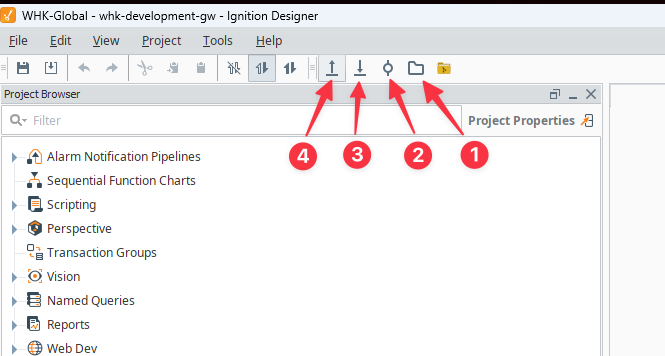

# Ignition Development Environment Setup Guide

## Table of Contents
- [Ignition Development Environment Setup Guide](#ignition-development-environment-setup-guide)
  - [Table of Contents](#table-of-contents)
- [QuickStart](#quickstart)
  - [Getting a Github Access Token](#getting-a-github-access-token)
    - [Getting a Classic Personal Access Token](#getting-a-classic-personal-access-token)
    - [GitHub Token Requirements](#github-token-requirements)
  - [Environment Setup](#environment-setup)
    - [Environment Variables](#environment-variables)
    - [Starting the Gateway](#starting-the-gateway)
    - [Connecting to Development VPN](#connecting-to-development-vpn)
  - [Git Configuration](#git-configuration)
    - [Git YAML Configuration](#git-yaml-configuration)
      - [Example configuration:](#example-configuration)
  - [Docker Changes for Git.Yaml changes or other needs](#docker-changes-for-gityaml-changes-or-other-needs)
    - [Starting the Docker Environment](#starting-the-docker-environment)
    - [Stopping the Docker Environment](#stopping-the-docker-environment)
    - [Restarting the Docker Environment](#restarting-the-docker-environment)
    - [Resetting Volumes](#resetting-volumes)
    - [Exec'ing into the Gateway Container](#execing-into-the-gateway-container)
    - [Viewing Logs](#viewing-logs)
- [Other Helpful Musings...](#other-helpful-musings)
- [Using the Git Module in the Ignition Designer](#using-the-git-module-in-the-ignition-designer)
- [Git Operations Inside the Ignition Container](#git-operations-inside-the-ignition-container)
- [Using Backend or Frontend GitSubmodules](#using-backend-or-frontend-gitsubmodules)
- [Restoring database from backups](#restoring-database-from-backups)

## Talk Runbook and Demo Helpers

- See `TALK-RUNBOOK.md` for the 45‑min outline, roles, and scripted demo.
- Quick demo scripts:
  - `./scripts/demo-preflight.sh`
  - `./scripts/demo-up.sh`
  - `./scripts/demo-down.sh`
  - `./scripts/demo-open.sh`
 - Slide deck outline: `SLIDES-OUTLINE.md`

# QuickStart

## Getting a Github Access Token

### Getting a Classic Personal Access Token

1. Go to your GitHub account settings
2. Click "Developer settings" in the left sidebar
3. Click "Personal access tokens" then "Tokens (classic)"
4. Click "Generate new token" and select "Generate new token (classic)"
5. Give your token a descriptive name
6. Select the following scopes:
   - `read:packages` (Required for pulling Docker images)
   - `repo`
7. Click "Generate token"
8. Copy your token immediately - you won't be able to see it again!

**Important:** Store this token securely. Never commit it to source control.

You'll use this token for:
- Docker login (see command below)
- The `GIT_USER_TOKEN` environment variable (in the .env file, see [Environment Variables](#environment-variables))
- The `secrets/GIT_USER_TOKEN` file (you will need to create this)

### GitHub Token Requirements
Your token must have the "read packages" permission enabled. If you don't, you'll get this error:


> **Note:** In addition to the "read packages" permission, your GitHub token must also be configured for Single Sign-On (SSO) if your organization requires it. Ensure that your token is authorized for SSO to avoid authentication issues.

## Environment Setup

### Environment Variables
Use dotenv-vault to manage environment variables:
```bash
# Install dotenv-vault globally
npm install -g dotenv-vault@latest

# Pull environment variables
npx dotenv-vault@latest pull
```
This will pull the .env development file locally. Update the `GIT_USER_TOKEN` in your .env with your GitHub token.

### Starting the Gateway

1. Start the Docker environment:
```bash
docker compose up -d
```

2. Open the Ignition Gateway:
   - Navigate to `https://localhost:9043`
   - Accept the Git Module Certificate:
     1. Go to `Configuration -> Modules -> Quarantined Modues`
     2. Select `Accept` for the `Git` module
     3. Wait while projects are pulled (this can take a few minutes)
     4. Confirm the projects are pulled in

### Connecting to Development VPN

1. Install FortiClient VPN:
   - Download FortiClient from [FortiClient.com](https://www.forticlient.com/)
   - Choose the free VPN-only version for your operating system
   - Follow the installation wizard

2. Configure VPN Connection:
   - Open FortiClient
   - Click "Configure VPN"
   - Enter the following details:
     - Connection Name: `Development Environment`
     - Remote Gateway: `your-vpn-gateway.com/development`
     - Port: `10443`
     - `Enable Single Sign On (SSO) for VPN Tunnel`: True
     - VPN Type: `SSL-VPN`

3. Connect to VPN:
   - Enter your organization credentials
   - Click "Connect"
   - Accept any security certificates if prompted

**Note:** Contact IT if you need VPN credentials or have connection issues.

## Git Configuration

The `gw-init/git.yaml` file is used to configure the git source for the gateway. It is used to pull in the `ignition-modules` repo and push/pull changes to it.

### Git YAML Configuration

The git.yaml file contains the configuration for Git integration with Ignition projects. Each entry in the YAML file represents a Git repository connection with the following properties:

- `repo_uri`: The HTTPS URL of the Git repository
- `repo_branch`: The branch to use (e.g. main, master)
- `ignition_projectName`: The name of the Ignition project to associate with this repo
- `ignition_userName`: The Ignition user account to use for project access
- `ignition_inheritable`: Whether child projects can inherit from this project (true/false)
- `ignition_parentName`: The parent project name if this is a child project, null otherwise
- `user_name`: Git username for authentication
- `user_email`: Git user email
- `user_password`: Git password (not used when using tokens)
- `commissioning_importThemes`: Whether to import themes during commissioning (true/false)
- `commissioning_importTags`: Whether to import tags during commissioning (true/false) 
- `commissioning_importImages`: Whether to import images during commissioning (true/false)
- `initDefaultBranch`: The default branch name to use when initializing the repo

#### Example configuration:
```yaml
- repo_uri: https://github.com/yourorg/global-ignition-project.git
  repo_branch: master
  ignition_projectName: Global-Project
  ignition_userName: your-email@yourorg.com
  ignition_inheritable: true
  ignition_parentName: null
  user_name: your-username
  user_email: your-email@yourorg.com
  user_password: <not used>
  commissioning_importThemes: true
  commissioning_importTags: true
  commissioning_importImages: true
  initDefaultBranch: main
- repo_uri: https://github.com/yourorg/ignition-reporting.git
  repo_branch: main
  ignition_projectName: Reporting
  ignition_userName: your-email@yourorg.com
  ignition_inheritable: false
  ignition_parentName: Global-Project
  user_name: your-username
  user_email: your-email@yourorg.com
  user_password: <not used>
  commissioning_importThemes: true
  commissioning_importTags: true
  commissioning_importImages: true
  initDefaultBranch: main
- repo_uri: https://github.com/yourorg/ignition-scada.git
  repo_branch: main
  ignition_projectName: Manufacturing_Plant_01
  ignition_userName: your-email@yourorg.com
  ignition_inheritable: false
  ignition_parentName: Global-Project
  user_name: your-username
  user_email: your-email@yourorg.com
  user_password: <not used>
  commissioning_importThemes: true
  commissioning_importTags: true
  commissioning_importImages: true
  initDefaultBranch: main
  ```

  Note, that the Global app is inherited by all other projects. This can be used to flexibly change branches or different projects that are needed for your development. Modify to use your git credentials and organizational email.

## Docker Changes for Git.Yaml changes or other needs

### Starting the Docker Environment

To start up the Docker environment:
`docker compose up -d`

### Stopping the Docker Environment

To stop the Docker environment:
`docker compose down`

### Restarting the Docker Environment

To restart the Docker environment:
`docker compose restart`

### Resetting Volumes

To reset the volumes:
`docker compose down -v`

### Exec'ing into the Gateway Container

To exec' into the gateway container:
`docker ps`

Get the id of the container and use it to exec' into the container:
`docker exec -it <ignition-container-id> bash`

### Viewing Logs

Get the container id of the gateway:
`docker ps`
To view the logs:
`docker logs <ignition-container-id>`

# Other Helpful Musings...

# Using the Git Module in the Ignition Designer

There are a few main ways to interact with the Git module in the Ignition Designer:
1. Export Gateway scoped resources into the projects local git repo
   1. Tags
   2. Images
   3. Themes
2. Commit resources go to the local git repo
   1. A popup will appear to select the resources to commit
3. Push resources to the remote git repo
4. Pull resources from the remote git repo

Generally, the commit and push operations are predominantly used. And less so the export gateway resources. The pull is rarely used

> **Warning:** Using the `pull` operation on a production gateway can lead to unexpected behavior and potential downtime. It is highly recommended to perform pull operations in a development or staging environment first to ensure that changes do not disrupt the production system. Always coordinate with your team and follow your organization's deployment procedures when making changes to a production gateway.


# Git Operations Inside the Ignition Container

To perform Git operations on Ignition projects directly within the container:

1. First, exec into the running Ignition container:
```bash
# Find the container ID
docker ps

# Exec into the container
docker exec -it <ignition-container-id> bash
```

2. Navigate to the projects directory:
```bash
cd /usr/local/bin/ignition/data/projects
```

3. List available projects:
```bash
ls
```

4. Navigate to your project directory and perform Git operations:
```bash
# Enter project directory
cd <project-name>

# See recent commits (Git Log)
git log --oneline --graph --all -n 10

# Check current branch
git branch

# Create and checkout new branch
git checkout -b feature/new-branch

# Switch to existing branch
git checkout existing-branch

# Pull latest changes
git pull

# Check status
git status
```

**Important Notes:**
- Always verify you're in the correct project directory before running Git commands
- The Git module will automatically detect branch changes and reload the project
- Avoid making direct changes to the `master` or `main` branches
- Coordinate branch changes with your team to prevent conflicts
- Remember that branch changes will affect the running Ignition instance

# Using Backend or Frontend GitSubmodules

To initialize and update Git submodules in the project:

1. Initialize the submodules:
```bash
git submodule update --init --recursive
```

2. Update submodules to their latest commits:
```bash
git submodule update --remote --merge
```

3. When making changes in a submodule:
   - Navigate into the submodule directory
   - Create/checkout your feature branch
   - Make your changes
   - Commit and push changes to the submodule repository
   - Return to the parent repository
   - Commit the updated submodule reference
   - Push the parent repository changes

4. When pulling changes that include submodule updates:
```bash
git pull
git submodule update --init --recursive
```

**Important Notes:**
- Always commit submodule changes before committing in the parent repository
- Use `git status` to check if submodules are in a detached HEAD state
- To switch a submodule to a specific branch:
  ```bash
  cd path/to/submodule
  git checkout branch-name
  cd ..
  git add path/to/submodule
  git commit -m "Switch submodule to branch-name"
  ```

# Restoring database from backups

To restore a PostgreSQL database backup in the Ignition environment:

1. First, copy your .sql backup file into the running PostgreSQL container:
```bash
# Find the Postgres container ID
docker ps | grep db

# Copy the backup file into the container
docker cp path/to/your/backup.sql <postgres-container-id>:/tmp/
```

2. Exec into the PostgreSQL container:
```bash
docker exec -it <postgres-container-id> bash
```

3. Restore the database:
```bash
# Close connections if needed
psql -U admin -c "SELECT pg_terminate_backend(pg_stat_activity.pid) FROM pg_stat_activity WHERE pg_stat_activity.datname = 'your_database_name' AND pid <> pg_backend_pid();" && psql -U admin -c "DROP DATABASE IF EXISTS \"your_database_name\";"

# If you need to drop the existing database first (be careful!)
psql -U admin -c "DROP DATABASE IF EXISTS \"your_database_name\";"
psql -U admin -c "CREATE DATABASE \"your_database_name\";"

# Restore the backup
psql -U admin 'your_database_name' < /tmp/backup.sql

**Alternative Method** (restore from outside the container):
```bash
# Restore directly without entering the container (Untested)
cat backup.sql | docker exec -i <postgres-container-id> psql -U admin -d your_database_name
```

**Important Notes:**
- Always backup your current database before performing a restore
- Ensure the Ignition Gateway is stopped or in maintenance mode during database operations
- The postgres user should have sufficient privileges for the restore operation
- Remove the backup file from the container after restoration:
  ```bash
  docker exec -it <postgres-container-id> rm /tmp/backup.sql
  ```
- If you encounter permission issues, ensure the postgres user has proper access to the backup file