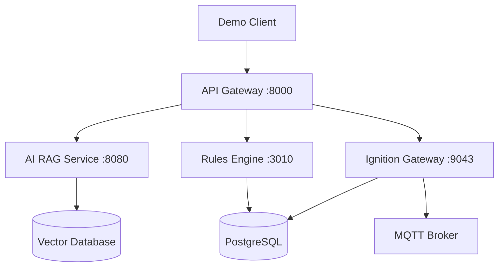

# AI in Manufacturing 2025 - Demo Platform

A comprehensive manufacturing execution system (MES) with AI-powered capabilities, designed to demonstrate the integration of artificial intelligence in industrial automation workflows.

> 🗺️ **New here?** See [`GUIDE-INDEX.md`](GUIDE-INDEX.md) for a complete map of demos, services, and documentation.

## What This Platform Does

This repository contains a full-stack manufacturing platform that showcases:

- **Real-time Industrial Data Processing** via MQTT and Ignition SCADA
- **AI-Powered Manufacturing Insights** using retrieval-augmented generation (RAG)
- **Automated Quality Control** with intelligent validation rules
- **Microservices Architecture** for scalable manufacturing operations
- **Interactive Demos** for presentations and proof-of-concepts

## Who This Is For

| Role | You Should... | Start Here |
|------|---------------|------------|
| **Presenter/Evaluator** | Run scripted demos | [`demos/README.md`](demos/README.md) |
| **Developer** | Understand the codebase and contribute | [`docs/development/GETTING-STARTED.md`](docs/development/GETTING-STARTED.md) |
| **DevOps/Deployer** | Deploy to environments | [`docs/deployment/README.md`](docs/deployment/README.md) |
| **Architect** | Understand system design | [`ARCHITECTURE.md`](ARCHITECTURE.md) |

## Quick Start

### Prerequisites
- Docker & Docker Compose
- Node.js 18+ (for package management)
- GitHub Personal Access Token ([setup guide](docs/setup/SECRETS-QUICKSTART.md))

### 1-Minute Demo
```bash
# Clone and setup
git clone <repository-url>
cd icc-ai-in-manufacturing-2025

# Configure environment
cp .env.example .env
# Edit .env with your GitHub token

# Start the platform
docker compose up -d

# Run a demo
./demos/scripts/run-full-stack-demo.sh --auto
```

### Verify Installation
- **Ignition Gateway**: https://localhost:9043
- **Grafana Dashboard**: http://localhost:3001  
- **API Gateway**: http://localhost:8000
- **Demo Status**: `./scripts/demo-preflight.sh`

## Platform Architecture



## Key Services

| Service | Purpose | Port | Documentation |
|---------|---------|------|---------------|
| **Ignition Gateway** | SCADA/HMI system | 9043 | [Services Guide](services/README.md) |
| **AI RAG Service** | Natural language manufacturing queries | 8080 | [AI Documentation](docs/development/AI-CONTEXT-ENGINEERING.md) |
| **Rules Engine** | Automated validation | 3010 | [Rules Guide](services/rules-engine/README.md) |
| **API Gateway** | Request routing & auth | 8000 | [API Docs](docs/api/README.md) |

## Repository Structure

```
├── demos/              # Interactive demonstrations
├── services/           # Core platform services
│   ├── ignition/       # SCADA/HMI configurations
│   ├── llama-index/    # AI RAG service
│   ├── rules-engine/   # Validation engine
│   └── monitoring/     # Observability stack
├── docs/               # Documentation hub
│   ├── setup/          # Environment setup guides
│   ├── development/    # Developer resources
│   ├── deployment/     # Deployment guides
│   ├── troubleshooting/# Common issues & fixes
│   └── api/            # API documentation
├── config/             # Service configurations
├── scripts/            # Automation utilities
└── tests/              # Test suites
```

## Common Tasks

### Run a Demo
```bash
./demos/scripts/run-full-stack-demo.sh
```

### Development Setup
```bash
# See full setup guide: docs/development/GETTING-STARTED.md
docker compose up -d
npm install
```

### Troubleshooting
- **Port conflicts?** → [Conflict Resolution Guide](docs/troubleshooting/CONFLICT-RESOLUTION-GUIDE.md)
- **Authentication issues?** → [Secrets Quickstart](docs/setup/SECRETS-QUICKSTART.md)
- **Environment problems?** → `./scripts/demo-preflight.sh`

## Getting Help

- 📚 **Documentation**: Browse [`docs/`](docs/) for comprehensive guides
- 🐛 **Issues**: Check [troubleshooting docs](docs/troubleshooting/) first
- 🎯 **Demos**: See [demo guides](docs/demos/) for presentation help
- 🔧 **Development**: Visit [development docs](docs/development/) for contributor info

## Next Steps

1. **First Time?** → Read [`GUIDE-INDEX.md`](GUIDE-INDEX.md) for navigation
2. **Want to Demo?** → Start with [`demos/README.md`](demos/README.md)  
3. **Want to Develop?** → Check [`docs/development/GETTING-STARTED.md`](docs/development/GETTING-STARTED.md)
4. **Need Architecture Overview?** → See [`ARCHITECTURE.md`](ARCHITECTURE.md)

---

**💡 Pro Tip**: Use `./scripts/demo-preflight.sh` before any presentation to verify everything is working correctly.