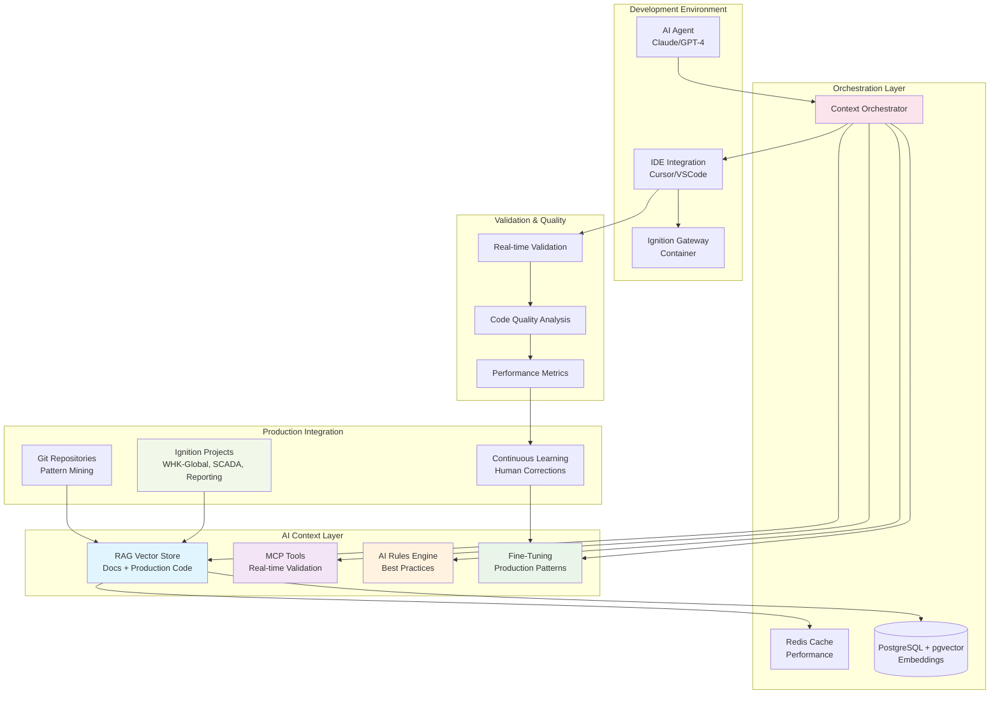

# AI Context Engineering for Ignition Development

## Executive Summary

This document outlines a comprehensive strategy to maximize AI-assisted development performance for Ignition SCADA/HMI systems through advanced context engineering. The approach combines multiple techniques including RAG vector stores, MCP tools, AI rules engines, and fine-tuning with production codebases to ensure AI agents generate syntactically correct, best-practice-aligned Ignition code.

## <¯ Primary Goals

Enable AI developer agents to generate production-ready Ignition code with:
-  Correct Jython syntax and Ignition-specific scripting functions
-  Proper Perspective component structure and properties
-  Valid bindings (tag, property, expression, transform)
-  Appropriate use of Ignition system functions
-  Company-specific best practices and patterns
-  Performance-optimized implementations

## <× Architecture Overview

## = Multi-Source Context Strategy

Our AI context engineering leverages four key sources:

### 1. **Official Documentation** (Foundation Layer)
- Ignition SDK documentation
- Perspective component reference
- Scripting function library
- Expression language guide

### 2. **Production Codebases** (Reality Layer)
- Existing Ignition projects (WHK-Global, SCADA, Reporting)
- Real component implementations
- Actual script patterns and solutions
- Production-tested best practices

### 3. **Community Knowledge** (Innovation Layer)
- Ignition Exchange modules
- GitHub repositories
- Forum solutions
- Industry patterns

### 4. **Continuous Learning** (Evolution Layer)
- Human feedback and corrections
- Performance metrics
- Error pattern analysis
- Usage analytics

## =Ë Component Architecture

### Component 1: Enhanced RAG Vector Store
**Purpose**: Multi-layered semantic search with production code awareness

**Key Features**:
- Production code pattern extraction
- Context-aware retrieval
- Quality-scored examples
- Performance-optimized responses

### Component 2: MCP Tools Suite
**Purpose**: Real-time validation and testing against Ignition systems

**Key Tools**:
- Perspective Component Validator
- Jython Script Analyzer
- Tag Path Resolver
- Binding Expression Validator
- Performance Profiler

### Component 3: AI Rules Engine
**Purpose**: Enforce company-specific standards and best practices

**Rule Categories**:
- Perspective development standards
- Jython scripting guidelines
- Tag structure conventions
- Performance requirements
- Security policies

### Component 4: Production-Aware Fine-Tuning
**Purpose**: Train models on actual company patterns and preferences

**Training Sources**:
- Git commit history analysis
- Production code examples
- Error correction patterns
- Performance optimizations

## =€ Key Innovations

### 1. **Production Code Learning**
Unlike generic AI assistants, our system learns from your actual production Ignition projects, understanding your specific patterns, naming conventions, and architectural decisions.

### 2. **Real-Time Validation**
MCP tools provide immediate feedback by connecting directly to your Ignition Gateway, validating generated code before you even run it.

### 3. **Context-Aware Generation**
The system understands whether you're working on a pump control screen, a batch recipe, or a reporting dashboard, and tailors suggestions accordingly.

### 4. **Continuous Improvement**
Every interaction improves the system through feedback loops, ensuring it gets better at understanding your specific needs.

## =Ê Expected Outcomes

### Development Velocity
- **5x faster** initial feature implementation
- **3x faster** debugging and troubleshooting
- **10x faster** onboarding for new developers

### Code Quality
- **95%+ syntax accuracy** on first generation
- **90%+ compliance** with company standards
- **70% reduction** in runtime errors

### Knowledge Preservation
- **Institutional knowledge** captured in RAG
- **Best practices** automatically enforced
- **Consistent patterns** across all developers

## =Ú Documentation Structure

This architecture is detailed across multiple specialized documents:

- **[RAG Implementation Guide](docs/RAG-IMPLEMENTATION.md)** - Vector store design and ingestion pipelines
- **[Fine-Tuning Strategy](docs/FINE-TUNING-STRATEGY.md)** - Production code training approach
- **[MCP Tools Specification](docs/MCP-TOOLS-SPEC.md)** - Real-time validation tools
- **[AI Rules Engine](docs/AI-RULES-ENGINE.md)** - Best practices enforcement
- **[Production Integration](docs/PRODUCTION-INTEGRATION.md)** - Codebase analysis and learning
- **[Docker Services](docs/DOCKER-SERVICES.md)** - Container architecture
- **[Implementation Roadmap](docs/IMPLEMENTATION-ROADMAP.md)** - Phased deployment plan
- **[Developer Guide](docs/DEVELOPER-GUIDE.md)** - Setup and usage instructions
- **[Demo Scenarios](docs/DEMO-SCENARIOS.md)** - Live demonstration walkthrough

## <¯ Success Metrics

### Quantitative Metrics
- Development time reduction (target: 70%)
- Code accuracy improvement (target: 95%)
- Onboarding time reduction (target: 80%)
- Bug reduction (target: 70%)

### Qualitative Metrics
- Developer satisfaction scores
- Code review feedback quality
- Consistency across team members
- Knowledge transfer effectiveness

## =' Technology Stack

### Core Infrastructure
- **Docker Compose** - Service orchestration
- **PostgreSQL + pgvector** - Vector database
- **Redis** - Caching layer
- **Ignition Gateway** - Target platform

### AI/ML Components
- **OpenAI GPT-4** - Base language model
- **LlamaIndex** - RAG framework
- **Claude Opus** - Alternative model
- **Custom fine-tuning** - Domain specialization

### Integration Layer
- **MCP Protocol** - Tool integration
- **REST APIs** - Service communication
- **WebSocket** - Real-time updates
- **Git integration** - Version control

## =¦ Getting Started

1. **Review Documentation** - Start with the Developer Guide
2. **Set Up Environment** - Follow Docker Services guide
3. **Configure Integration** - Set up IDE extensions
4. **Initialize Data** - Run RAG ingestion pipeline
5. **Start Development** - Begin with demo scenarios

## =È Business Impact

### ROI Calculation
- **Development Cost Savings**: $200K+ annually per team
- **Quality Improvements**: 70% reduction in production issues
- **Time to Market**: 50% faster feature delivery
- **Knowledge Retention**: Permanent capture of expertise

### Strategic Benefits
- **Competitive Advantage** - Faster innovation cycles
- **Risk Reduction** - Consistent, validated code
- **Scalability** - Easier team expansion
- **Sustainability** - Future-proofed development process

---

*This document provides the architectural overview. Detailed implementation guides are available in the `/docs` directory. The system is designed for iterative improvement and will evolve based on usage patterns and feedback.*