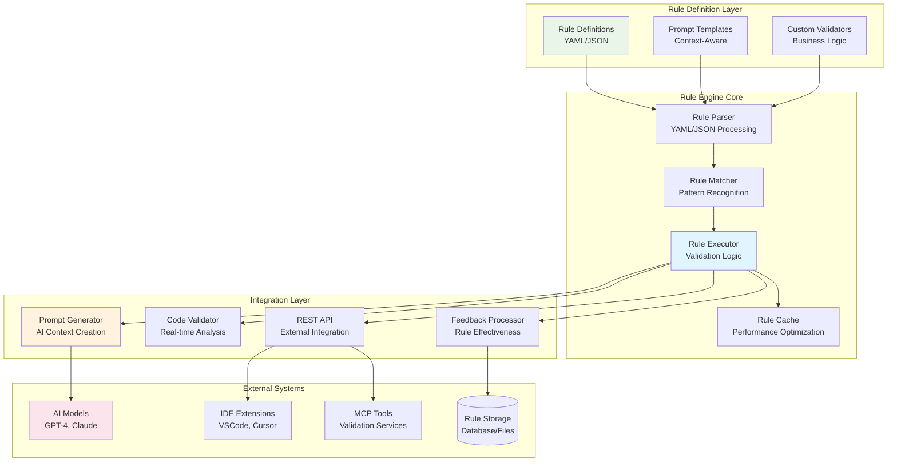

# AI Rules Engine Design

## Overview

The AI Rules Engine enforces Ignition development best practices, coding standards, and company-specific conventions through declarative rules. It integrates with AI models to provide context-aware prompts and real-time validation, ensuring consistent, high-quality code generation that follows established patterns and performance guidelines.

## 🎯 Rules Engine Objectives

### Primary Goals
- **Standards Enforcement**: Automatically enforce coding standards and best practices
- **Context-Aware Prompting**: Generate AI prompts tailored to specific development contexts
- **Quality Assurance**: Prevent common mistakes and anti-patterns
- **Knowledge Preservation**: Capture and enforce institutional knowledge
- **Consistency**: Ensure uniform code style across all developers and AI-generated code

### Key Benefits
- **Immediate Feedback**: Real-time validation during development
- **Learning Integration**: Rules inform AI model training and fine-tuning
- **Scalable Standards**: Consistent enforcement across teams and projects
- **Adaptive System**: Rules can evolve with changing requirements

## 🏗️ Architecture Design

### Rules Engine Components



## 📋 Rule Categories & Structure

### 1. Perspective Development Rules

```yaml
# rules/perspective-rules.yaml
perspective_rules:
  metadata:
    category: "perspective_development"
    version: "1.0"
    priority: "high"
    
  component_structure:
    - rule_id: "PERSP-001"
      name: "camelCase Custom Properties"
      description: "Custom properties must use camelCase naming"
      severity: "error"
      pattern: "custom\\.([A-Z].*)"
      message: "Custom properties must start with lowercase letter"
      suggested_fix: "Use camelCase: custom.myProperty instead of custom.MyProperty"
      examples:
        correct: "custom.tankLevel"
        incorrect: "custom.TankLevel"
      
    - rule_id: "PERSP-002" 
      name: "Prefer Property Bindings"
      description: "Use property bindings over expression bindings for simple tag references"
      severity: "warning"
      pattern: "\\{.*tag\\([\"'].+[\"']\\).*\\}"
      message: "Consider using property binding instead of expression binding for simple tag reference"
      suggested_fix: "Use property binding: {path/to/tag} instead of {tag('[path]to/tag')}"
      context: ["simple_tag_reference"]
      
    - rule_id: "PERSP-003"
      name: "Transform for Complex Logic"
      description: "Use transform bindings for complex data manipulation"
      severity: "info"
      conditions:
        - expression_length: "> 100"
        - contains_multiple_operations: true
      message: "Complex expressions should use transform scripts for better maintainability"
      suggested_fix: "Move logic to transform script with proper error handling"
      
  performance:
    - rule_id: "PERSP-PERF-001"
      name: "Limit Polling Bindings"
      description: "Avoid excessive polling bindings that impact performance"
      severity: "warning"
      conditions:
        - binding_type: "tag"
        - polling_rate: "< 1000ms"
        - component_count: "> 10"
      message: "Too many high-frequency polling bindings may impact performance"
      suggested_fix: "Use indirect bindings or group related tags"
      
    - rule_id: "PERSP-PERF-002"
      name: "Indirect Tag Bindings"
      description: "Use indirect tag bindings for dynamic tag paths"
      severity: "info"
      pattern: "\\{.*\\+.*\\}" # String concatenation in binding
      message: "Dynamic tag paths should use indirect bindings"
      suggested_fix: "Configure indirect binding with base path"
      
  styling:
    - rule_id: "PERSP-STYLE-001"
      name: "Use Theme Variables"
      description: "Use theme variables instead of hardcoded colors"
      severity: "warning"
      pattern: "#[0-9A-Fa-f]{6}|rgb\\(.*\\)"
      message: "Use theme variables for colors: var(--neutral-10) instead of hardcoded values"
      suggested_fix: "Replace with appropriate theme variable"
      
    - rule_id: "PERSP-STYLE-002"
      name: "Responsive Design"
      description: "Use flex containers for responsive layouts"
      severity: "info"
      conditions:
        - container_type: "coordinate"
        - has_multiple_children: true
      message: "Consider using flex container for better responsive behavior"
      
  security:
    - rule_id: "PERSP-SEC-001"
      name: "Role-Based Component Visibility"
      description: "Implement proper role-based access for sensitive components"
      severity: "error"
      conditions:
        - component_type: ["Button", "NumericEntryField", "TextArea"]
        - affects_production: true
      message: "Production control components must have role-based visibility"
      required_properties: ["security.roleAccess"]
```

### 2. Jython Scripting Rules

```yaml
# rules/jython-rules.yaml
jython_rules:
  metadata:
    category: "jython_scripting"
    version: "1.0"
    priority: "high"
    
  imports:
    - rule_id: "JYTHON-IMP-001"
      name: "System Function Imports"
      description: "Import system functions from appropriate modules"
      severity: "error"
      pattern: "from system import \\*"
      message: "Avoid wildcard imports from system module"
      suggested_fix: "Import specific functions: from system.tag import readBlocking"
      
    - rule_id: "JYTHON-IMP-002"
      name: "Document Java Imports"
      description: "Document purpose of Java imports"
      severity: "warning"
      pattern: "from java\\."
      message: "Java imports should be documented with comments explaining their purpose"
      required_context: "comment_before_import"
      
  error_handling:
    - rule_id: "JYTHON-ERR-001"
      name: "Tag Operation Error Handling"
      description: "Always use try-except blocks for tag reads/writes"
      severity: "error"
      patterns:
        - "system\\.tag\\.read(?!Blocking)"
        - "system\\.tag\\.write"
      conditions:
        - not_in_try_block: true
      message: "Tag operations must be wrapped in try-except blocks"
      code_template: |
        try:
            {original_code}
        except Exception as e:
            logger = system.util.getLogger("{script_name}")
            logger.error("Tag operation failed: %s" % str(e))
      
    - rule_id: "JYTHON-ERR-002"
      name: "Use System Logger"
      description: "Use system.util.getLogger() for error logging"
      severity: "warning"
      pattern: "print\\(.*error.*\\)|print\\(.*Error.*\\)"
      message: "Use system logger instead of print statements for errors"
      suggested_fix: |
        logger = system.util.getLogger("ScriptName")
        logger.error("Error message")
        
  performance:
    - rule_id: "JYTHON-PERF-001"
      name: "Batch Tag Reads"
      description: "Use readBlocking() for multiple tag operations"
      severity: "warning"
      conditions:
        - multiple_tag_reads: "> 3"
        - uses_individual_reads: true
      message: "Multiple individual tag reads should use readBlocking() for better performance"
      code_template: |
        tagPaths = ['[default]Tag1', '[default]Tag2', '[default]Tag3']
        values = system.tag.readBlocking(tagPaths)
        for i, value in enumerate(values):
            if value.quality.isGood():
                # Process values[i].value
                pass
                
    - rule_id: "JYTHON-PERF-002"
      name: "Avoid Nested Tag Loops"
      description: "Avoid nested loops when processing datasets or tags"
      severity: "error"
      pattern: "for.*in.*:\\s*\\n.*for.*in.*:\\s*\\n.*system\\.tag"
      message: "Nested loops with tag operations cause severe performance issues"
      suggested_fix: "Restructure logic to batch tag operations outside loops"
      
  best_practices:
    - rule_id: "JYTHON-BP-001"
      name: "Function Documentation"
      description: "Functions should have docstrings describing purpose and parameters"
      severity: "warning"
      pattern: "def\\s+\\w+\\([^)]*\\):\\s*\\n(?!\\s*\"\"\")"
      message: "Functions should have docstring documentation"
      code_template: |
        def functionName(param1, param2):
            """
            Brief description of function purpose.
            
            Args:
                param1: Description of parameter 1
                param2: Description of parameter 2
                
            Returns:
                Description of return value
            """
            
    - rule_id: "JYTHON-BP-002"
      name: "Meaningful Variable Names"
      description: "Use descriptive variable names"
      severity: "info"
      pattern: "\\b[a-z]\\b|\\btemp\\b|\\btmp\\b"
      message: "Use more descriptive variable names"
      context: "variable_declaration"
```

### 3. Tag Configuration Rules

```yaml
# rules/tag-rules.yaml
tag_rules:
  metadata:
    category: "tag_configuration"
    version: "1.0"
    priority: "medium"
    
  naming:
    - rule_id: "TAG-NAME-001"
      name: "PascalCase Folders"
      description: "Tag folders should use PascalCase naming"
      severity: "warning"
      pattern: "^[A-Z][a-zA-Z0-9]*$"
      scope: "folder_names"
      message: "Tag folders should use PascalCase: 'TankFarm' not 'tank_farm'"
      
    - rule_id: "TAG-NAME-002"
      name: "camelCase Tag Names"
      description: "Tag names should use camelCase"
      severity: "warning"
      pattern: "^[a-z][a-zA-Z0-9]*$"
      scope: "tag_names"
      message: "Tag names should use camelCase: 'tankLevel' not 'TankLevel'"
      
    - rule_id: "TAG-NAME-003"
      name: "Include Engineering Units"
      description: "Include unit suffix in tag names for measured values"
      severity: "info"
      conditions:
        - tag_type: "numeric"
        - represents_measurement: true
      suggested_suffixes: ["_PSI", "_GPM", "_DEG", "_PERCENT", "_RPM"]
      message: "Consider adding unit suffix to tag name for clarity"
      
  structure:
    - rule_id: "TAG-STRUCT-001"
      name: "Group Related Tags in UDTs"
      description: "Related tags should be organized in User Defined Types"
      severity: "info"
      conditions:
        - related_tag_count: "> 5"
        - common_prefix_length: "> 3"
      message: "Consider organizing related tags into a UDT for better management"
      suggested_fix: "Create UDT with common structure and instantiate as needed"
      
    - rule_id: "TAG-STRUCT-002"
      name: "Optimize Scan Classes"
      description: "Use appropriate scan classes for tag update rates"
      severity: "warning"
      conditions:
        - tag_type: "opc"
        - scan_rate: "< 1000ms"
        - tag_count: "> 50"
      message: "High-frequency scanning of many tags may impact performance"
      suggested_fix: "Group tags by update requirements and use appropriate scan classes"
      
  security:
    - rule_id: "TAG-SEC-001"
      name: "Security Zones for Sensitive Tags"
      description: "Apply security zones to sensitive control tags"
      severity: "error"
      conditions:
        - tag_name_contains: ["setpoint", "command", "enable", "disable"]
        - writable: true
      message: "Control tags must have security zones configured"
      required_config: "securityZone"
      
    - rule_id: "TAG-SEC-002"
      name: "Read-Only Calculated Values"
      description: "Calculated values should be read-only"
      severity: "warning"
      conditions:
        - has_expression: true
        - writable: true
      message: "Tags with expressions should typically be read-only"
      suggested_fix: "Set tag to read-only or move calculation to separate tag"
      
  alarms:
    - rule_id: "TAG-ALARM-001"
      name: "Alarm Deadbands"
      description: "Analog alarms should have appropriate deadbands"
      severity: "warning"
      conditions:
        - alarm_type: ["high", "low"]
        - deadband: null
      message: "Analog alarms should have deadbands to prevent alarm chattering"
      suggested_fix: "Set deadband to 2-5% of alarm setpoint"
```

### 4. Project-Specific Rules (WHK-Global)

```yaml
# rules/whk-global-rules.yaml
whk_global_rules:
  metadata:
    category: "project_specific"
    project: "WHK-Global"
    version: "1.0"
    priority: "high"
    
  naming_conventions:
    - rule_id: "WHK-NAME-001"
      name: "Equipment Prefixes"
      description: "Equipment tags must use standard prefixes"
      severity: "error"
      equipment_prefixes:
        tanks: ["TK", "TNK"]
        pumps: ["PMP", "P"]
        valves: ["VLV", "V"]
        motors: ["MTR", "M"]
        sensors: ["SE", "AI", "DI"]
      pattern: "^(TK|TNK|PMP|P|VLV|V|MTR|M|SE|AI|DI)\\d+"
      scope: "equipment_tags"
      message: "Equipment tags must use standard prefixes (TK, PMP, VLV, etc.)"
      
    - rule_id: "WHK-NAME-002"
      name: "Area Designations"
      description: "Include area designation in tag paths"
      severity: "warning"
      required_areas: ["Distillation", "Fermentation", "Packaging", "Utilities", "Quality"]
      message: "Tag paths should include area designation for better organization"
      
  process_safety:
    - rule_id: "WHK-SAFETY-001"
      name: "Critical Alarm Acknowledgment"
      description: "Critical process alarms require acknowledgment"
      severity: "error"
      conditions:
        - alarm_priority: "critical"
        - process_critical: true
      required_config: "ackRequired: true"
      message: "Critical process alarms must require acknowledgment"
      
    - rule_id: "WHK-SAFETY-002"
      name: "Interlock Documentation"
      description: "Safety interlocks must be documented"
      severity: "error"
      conditions:
        - tag_name_contains: ["interlock", "trip", "shutdown"]
      required_properties: ["documentation", "safetyRating"]
      message: "Safety interlock tags must have documentation and safety rating"
      
  batch_operations:
    - rule_id: "WHK-BATCH-001"
      name: "Recipe Parameter Validation"
      description: "Recipe parameters must have validation ranges"
      severity: "error"
      conditions:
        - context: "recipe_parameter"
        - numeric_type: true
      required_properties: ["minValue", "maxValue", "defaultValue"]
      message: "Recipe parameters must define valid ranges and defaults"
      
    - rule_id: "WHK-BATCH-002"
      name: "Batch State Tracking"
      description: "Batch operations must track state changes"
      severity: "warning"
      conditions:
        - affects_batch_state: true
      message: "Batch state changes should be logged to batch historian"
      required_actions: ["log_to_historian", "update_batch_record"]
      
  compliance:
    - rule_id: "WHK-COMP-001"
      name: "FDA Validation Requirements"
      description: "Production systems must meet FDA validation requirements"
      severity: "error"
      conditions:
        - system_type: "production"
        - affects_product_quality: true
      required_properties: ["validationStatus", "changeControl"]
      message: "Production systems require FDA validation documentation"
      
    - rule_id: "WHK-COMP-002"
      name: "Audit Trail Requirements"
      description: "Critical parameter changes must be audit trailed"
      severity: "error"
      conditions:
        - parameter_type: "critical"
        - user_modifiable: true
      required_config: "auditTrail: enabled"
      message: "Critical parameters must have audit trail enabled"
```

## 🚀 Rule Engine Implementation

### Core Rule Engine

```python
# ai-rules/core/rule_engine.py
from typing import Dict, List, Any, Optional
import yaml
import json
import re
from pathlib import Path
from dataclasses import dataclass
from enum import Enum

class RuleSeverity(Enum):
    ERROR = "error"
    WARNING = "warning"
    INFO = "info"

@dataclass
class RuleViolation:
    rule_id: str
    severity: RuleSeverity
    message: str
    location: Optional[str]
    suggested_fix: Optional[str]
    code_example: Optional[str]

@dataclass
class ValidationResult:
    passed: bool
    violations: List[RuleViolation]
    score: float
    suggestions: List[str]

class IgnitionRuleEngine:
    def __init__(self, rules_directory: str):
        self.rules_directory = Path(rules_directory)
        self.rules = {}
        self.context_templates = {}
        self._load_all_rules()
    
    def _load_all_rules(self):
        """Load all rule definitions from YAML files"""
        for rule_file in self.rules_directory.glob("*.yaml"):
            with open(rule_file, 'r', encoding='utf-8') as f:
                rule_data = yaml.safe_load(f)
                
            # Extract category from filename
            category = rule_file.stem.replace('-rules', '')
            self.rules[category] = rule_data
            
            # Load associated templates
            template_file = rule_file.parent / f"{category}-templates.yaml"
            if template_file.exists():
                with open(template_file, 'r', encoding='utf-8') as f:
                    self.context_templates[category] = yaml.safe_load(f)
    
    def validate_code(self, code: str, context: Dict[str, Any]) -> ValidationResult:
        """Validate code against applicable rules"""
        violations = []
        
        # Determine applicable rule categories
        categories = self._determine_applicable_categories(code, context)
        
        for category in categories:
            if category not in self.rules:
                continue
                
            category_rules = self.rules[category]
            category_violations = self._validate_against_category(code, context, category_rules)
            violations.extend(category_violations)
        
        # Calculate overall score
        score = self._calculate_score(violations)
        
        # Generate suggestions
        suggestions = self._generate_suggestions(violations, context)
        
        return ValidationResult(
            passed=len([v for v in violations if v.severity == RuleSeverity.ERROR]) == 0,
            violations=violations,
            score=score,
            suggestions=suggestions
        )
    
    def _determine_applicable_categories(self, code: str, context: Dict[str, Any]) -> List[str]:
        """Determine which rule categories apply to the given code"""
        categories = []
        
        # Check for Perspective content
        if ('{' in code and '"type"' in code) or context.get('content_type') == 'perspective':
            categories.append('perspective')
        
        # Check for Jython/Python content
        if ('def ' in code or 'import ' in code or 'system.' in code) or context.get('content_type') == 'jython':
            categories.append('jython')
        
        # Check for tag configuration
        if context.get('content_type') == 'tag_config' or '[default]' in code:
            categories.append('tag')
        
        # Check for project-specific rules
        project = context.get('project_name', '').lower()
        if 'whk' in project or 'global' in project:
            categories.append('whk-global')
        
        return categories
    
    def _validate_against_category(self, code: str, context: Dict[str, Any], rules: Dict) -> List[RuleViolation]:
        """Validate code against rules in a specific category"""
        violations = []
        
        # Get rule groups from the category
        for group_name, rule_group in rules.items():
            if group_name == 'metadata':
                continue
                
            if isinstance(rule_group, list):
                for rule in rule_group:
                    violation = self._check_rule(code, context, rule)
                    if violation:
                        violations.append(violation)
        
        return violations
    
    def _check_rule(self, code: str, context: Dict[str, Any], rule: Dict) -> Optional[RuleViolation]:
        """Check a single rule against code"""
        rule_id = rule.get('rule_id', 'UNKNOWN')
        severity = RuleSeverity(rule.get('severity', 'warning'))
        
        # Check if rule conditions are met
        if not self._check_conditions(code, context, rule):
            return None
        
        # Check pattern-based rules
        if 'pattern' in rule:
            if re.search(rule['pattern'], code, re.MULTILINE):
                return RuleViolation(
                    rule_id=rule_id,
                    severity=severity,
                    message=rule.get('message', 'Rule violation detected'),
                    location=self._find_violation_location(code, rule['pattern']),
                    suggested_fix=rule.get('suggested_fix'),
                    code_example=rule.get('code_template')
                )
        
        # Check condition-based rules
        if 'conditions' in rule:
            if self._evaluate_conditions(code, context, rule['conditions']):
                return RuleViolation(
                    rule_id=rule_id,
                    severity=severity,
                    message=rule.get('message', 'Rule violation detected'),
                    location=None,
                    suggested_fix=rule.get('suggested_fix'),
                    code_example=rule.get('code_template')
                )
        
        return None
    
    def _check_conditions(self, code: str, context: Dict[str, Any], rule: Dict) -> bool:
        """Check if rule should be applied based on conditions"""
        if 'scope' in rule:
            if context.get('scope') != rule['scope']:
                return False
        
        if 'context' in rule:
            required_contexts = rule['context'] if isinstance(rule['context'], list) else [rule['context']]
            if not any(ctx in context.get('contexts', []) for ctx in required_contexts):
                return False
        
        return True
    
    def generate_context_prompt(self, development_context: Dict[str, Any]) -> str:
        """Generate context-aware AI prompt based on applicable rules"""
        applicable_categories = self._determine_applicable_categories('', development_context)
        
        prompt_parts = [
            "You are an expert Ignition developer. Follow these guidelines and best practices:"
        ]
        
        for category in applicable_categories:
            if category in self.context_templates:
                template = self.context_templates[category]
                prompt_parts.append(f"\n## {category.title()} Development Guidelines\n")
                prompt_parts.append(template.get('prompt_section', ''))
            
            if category in self.rules:
                rules = self.rules[category]
                key_rules = self._extract_key_rules(rules)
                if key_rules:
                    prompt_parts.append(f"\n### {category.title()} Rules:\n")
                    for rule in key_rules:
                        prompt_parts.append(f"- {rule}")
        
        # Add project-specific context
        project = development_context.get('project_name')
        if project:
            prompt_parts.append(f"\n## Project Context: {project}\n")
            prompt_parts.append(f"Follow {project} specific patterns and conventions.")
        
        # Add examples
        context_type = development_context.get('development_type')
        if context_type and context_type in self.context_templates:
            examples = self.context_templates[context_type].get('examples', {})
            if examples:
                prompt_parts.append("\n## Code Examples:\n")
                for example_name, example_code in examples.items():
                    prompt_parts.append(f"\n### {example_name}:\n```python\n{example_code}\n```\n")
        
        return '\n'.join(prompt_parts)
    
    def _extract_key_rules(self, rules: Dict) -> List[str]:
        """Extract key rules for prompt generation"""
        key_rules = []
        
        for group_name, rule_group in rules.items():
            if group_name == 'metadata':
                continue
                
            if isinstance(rule_group, list):
                for rule in rule_group:
                    if rule.get('severity') in ['error', 'warning']:
                        description = rule.get('description', rule.get('message', ''))
                        if description:
                            key_rules.append(description)
        
        return key_rules[:10]  # Limit to top 10 rules
```

### Context Template System

```yaml
# rules/perspective-templates.yaml
perspective_templates:
  prompt_section: |
    When creating Perspective components:
    - Use consistent naming conventions (camelCase for properties)
    - Implement proper error handling in event scripts
    - Consider performance implications of binding frequency
    - Apply security roles for production controls
    - Use theme variables for consistent styling
    
  examples:
    button_with_tag_write: |
      # Perspective Button with Tag Write
      {
        "type": "Button",
        "props": {
          "text": "Start Process",
          "style": {
            "backgroundColor": "var(--primary-color)"
          }
        },
        "events": {
          "onClick": {
            "script": """
      def runAction(self, event):
          tagPath = '[default]Equipment/Process/Start'
          try:
              system.tag.writeBlocking([tagPath], [True])
              self.getSibling("StatusLabel").props.text = "Process Started"
          except Exception as e:
              logger = system.util.getLogger("ProcessControl")
              logger.error("Failed to start process: %s" % str(e))
      """
          }
        }
      }
      
    table_with_binding: |
      # Perspective Table with Dataset Binding
      {
        "type": "Table",
        "props": {
          "data": {
            "binding": {
              "type": "tag",
              "config": {
                "path": "[default]BatchData/CurrentBatch"
              }
            }
          },
          "columns": [
            {
              "field": "timestamp",
              "header": "Time",
              "width": 150
            },
            {
              "field": "temperature",
              "header": "Temperature (°F)",
              "width": 120,
              "number": {
                "format": "0.1"
              }
            }
          ]
        }
      }
```

```yaml
# rules/jython-templates.yaml
jython_templates:
  prompt_section: |
    When writing Jython scripts for Ignition:
    - Always use try-except blocks for tag operations
    - Use system.util.getLogger() for logging instead of print statements
    - Prefer system.tag.readBlocking() for multiple tag operations
    - Include proper error handling and logging
    - Use meaningful variable names and add comments
    
  examples:
    tag_read_with_error_handling: |
      def readTankLevels():
          """
          Read tank levels with proper error handling and logging.
          
          Returns:
              dict: Tank levels indexed by tank name
          """
          logger = system.util.getLogger("TankLevelMonitor")
          
          tagPaths = [
              '[default]Tanks/Tank1/Level',
              '[default]Tanks/Tank2/Level',
              '[default]Tanks/Tank3/Level'
          ]
          
          tank_levels = {}
          
          try:
              values = system.tag.readBlocking(tagPaths)
              
              for i, value in enumerate(values):
                  tank_name = f"Tank{i+1}"
                  
                  if value.quality.isGood():
                      tank_levels[tank_name] = value.value
                      logger.debug("Read %s level: %.2f" % (tank_name, value.value))
                  else:
                      logger.warning("Poor quality reading for %s: %s" % (tank_name, value.quality))
                      tank_levels[tank_name] = None
                      
          except Exception as e:
              logger.error("Failed to read tank levels: %s" % str(e))
              return {}
              
          return tank_levels
          
    database_operation_with_transaction: |
      def updateBatchRecord(batch_id, parameters):
          """
          Update batch record with proper transaction handling.
          
          Args:
              batch_id (str): Batch identifier
              parameters (dict): Parameters to update
          """
          logger = system.util.getLogger("BatchUpdater")
          
          query = """
              UPDATE batch_records 
              SET temperature = ?, pressure = ?, updated_at = NOW()
              WHERE batch_id = ?
          """
          
          params = [
              parameters.get('temperature'),
              parameters.get('pressure'), 
              batch_id
          ]
          
          try:
              rows_affected = system.db.runPrepUpdate(query, params, "production_db")
              
              if rows_affected > 0:
                  logger.info("Updated batch record for batch %s" % batch_id)
              else:
                  logger.warning("No batch record found for batch %s" % batch_id)
                  
          except Exception as e:
              logger.error("Failed to update batch record for %s: %s" % (batch_id, str(e)))
              raise
```

## 🔗 Integration Interfaces

### REST API

```python
# ai-rules/api/rules_api.py
from fastapi import FastAPI, HTTPException
from pydantic import BaseModel
from typing import Dict, List, Any, Optional

app = FastAPI(title="Ignition Rules Engine API")

class ValidationRequest(BaseModel):
    code: str
    context: Dict[str, Any]
    categories: Optional[List[str]] = None

class PromptRequest(BaseModel):
    development_context: Dict[str, Any]
    include_examples: bool = True

@app.post("/validate")
async def validate_code(request: ValidationRequest):
    """Validate code against applicable rules"""
    try:
        result = rule_engine.validate_code(request.code, request.context)
        
        return {
            "passed": result.passed,
            "score": result.score,
            "violations": [
                {
                    "rule_id": v.rule_id,
                    "severity": v.severity.value,
                    "message": v.message,
                    "location": v.location,
                    "suggested_fix": v.suggested_fix,
                    "code_example": v.code_example
                }
                for v in result.violations
            ],
            "suggestions": result.suggestions
        }
    except Exception as e:
        raise HTTPException(status_code=500, detail=str(e))

@app.post("/generate-prompt")
async def generate_context_prompt(request: PromptRequest):
    """Generate context-aware AI prompt"""
    try:
        prompt = rule_engine.generate_context_prompt(request.development_context)
        
        return {
            "prompt": prompt,
            "applicable_categories": rule_engine._determine_applicable_categories('', request.development_context),
            "context_metadata": {
                "project": request.development_context.get('project_name'),
                "development_type": request.development_context.get('development_type'),
                "target_platform": request.development_context.get('target_platform', 'ignition')
            }
        }
    except Exception as e:
        raise HTTPException(status_code=500, detail=str(e))

@app.get("/rules/{category}")
async def get_rules_by_category(category: str):
    """Get all rules for a specific category"""
    if category not in rule_engine.rules:
        raise HTTPException(status_code=404, detail=f"Category {category} not found")
    
    return rule_engine.rules[category]

@app.get("/health")
async def health_check():
    """Health check endpoint"""
    return {
        "status": "healthy",
        "rules_loaded": len(rule_engine.rules),
        "categories": list(rule_engine.rules.keys())
    }
```

## 🐳 Docker Integration

### Rules Engine Service

```dockerfile
# ai-rules/Dockerfile
FROM python:3.11-slim

WORKDIR /app

# Install dependencies
RUN pip install fastapi uvicorn pyyaml

# Copy application code
COPY . .

# Expose API port
EXPOSE 8083

# Health check
HEALTHCHECK --interval=30s --timeout=10s --retries=3 \
    CMD curl -f http://localhost:8083/health || exit 1

# Start API server
CMD ["uvicorn", "api.rules_api:app", "--host", "0.0.0.0", "--port", "8083"]
```

### Docker Compose Service

```yaml
# Addition to docker-compose.yml
ignition-rules-engine:
  build: ./ai-rules
  environment:
    - RULES_DIRECTORY=/app/rules
    - LOG_LEVEL=info
    - API_PORT=8083
  volumes:
    - ./ai-rules/rules:/app/rules:ro
  networks:
    - whk-network
  ports:
    - "8083:8083"
  healthcheck:
    test: ["CMD", "curl", "-f", "http://localhost:8083/health"]
    interval: 30s
    timeout: 10s
    retries: 3
  restart: unless-stopped
```

## 📊 Monitoring & Analytics

### Rule Effectiveness Metrics

```python
# ai-rules/monitoring/rule_metrics.py
from prometheus_client import Counter, Histogram, Gauge
import time
from collections import defaultdict

class RuleMetrics:
    def __init__(self):
        self.validation_counter = Counter(
            'rule_validations_total',
            'Total rule validations performed',
            ['category', 'status']
        )
        
        self.violation_counter = Counter(
            'rule_violations_total',
            'Total rule violations detected',
            ['rule_id', 'severity']
        )
        
        self.validation_duration = Histogram(
            'rule_validation_duration_seconds',
            'Time spent on rule validation',
            ['category']
        )
        
        self.rule_effectiveness = Gauge(
            'rule_effectiveness_ratio',
            'Effectiveness of rules in preventing issues',
            ['rule_id']
        )
        
    def record_validation(self, category: str, violations: List, duration: float):
        """Record validation metrics"""
        status = 'failed' if any(v.severity.value == 'error' for v in violations) else 'passed'
        
        self.validation_counter.labels(category=category, status=status).inc()
        self.validation_duration.labels(category=category).observe(duration)
        
        for violation in violations:
            self.violation_counter.labels(
                rule_id=violation.rule_id,
                severity=violation.severity.value
            ).inc()
    
    def update_rule_effectiveness(self, rule_id: str, effectiveness_score: float):
        """Update rule effectiveness based on feedback"""
        self.rule_effectiveness.labels(rule_id=rule_id).set(effectiveness_score)
```

## 🔄 Continuous Rule Evolution

### Rule Learning System

```python
# ai-rules/learning/rule_evolution.py
class RuleLearningSystem:
    def __init__(self, rule_engine, feedback_db):
        self.rule_engine = rule_engine
        self.feedback_db = feedback_db
        
    def analyze_feedback_patterns(self) -> Dict[str, Any]:
        """Analyze user feedback to identify rule improvement opportunities"""
        
        # Get recent feedback
        feedback_data = self.feedback_db.get_recent_feedback(days=30)
        
        analysis = {
            'frequently_violated_rules': self._find_frequently_violated_rules(feedback_data),
            'false_positive_rules': self._identify_false_positives(feedback_data),
            'missing_rule_opportunities': self._find_missing_rules(feedback_data),
            'rule_effectiveness_scores': self._calculate_effectiveness_scores(feedback_data)
        }
        
        return analysis
    
    def suggest_rule_improvements(self) -> List[Dict]:
        """Suggest improvements to existing rules based on analysis"""
        analysis = self.analyze_feedback_patterns()
        suggestions = []
        
        # Suggest rule refinements for false positives
        for rule_id in analysis['false_positive_rules']:
            suggestions.append({
                'type': 'refinement',
                'rule_id': rule_id,
                'action': 'add_exception_conditions',
                'rationale': 'High false positive rate detected'
            })
        
        # Suggest new rules for common patterns
        for pattern in analysis['missing_rule_opportunities']:
            suggestions.append({
                'type': 'new_rule',
                'pattern': pattern['pattern'],
                'suggested_rule': pattern['suggested_rule'],
                'confidence': pattern['confidence']
            })
        
        return suggestions
    
    def auto_update_rule_priorities(self):
        """Automatically adjust rule priorities based on effectiveness"""
        effectiveness_scores = self._calculate_effectiveness_scores(
            self.feedback_db.get_recent_feedback(days=90)
        )
        
        for rule_id, score in effectiveness_scores.items():
            if score < 0.3:  # Low effectiveness
                self._suggest_rule_deprecation(rule_id, score)
            elif score > 0.8:  # High effectiveness  
                self._promote_rule_priority(rule_id, score)
```

This comprehensive AI Rules Engine provides a flexible, extensible system for enforcing Ignition development standards while continuously learning and improving based on real-world usage patterns and developer feedback.