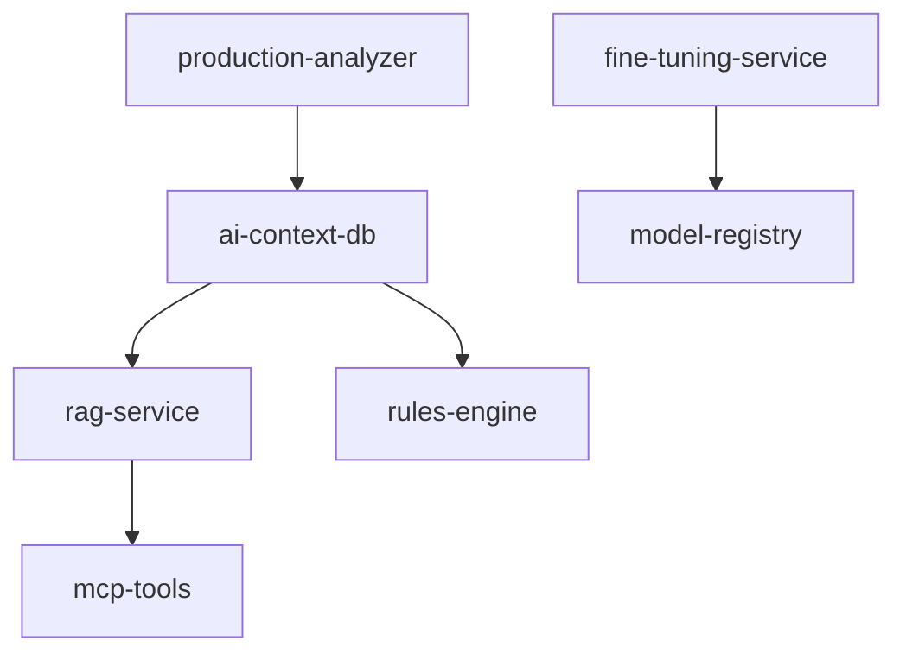

# Developer Guide - AI Context Engineering for Ignition

## Overview

This guide provides comprehensive setup instructions, API usage, and troubleshooting for the AI Context Engineering system for Ignition development.

## Prerequisites

- Docker and Docker Compose
- Git
- Node.js 18+ (for MCP tools)
- Python 3.10+ (for RAG services)
- PostgreSQL 15+ with pgvector extension

## Quick Start

### 1. Environment Setup

```bash
# Clone the repository
git clone <repository-url>
cd whk-services-deployments

# Copy environment template
cp env-variables-example.txt .env

# Configure required environment variables
nano .env
```

### 2. Required Environment Variables

```env
# AI Services
OPENAI_API_KEY=your_openai_api_key
RAG_OPENAI_MODEL=gpt-4
RAG_EMBEDDING_MODEL=text-embedding-3-large
VECTOR_DIMENSIONS=3072

# Database
POSTGRES_PASSWORD=your_secure_password
PGVECTOR_ENABLED=true

# MCP Tools
MCP_SERVER_HOST=0.0.0.0
MCP_SERVER_PORT=3333

# Ignition Production Paths
IGNITION_PRODUCTION_PATH=/path/to/production/ignition
WHK_GLOBAL_PATH=/path/to/whk-global
SCADA_PROJECT_PATH=/path/to/scada-project
REPORTING_PROJECT_PATH=/path/to/reporting-project

# Fine-tuning
FINE_TUNE_MODEL_NAME=gpt-4-ignition-whk
TRAINING_VALIDATION_SPLIT=0.8
```

### 3. Start Services

```bash
# Start all AI services
docker-compose up -d ai-context-db rag-service mcp-tools rules-engine

# Verify services are running
docker-compose ps
```

## Service Architecture

### Core Services

1. **ai-context-db**: PostgreSQL with pgvector for embeddings
2. **rag-service**: Vector search and document retrieval
3. **mcp-tools**: Real-time validation tools
4. **rules-engine**: Best practices enforcement
5. **fine-tuning-service**: Model training pipeline

### Service Dependencies



## API Usage

### RAG Service API

#### Retrieve Context
```bash
curl -X POST http://localhost:8001/retrieve \
  -H "Content-Type: application/json" \
  -d '{
    "query": "Create a Perspective button with tag binding",
    "context_type": "perspective_ui",
    "max_results": 5,
    "similarity_threshold": 0.7
  }'
```

Response:
```json
{
  "results": [
    {
      "content": "...",
      "source": "production",
      "score": 0.95,
      "metadata": {
        "project": "WHK-Global",
        "component_type": "Button",
        "patterns": ["tag_binding", "event_handler"]
      }
    }
  ],
  "query_context": "...",
  "total_results": 5
}
```

#### Ingest Production Code
```bash
curl -X POST http://localhost:8001/ingest \
  -H "Content-Type: application/json" \
  -d '{
    "source_path": "/ignition/projects/WHK-Global",
    "source_type": "ignition_project",
    "force_reindex": false
  }'
```

### MCP Tools API

#### Validate Perspective Component
```bash
curl -X POST http://localhost:3333/validate/perspective \
  -H "Content-Type: application/json" \
  -d '{
    "component": {
      "type": "Button",
      "props": {
        "text": "Start Process",
        "style": {"backgroundColor": "#007bff"}
      },
      "events": {
        "onActionPerformed": "system.tag.writeBlocking([\"[default]Process/Start\"], [True])"
      }
    }
  }'
```

#### Analyze Jython Script
```bash
curl -X POST http://localhost:3333/analyze/jython \
  -H "Content-Type: application/json" \
  -d '{
    "script": "system.tag.write(\"[default]Process/Value\", event.source.value)"
  }'
```

### Rules Engine API

#### Get Context-Aware Prompt
```bash
curl -X POST http://localhost:8002/prompt \
  -H "Content-Type: application/json" \
  -d '{
    "task": "create_perspective_button",
    "context": {
      "project": "WHK-Global",
      "view_type": "process_control"
    }
  }'
```

#### Validate Against Rules
```bash
curl -X POST http://localhost:8002/validate \
  -H "Content-Type: application/json" \
  -d '{
    "code": "...",
    "type": "jython_script",
    "context": {"component": "gateway_script"}
  }'
```

## Development Workflow

### 1. Setting Up Development Environment

```bash
# Start dev container
docker-compose -f docker-compose.dev.yml up -d

# Access development shell
docker exec -it whk-ai-dev bash

# Install dependencies
pip install -r requirements-dev.txt
npm install
```

### 2. Adding New Production Code

```python
from services.production_analyzer import ProductionCodeAnalyzer

analyzer = ProductionCodeAnalyzer()

# Analyze new project
patterns = analyzer.analyze_project("/path/to/new/project")

# Index in vector store
from services.rag_service import RAGService
rag = RAGService()
rag.ingest_patterns(patterns)
```

### 3. Testing Changes

```bash
# Run unit tests
pytest tests/unit/

# Run integration tests
pytest tests/integration/

# Test MCP tools
npm test

# Validate vector embeddings
python scripts/validate_embeddings.py
```

### 4. Deploying Updates

```bash
# Update production services
docker-compose pull
docker-compose up -d --remove-orphans

# Verify deployment
./scripts/health_check.sh
```

## Configuration

### RAG Service Configuration

```yaml
# config/rag_config.yml
embedding:
  model: "text-embedding-3-large"
  dimensions: 3072
  
retrieval:
  similarity_threshold: 0.7
  max_results: 10
  rerank_threshold: 0.8
  
indexing:
  chunk_size: 1000
  chunk_overlap: 200
  batch_size: 100
```

### MCP Tools Configuration

```json
{
  "server": {
    "host": "0.0.0.0",
    "port": 3333
  },
  "tools": {
    "perspective_validator": {
      "enabled": true,
      "strict_mode": false
    },
    "jython_analyzer": {
      "enabled": true,
      "syntax_check": true,
      "best_practices": true
    }
  }
}
```

### Rules Engine Configuration

```yaml
# config/rules_config.yml
rules:
  perspective:
    enabled: true
    strict_naming: true
    whk_standards: true
  
  jython:
    enabled: true
    import_validation: true
    performance_checks: true
```

## Monitoring and Observability

### Health Checks

```bash
# Check all services
curl http://localhost:8001/health  # RAG Service
curl http://localhost:3333/health  # MCP Tools
curl http://localhost:8002/health  # Rules Engine

# Database health
docker exec ai-context-db pg_isready
```

### Metrics Endpoints

- RAG Service: `http://localhost:8001/metrics`
- MCP Tools: `http://localhost:3333/metrics`
- Rules Engine: `http://localhost:8002/metrics`

### Grafana Dashboards

Access Grafana at `http://localhost:3001` with dashboards for:
- Vector database performance
- API response times
- Query success rates
- Model inference metrics

## Troubleshooting

### Common Issues

#### 1. Vector Database Connection Failed

```bash
# Check database status
docker logs ai-context-db

# Verify pgvector extension
docker exec ai-context-db psql -U postgres -c "SELECT * FROM pg_extension WHERE extname = 'vector';"

# Restart database
docker-compose restart ai-context-db
```

#### 2. RAG Service Returns Empty Results

```bash
# Check embedding count
curl http://localhost:8001/stats

# Verify index status
python scripts/check_index_health.py

# Re-index if necessary
curl -X POST http://localhost:8001/reindex
```

#### 3. MCP Tools Validation Errors

```bash
# Check tool status
curl http://localhost:3333/tools/status

# View tool logs
docker logs mcp-tools

# Restart tools service
docker-compose restart mcp-tools
```

#### 4. Fine-tuning Pipeline Fails

```bash
# Check training data
python scripts/validate_training_data.py

# Monitor training logs
docker logs fine-tuning-service

# Verify model output
python scripts/test_fine_tuned_model.py
```

### Performance Optimization

#### Vector Search Performance

```sql
-- Optimize vector queries
CREATE INDEX CONCURRENTLY IF NOT EXISTS embeddings_cosine_idx 
ON embeddings USING ivfflat (embedding vector_cosine_ops);

-- Monitor query performance
SELECT query, calls, total_time, mean_time 
FROM pg_stat_statements 
WHERE query LIKE '%<->%' 
ORDER BY mean_time DESC;
```

#### Memory Optimization

```yaml
# docker-compose.override.yml
services:
  rag-service:
    deploy:
      resources:
        limits:
          memory: 4G
        reservations:
          memory: 2G
```

### Debugging Tools

#### Enable Debug Logging

```env
LOG_LEVEL=DEBUG
RAG_DEBUG=true
MCP_DEBUG=true
RULES_DEBUG=true
```

#### Vector Search Debug

```python
from services.rag_service import RAGService

rag = RAGService(debug=True)
results = rag.search("perspective button", debug_info=True)
print(results.debug_info)
```

#### Production Code Analysis Debug

```python
from services.production_analyzer import ProductionCodeAnalyzer

analyzer = ProductionCodeAnalyzer(verbose=True)
patterns = analyzer.analyze_project("/path/to/project", debug=True)
```

## Best Practices

### 1. Data Management

- Regularly backup vector embeddings
- Monitor embedding drift over time
- Implement data versioning for training sets
- Use incremental updates for large codebases

### 2. Performance

- Cache frequently accessed embeddings
- Use connection pooling for database access
- Implement query result caching
- Monitor and optimize vector index performance

### 3. Security

- Secure API endpoints with authentication
- Encrypt sensitive configuration data
- Implement rate limiting on public endpoints
- Regular security updates for dependencies

### 4. Monitoring

- Set up alerts for service failures
- Monitor embedding quality metrics
- Track query performance over time
- Implement distributed tracing

## Contributing

### Development Setup

```bash
# Fork and clone repository
git clone <your-fork-url>
cd whk-services-deployments

# Create feature branch
git checkout -b feature/your-feature

# Set up pre-commit hooks
pre-commit install

# Run tests before committing
./scripts/run_tests.sh
```

### Code Standards

- Follow PEP 8 for Python code
- Use TypeScript for MCP tools
- Document all public APIs
- Write comprehensive tests
- Include type hints where applicable

### Submitting Changes

1. Ensure all tests pass
2. Update documentation
3. Add changelog entry
4. Submit pull request with clear description
5. Address review feedback

## Support

For issues and questions:

1. Check existing GitHub issues
2. Review troubleshooting section
3. Post detailed issue with logs
4. Tag appropriate maintainers

## Appendix

### Useful Scripts

- `scripts/backup_embeddings.sh` - Backup vector database
- `scripts/health_check.sh` - Comprehensive health check
- `scripts/update_production_index.sh` - Update production code index
- `scripts/validate_setup.sh` - Validate initial setup

### Configuration Templates

- `config/templates/` - Service configuration templates
- `docker/templates/` - Docker configuration templates
- `scripts/templates/` - Script templates for common tasks