# Fine-Tuning Strategy for Ignition Development

## Overview

This document outlines a comprehensive fine-tuning strategy to create AI models specialized in Ignition SCADA/HMI development. Unlike generic models, our fine-tuned models will understand your specific patterns, naming conventions, architectural decisions, and code quality standards derived from production codebases.

## 🎯 Fine-Tuning Objectives

### Primary Goals
- **Production Pattern Recognition**: Understand and replicate actual coding patterns from your live systems
- **Company-Specific Standards**: Enforce your organization's coding conventions and best practices
- **Context-Aware Generation**: Generate code appropriate for specific project contexts (WHK-Global, SCADA, Reporting)
- **Error Reduction**: Minimize common mistakes by learning from corrected code patterns

### Success Metrics
- **Syntax Accuracy**: >95% valid Ignition code on first generation
- **Pattern Consistency**: >90% adherence to production patterns
- **Context Relevance**: >85% appropriate responses for project-specific queries
- **Performance**: Generated code meets or exceeds production performance standards

## 📊 Training Data Architecture

### Multi-Source Dataset Composition

```mermaid
graph TB
    subgraph "Production Sources (60%)"
        ProdViews[Perspective Views<br/>WHK-Global, SCADA, Reporting]
        ProdScripts[Jython Scripts<br/>Gateway, Client, Transform]
        ProdTags[Tag Configurations<br/>UDTs, Expressions, Alarms]
        ProdQueries[Named Queries<br/>Batch, Historian, Reports]
    end
    
    subgraph "Git History (20%)"
        Commits[Commit Messages & Diffs<br/>Bug Fixes, Features, Refactors]
        Reviews[Code Review Comments<br/>Feedback & Improvements]
        Issues[Issue Resolutions<br/>Problem-Solution Pairs]
    end
    
    subgraph "Community & Official (15%)"
        Exchange[Ignition Exchange<br/>Modules & Examples]
        GitHub[Community Repos<br/>Best Practices]
        Official[Inductive Automation<br/>Documentation & Examples]
    end
    
    subgraph "Synthetic & Corrections (5%)"
        Synthetic[Generated Examples<br/>Edge Cases & Variations]
        Corrections[Human Corrections<br/>Feedback Loop Data]
    end
    
    ProdViews --> Dataset[Training Dataset]
    ProdScripts --> Dataset
    ProdTags --> Dataset
    ProdQueries --> Dataset
    Commits --> Dataset
    Reviews --> Dataset
    Issues --> Dataset
    Exchange --> Dataset
    GitHub --> Dataset
    Official --> Dataset
    Synthetic --> Dataset
    Corrections --> Dataset
    
    style ProdViews fill:#e8f5e8
    style Commits fill:#e1f5fe
    style Exchange fill:#fff3e0
    style Corrections fill:#fce4ec
```



### Dataset Categories & Weights

```yaml
training_composition:
  perspective_development: 35%
    - view_creation: 15%
    - component_configuration: 10%
    - binding_setup: 10%
  
  jython_scripting: 30%
    - gateway_scripts: 10%
    - event_handlers: 8%
    - transform_scripts: 7%
    - utility_functions: 5%
  
  tag_management: 20%
    - udt_definitions: 8%
    - tag_configurations: 6%
    - alarm_setup: 6%
  
  system_integration: 15%
    - database_queries: 8%
    - opc_configuration: 4%
    - reporting_setup: 3%
```

## 🔧 Data Collection Pipeline

### 1. Production Code Extraction

```python
# fine-tuning/collectors/production_collector.py
from pathlib import Path
from typing import Dict, List, Tuple
import json
import git

class ProductionCodeCollector:
    def __init__(self, project_paths: List[str], git_repos: List[str]):
        self.project_paths = project_paths
        self.git_repos = git_repos
        self.training_pairs = []
    
    def collect_all_training_data(self) -> List[Dict]:
        """Collect all training data from production sources"""
        
        # 1. Extract current production patterns
        production_examples = self._extract_production_examples()
        
        # 2. Mine git history for learning examples
        git_examples = self._mine_git_history()
        
        # 3. Generate instruction-response pairs
        training_pairs = []
        training_pairs.extend(self._create_perspective_pairs(production_examples))
        training_pairs.extend(self._create_script_pairs(production_examples))
        training_pairs.extend(self._create_git_learning_pairs(git_examples))
        
        return training_pairs
    
    def _create_perspective_pairs(self, production_data: Dict) -> List[Dict]:
        """Create training pairs for Perspective development"""
        pairs = []
        
        for view_data in production_data['perspective_views']:
            # Simple component examples
            for component in view_data['metadata']['components_used']:
                if component['type'] in ['Button', 'Label', 'TextField', 'Dropdown']:
                    pair = {
                        "messages": [
                            {
                                "role": "system",
                                "content": f"You are an expert Ignition developer working on the {view_data['project']} project. Generate production-quality Perspective components following company standards."
                            },
                            {
                                "role": "user", 
                                "content": f"Create a {component['type']} component for {self._infer_use_case(component, view_data)}"
                            },
                            {
                                "role": "assistant",
                                "content": self._extract_component_json(component, view_data)
                            }
                        ],
                        "metadata": {
                            "category": "perspective_component",
                            "component_type": component['type'],
                            "project": view_data['project'],
                            "complexity": "basic",
                            "production_source": True
                        }
                    }
                    pairs.append(pair)
            
            # Complex view examples
            if view_data['metadata']['complexity_score'] > 15:
                pair = {
                    "messages": [
                        {
                            "role": "system",
                            "content": f"You are an expert Ignition developer. Create comprehensive Perspective views following {view_data['project']} project patterns and standards."
                        },
                        {
                            "role": "user",
                            "content": self._generate_view_prompt(view_data)
                        },
                        {
                            "role": "assistant", 
                            "content": self._format_view_response(view_data)
                        }
                    ],
                    "metadata": {
                        "category": "perspective_view",
                        "project": view_data['project'],
                        "complexity": "advanced",
                        "components_count": len(view_data['metadata']['components_used']),
                        "production_source": True
                    }
                }
                pairs.append(pair)
        
        return pairs
    
    def _create_script_pairs(self, production_data: Dict) -> List[Dict]:
        """Create training pairs for Jython scripting"""
        pairs = []
        
        for script_data in production_data['scripts']:
            # Function-level examples
            functions = self._extract_functions(script_data['content'])
            
            for func_name, func_code in functions.items():
                if len(func_code.split('\n')) > 5:  # Non-trivial functions
                    pair = {
                        "messages": [
                            {
                                "role": "system", 
                                "content": f"You are an expert Ignition Jython developer. Write production-quality scripts for the {script_data['project']} project following company coding standards."
                            },
                            {
                                "role": "user",
                                "content": self._generate_function_prompt(func_name, func_code, script_data)
                            },
                            {
                                "role": "assistant",
                                "content": self._format_function_response(func_code, script_data)
                            }
                        ],
                        "metadata": {
                            "category": "jython_function",
                            "function_name": func_name,
                            "project": script_data['project'],
                            "has_error_handling": script_data['metadata']['error_handling'],
                            "system_functions": script_data['metadata']['system_functions'],
                            "production_source": True
                        }
                    }
                    pairs.append(pair)
            
            # Full script examples for complex scripts
            if script_data['metadata']['complexity_score'] > 20:
                pair = {
                    "messages": [
                        {
                            "role": "system",
                            "content": f"You are an expert Ignition developer. Write comprehensive Jython scripts following {script_data['project']} patterns and error handling practices."
                        },
                        {
                            "role": "user",
                            "content": self._generate_script_prompt(script_data)
                        },
                        {
                            "role": "assistant",
                            "content": self._format_script_response(script_data)
                        }
                    ],
                    "metadata": {
                        "category": "jython_script",
                        "script_name": script_data['name'],
                        "project": script_data['project'],
                        "complexity": script_data['metadata']['complexity_score'],
                        "production_source": True
                    }
                }
                pairs.append(pair)
        
        return pairs
    
    def _mine_git_history(self) -> List[Dict]:
        """Mine git repositories for learning examples"""
        git_examples = []
        
        for repo_url in self.git_repos:
            try:
                # Clone or update repository
                repo_path = self._get_or_clone_repo(repo_url)
                repo = git.Repo(repo_path)
                
                # Analyze commits for patterns
                commits = list(repo.iter_commits(max_count=500))
                
                for commit in commits:
                    if self._is_learning_commit(commit):
                        example = self._extract_learning_example(commit)
                        if example:
                            git_examples.append(example)
                            
            except Exception as e:
                print(f"Error mining {repo_url}: {e}")
                continue
        
        return git_examples
    
    def _create_git_learning_pairs(self, git_examples: List[Dict]) -> List[Dict]:
        """Create training pairs from git history"""
        pairs = []
        
        for example in git_examples:
            if example['type'] == 'bug_fix':
                pair = {
                    "messages": [
                        {
                            "role": "system",
                            "content": "You are an expert Ignition developer. Fix bugs and issues following best practices and proper error handling."
                        },
                        {
                            "role": "user",
                            "content": f"Fix this issue: {example['issue_description']}\n\nCurrent code:\n```python\n{example['before_code']}\n```"
                        },
                        {
                            "role": "assistant",
                            "content": f"Here's the fixed code:\n\n```python\n{example['after_code']}\n```\n\nChanges made:\n{example['fix_explanation']}"
                        }
                    ],
                    "metadata": {
                        "category": "bug_fix",
                        "issue_type": example['issue_type'],
                        "git_source": True,
                        "commit_hash": example['commit_hash']
                    }
                }
                pairs.append(pair)
            
            elif example['type'] == 'feature_implementation':
                pair = {
                    "messages": [
                        {
                            "role": "system",
                            "content": "You are an expert Ignition developer implementing new features following company patterns and standards."
                        },
                        {
                            "role": "user",
                            "content": example['feature_description']
                        },
                        {
                            "role": "assistant",
                            "content": example['implementation']
                        }
                    ],
                    "metadata": {
                        "category": "feature_implementation", 
                        "feature_type": example['feature_type'],
                        "git_source": True,
                        "commit_hash": example['commit_hash']
                    }
                }
                pairs.append(pair)
        
        return pairs
    
    def _generate_view_prompt(self, view_data: Dict) -> str:
        """Generate realistic prompt for view creation"""
        components = [c['type'] for c in view_data['metadata']['components_used']]
        unique_components = list(set(components))
        
        # Infer purpose from view name and components
        purpose = self._infer_view_purpose(view_data['name'], unique_components)
        
        prompt = f"Create a Perspective view for {purpose}. "
        
        if 'Table' in unique_components:
            prompt += "Include a data table with appropriate columns. "
        if 'Button' in unique_components:
            prompt += "Add control buttons for user interactions. "
        if 'Chart' in unique_components:
            prompt += "Include visualization charts for data trends. "
        if view_data['metadata']['has_scripts']:
            prompt += "Implement event handlers and custom logic. "
        
        prompt += f"Follow the {view_data['project']} project patterns and naming conventions."
        
        return prompt
    
    def _format_view_response(self, view_data: Dict) -> str:
        """Format production view as training response"""
        response = f"Here's a production-quality Perspective view for the {view_data['project']} project:\n\n"
        
        # Include sanitized view JSON (remove sensitive data)
        sanitized_view = self._sanitize_view_data(view_data['content'])
        response += f"```json\n{json.dumps(sanitized_view, indent=2)}\n```\n\n"
        
        # Add explanation
        components = [c['type'] for c in view_data['metadata']['components_used']]
        response += f"This view uses {len(set(components))} different component types:\n"
        for comp_type in set(components):
            count = components.count(comp_type)
            response += f"- {comp_type}: {count} instance{'s' if count > 1 else ''}\n"
        
        if view_data['metadata']['binding_types']:
            response += f"\nBinding types used: {', '.join(set(view_data['metadata']['binding_types']))}\n"
        
        if view_data['metadata']['has_scripts']:
            response += "\nIncludes custom event scripts for enhanced functionality.\n"
        
        return response
```

### 2. Dataset Quality Assurance

```python
# fine-tuning/quality/dataset_validator.py
from typing import List, Dict, Tuple
import ast
import json

class DatasetQualityValidator:
    def __init__(self):
        self.quality_metrics = {}
        self.validation_rules = self._load_validation_rules()
    
    def validate_training_dataset(self, dataset: List[Dict]) -> Dict:
        """Validate entire training dataset for quality and consistency"""
        
        validation_results = {
            'total_examples': len(dataset),
            'quality_scores': {},
            'category_distribution': {},
            'issues': [],
            'recommendations': []
        }
        
        # Analyze distribution
        validation_results['category_distribution'] = self._analyze_distribution(dataset)
        
        # Validate individual examples
        valid_examples = []
        for i, example in enumerate(dataset):
            quality_score, issues = self._validate_example(example)
            
            if quality_score >= 0.7:  # Quality threshold
                valid_examples.append(example)
            else:
                validation_results['issues'].append({
                    'index': i,
                    'quality_score': quality_score,
                    'issues': issues
                })
        
        validation_results['valid_examples'] = len(valid_examples)
        validation_results['quality_rate'] = len(valid_examples) / len(dataset)
        
        # Generate recommendations
        validation_results['recommendations'] = self._generate_recommendations(validation_results)
        
        return validation_results
    
    def _validate_example(self, example: Dict) -> Tuple[float, List[str]]:
        """Validate individual training example"""
        issues = []
        quality_score = 1.0
        
        # Check message structure
        if 'messages' not in example:
            issues.append("Missing 'messages' field")
            quality_score -= 0.5
        else:
            messages = example['messages']
            
            # Must have system, user, assistant messages
            roles = [msg.get('role') for msg in messages]
            if 'system' not in roles:
                issues.append("Missing system message")
                quality_score -= 0.2
            if 'user' not in roles:
                issues.append("Missing user message") 
                quality_score -= 0.3
            if 'assistant' not in roles:
                issues.append("Missing assistant message")
                quality_score -= 0.3
            
            # Validate content quality
            for msg in messages:
                content_quality, content_issues = self._validate_message_content(msg)
                quality_score *= content_quality
                issues.extend(content_issues)
        
        # Check metadata
        if 'metadata' not in example:
            issues.append("Missing metadata")
            quality_score -= 0.1
        
        # Category-specific validation
        category = example.get('metadata', {}).get('category')
        if category:
            cat_quality, cat_issues = self._validate_category_specific(example, category)
            quality_score *= cat_quality
            issues.extend(cat_issues)
        
        return max(quality_score, 0.0), issues
    
    def _validate_message_content(self, message: Dict) -> Tuple[float, List[str]]:
        """Validate individual message content"""
        issues = []
        quality_score = 1.0
        
        content = message.get('content', '')
        role = message.get('role', '')
        
        # Basic content checks
        if len(content) < 10:
            issues.append(f"{role} message too short")
            quality_score -= 0.3
        
        if len(content) > 8000:
            issues.append(f"{role} message too long (may exceed token limits)")
            quality_score -= 0.2
        
        # Role-specific validation
        if role == 'assistant':
            # Check for code quality
            if '```' in content:
                code_quality = self._validate_code_content(content)
                quality_score *= code_quality
            
            # Check for completeness
            if 'TODO' in content or 'FIXME' in content:
                issues.append("Assistant response contains incomplete markers")
                quality_score -= 0.3
        
        elif role == 'user':
            # User messages should be clear requests
            if '?' not in content and 'create' not in content.lower() and 'implement' not in content.lower():
                issues.append("User message unclear - no clear request")
                quality_score -= 0.2
        
        elif role == 'system':
            # System messages should set proper context
            if 'ignition' not in content.lower() and 'perspective' not in content.lower() and 'jython' not in content.lower():
                issues.append("System message lacks Ignition context")
                quality_score -= 0.1
        
        return quality_score, issues
    
    def _validate_code_content(self, content: str) -> float:
        """Validate code snippets in content"""
        quality_score = 1.0
        
        # Extract code blocks
        code_blocks = []
        in_code = False
        current_block = []
        
        for line in content.split('\n'):
            if line.strip().startswith('```'):
                if in_code:
                    code_blocks.append('\n'.join(current_block))
                    current_block = []
                in_code = not in_code
            elif in_code:
                current_block.append(line)
        
        # Validate each code block
        for code_block in code_blocks:
            # Check for Python/Jython syntax
            try:
                ast.parse(code_block)
            except SyntaxError:
                quality_score -= 0.3
            
            # Check for Ignition-specific patterns
            if 'system.' not in code_block:
                quality_score -= 0.1  # Should use Ignition system functions
            
            # Check for proper error handling
            if len(code_block.split('\n')) > 10 and 'try:' not in code_block:
                quality_score -= 0.2
        
        return max(quality_score, 0.0)
    
    def _analyze_distribution(self, dataset: List[Dict]) -> Dict:
        """Analyze dataset category distribution"""
        distribution = {}
        
        for example in dataset:
            category = example.get('metadata', {}).get('category', 'unknown')
            if category not in distribution:
                distribution[category] = 0
            distribution[category] += 1
        
        # Convert to percentages
        total = len(dataset)
        for category in distribution:
            distribution[category] = {
                'count': distribution[category],
                'percentage': (distribution[category] / total) * 100
            }
        
        return distribution
```

## 🚀 Training Configuration

### Fine-Tuning Parameters

```yaml
# fine-tuning/config/training_config.yaml
training_config:
  base_model: "gpt-4"
  training_method: "supervised_fine_tuning"
  
  hyperparameters:
    learning_rate: 5.0e-6
    batch_size: 4
    epochs: 3
    warmup_steps: 100
    weight_decay: 0.01
    gradient_accumulation_steps: 2
    
  data_config:
    train_split: 0.8
    validation_split: 0.2
    max_sequence_length: 4096
    truncation_strategy: "longest_first"
    
  optimization:
    optimizer: "adamw"
    scheduler: "cosine"
    gradient_clipping: 1.0
    early_stopping:
      enabled: true
      patience: 5
      metric: "validation_loss"
      min_delta: 0.001
      
  regularization:
    dropout_rate: 0.1
    layer_dropout: 0.05
    attention_dropout: 0.1
    
  logging:
    log_interval: 10
    eval_interval: 100
    save_interval: 500
    
  hardware:
    device: "cuda"
    mixed_precision: true
    gradient_checkpointing: true
    dataloader_num_workers: 4
```

### Multi-Stage Training Process

```python
# fine-tuning/training/multi_stage_trainer.py
from transformers import AutoTokenizer, AutoModelForCausalLM, TrainingArguments, Trainer
import torch
from typing import Dict, List

class IgnitionMultiStageTrainer:
    def __init__(self, config: Dict):
        self.config = config
        self.tokenizer = AutoTokenizer.from_pretrained("gpt-4")
        self.model = None
        
    def execute_training_pipeline(self, dataset: List[Dict]) -> Dict:
        """Execute multi-stage fine-tuning pipeline"""
        
        results = {}
        
        # Stage 1: Foundation Training (General Ignition Knowledge)
        print("Stage 1: Foundation Training...")
        foundation_data = self._filter_dataset(dataset, 'foundation')
        stage1_model = self._train_stage(foundation_data, 'foundation')
        results['stage1'] = self._evaluate_model(stage1_model, foundation_data)
        
        # Stage 2: Production Patterns Training
        print("Stage 2: Production Patterns Training...")
        production_data = self._filter_dataset(dataset, 'production')
        stage2_model = self._train_stage(production_data, 'production', base_model=stage1_model)
        results['stage2'] = self._evaluate_model(stage2_model, production_data)
        
        # Stage 3: Company-Specific Refinement
        print("Stage 3: Company-Specific Refinement...")
        company_data = self._filter_dataset(dataset, 'company_specific')
        final_model = self._train_stage(company_data, 'refinement', base_model=stage2_model)
        results['final'] = self._evaluate_model(final_model, company_data)
        
        # Save final model
        final_model.save_pretrained("./models/ignition-specialized-final")
        self.tokenizer.save_pretrained("./models/ignition-specialized-final")
        
        return results
    
    def _train_stage(self, dataset: List[Dict], stage_name: str, base_model=None) -> AutoModelForCausalLM:
        """Train a single stage"""
        
        # Load base model or initialize new one
        if base_model:
            model = base_model
        else:
            model = AutoModelForCausalLM.from_pretrained("gpt-4")
        
        # Prepare training arguments for this stage
        stage_config = self.config['stages'][stage_name]
        training_args = TrainingArguments(
            output_dir=f"./models/ignition-{stage_name}",
            learning_rate=stage_config['learning_rate'],
            per_device_train_batch_size=stage_config['batch_size'],
            per_device_eval_batch_size=stage_config['batch_size'],
            num_train_epochs=stage_config['epochs'],
            warmup_steps=stage_config['warmup_steps'],
            logging_steps=10,
            evaluation_strategy="steps",
            eval_steps=100,
            save_steps=500,
            load_best_model_at_end=True,
            metric_for_best_model="eval_loss",
            greater_is_better=False,
            save_total_limit=3,
            dataloader_num_workers=4,
            gradient_accumulation_steps=2,
            fp16=True if torch.cuda.is_available() else False,
            gradient_checkpointing=True,
            dataloader_pin_memory=True,
            remove_unused_columns=False
        )
        
        # Prepare dataset
        train_dataset, eval_dataset = self._prepare_datasets(dataset)
        
        # Create trainer
        trainer = Trainer(
            model=model,
            args=training_args,
            train_dataset=train_dataset,
            eval_dataset=eval_dataset,
            tokenizer=self.tokenizer,
            data_collator=self._data_collator,
            compute_metrics=self._compute_metrics
        )
        
        # Train
        trainer.train()
        
        return trainer.model
    
    def _filter_dataset(self, dataset: List[Dict], stage_type: str) -> List[Dict]:
        """Filter dataset for specific training stage"""
        
        if stage_type == 'foundation':
            # General Ignition knowledge (official docs, community examples)
            return [ex for ex in dataset 
                   if ex.get('metadata', {}).get('source_type') in ['official', 'community']]
        
        elif stage_type == 'production':
            # Production code patterns
            return [ex for ex in dataset 
                   if ex.get('metadata', {}).get('production_source') == True]
        
        elif stage_type == 'company_specific':
            # Company-specific patterns and corrections
            return [ex for ex in dataset 
                   if ex.get('metadata', {}).get('project') in ['WHK-Global', 'QSI_WhiskeyHouseKentucky01', 'Reporting']]
        
        return dataset
    
    def _evaluate_model(self, model: AutoModelForCausalLM, test_data: List[Dict]) -> Dict:
        """Evaluate model performance"""
        
        evaluation_results = {
            'syntax_accuracy': 0.0,
            'pattern_consistency': 0.0,
            'context_relevance': 0.0,
            'avg_confidence': 0.0
        }
        
        # Implementation of evaluation metrics
        # This would include:
        # - Syntax validation of generated code
        # - Pattern matching against production examples
        # - Context appropriateness scoring
        # - Confidence measurement
        
        return evaluation_results
```

## 🔄 Continuous Learning Integration

### Feedback-Driven Model Updates

```python
# fine-tuning/continuous/feedback_integration.py
from typing import List, Dict
import json
from datetime import datetime, timedelta

class ContinuousLearningPipeline:
    def __init__(self, db_connection, model_registry):
        self.db = db_connection
        self.model_registry = model_registry
        self.feedback_threshold = 100  # Minimum feedback items to trigger retraining
        
    def process_user_feedback(self, feedback_batch: List[Dict]):
        """Process batch of user feedback for model improvement"""
        
        # Store feedback in database
        for feedback in feedback_batch:
            self._store_feedback(feedback)
        
        # Check if retraining is needed
        if self._should_trigger_retraining():
            self._queue_retraining_job()
    
    def generate_improvement_dataset(self) -> List[Dict]:
        """Generate training data from user corrections"""
        
        # Get recent feedback with corrections
        corrections = self._get_corrections_since(datetime.now() - timedelta(days=30))
        
        improvement_pairs = []
        
        for correction in corrections:
            # Create training example from correction
            training_pair = {
                "messages": [
                    {
                        "role": "system",
                        "content": correction['context']['system_prompt']
                    },
                    {
                        "role": "user", 
                        "content": correction['original_query']
                    },
                    {
                        "role": "assistant",
                        "content": correction['corrected_response']
                    }
                ],
                "metadata": {
                    "category": "user_correction",
                    "correction_type": correction['correction_type'],
                    "original_error": correction['error_type'],
                    "user_rating_improvement": correction['rating_after'] - correction['rating_before'],
                    "feedback_source": True
                }
            }
            
            improvement_pairs.append(training_pair)
        
        return improvement_pairs
    
    def _should_trigger_retraining(self) -> bool:
        """Determine if model retraining should be triggered"""
        
        # Count recent feedback
        recent_feedback_count = self.db.execute("""
            SELECT COUNT(*) FROM user_feedback 
            WHERE created_at > NOW() - INTERVAL '7 days'
            AND corrections IS NOT NULL
        """).scalar()
        
        # Check quality degradation
        avg_recent_rating = self.db.execute("""
            SELECT AVG(user_rating) FROM user_feedback
            WHERE created_at > NOW() - INTERVAL '7 days'
        """).scalar()
        
        # Trigger if enough feedback and quality concerns
        return (recent_feedback_count >= self.feedback_threshold and 
                avg_recent_rating < 3.5)
    
    def execute_incremental_retraining(self):
        """Execute incremental retraining with new feedback data"""
        
        # Get current production model
        current_model = self.model_registry.get_production_model()
        
        # Generate improvement dataset
        improvement_data = self.generate_improvement_dataset()
        
        if len(improvement_data) < 20:
            print("Insufficient feedback data for retraining")
            return
        
        # Perform targeted fine-tuning
        trainer = IgnitionMultiStageTrainer(self._get_incremental_config())
        updated_model = trainer._train_stage(
            improvement_data, 
            'incremental_improvement',
            base_model=current_model
        )
        
        # Evaluate improvements
        evaluation = self._evaluate_improvement(current_model, updated_model)
        
        if evaluation['improvement_score'] > 0.05:  # 5% improvement threshold
            # Deploy improved model
            self.model_registry.deploy_model(updated_model, "incremental_v2")
            print(f"Deployed improved model with {evaluation['improvement_score']:.2%} improvement")
        else:
            print("Incremental training did not meet improvement threshold")
```

## 📊 Model Evaluation & Validation

### Comprehensive Testing Suite

```python
# fine-tuning/evaluation/model_evaluator.py
from typing import Dict, List, Tuple
import ast
import json
import subprocess

class IgnitionModelEvaluator:
    def __init__(self):
        self.test_scenarios = self._load_test_scenarios()
        self.validation_environments = self._setup_validation_environments()
    
    def comprehensive_evaluation(self, model, test_dataset: List[Dict]) -> Dict:
        """Perform comprehensive model evaluation"""
        
        results = {
            'syntax_validation': self._evaluate_syntax_accuracy(model, test_dataset),
            'semantic_correctness': self._evaluate_semantic_correctness(model, test_dataset), 
            'production_readiness': self._evaluate_production_readiness(model, test_dataset),
            'performance_benchmarks': self._evaluate_performance(model, test_dataset),
            'consistency_analysis': self._evaluate_consistency(model, test_dataset),
            'safety_assessment': self._evaluate_safety(model, test_dataset)
        }
        
        # Calculate overall score
        results['overall_score'] = self._calculate_overall_score(results)
        
        return results
    
    def _evaluate_syntax_accuracy(self, model, test_data: List[Dict]) -> Dict:
        """Evaluate syntax accuracy of generated code"""
        
        results = {
            'total_tests': 0,
            'syntax_valid': 0,
            'by_category': {},
            'common_errors': []
        }
        
        for test_case in test_data:
            category = test_case.get('metadata', {}).get('category', 'unknown')
            if category not in results['by_category']:
                results['by_category'][category] = {'total': 0, 'valid': 0}
            
            results['total_tests'] += 1
            results['by_category'][category]['total'] += 1
            
            # Generate response
            response = self._generate_model_response(model, test_case)
            
            # Extract and validate code
            code_blocks = self._extract_code_blocks(response)
            all_valid = True
            
            for code_block in code_blocks:
                try:
                    if code_block.strip().startswith('{'):
                        # JSON validation for Perspective components
                        json.loads(code_block)
                    else:
                        # Python syntax validation for scripts
                        ast.parse(code_block)
                except (SyntaxError, ValueError, json.JSONDecodeError) as e:
                    all_valid = False
                    results['common_errors'].append({
                        'error': str(e),
                        'code_snippet': code_block[:200],
                        'category': category
                    })
                    break
            
            if all_valid:
                results['syntax_valid'] += 1
                results['by_category'][category]['valid'] += 1
        
        # Calculate percentages
        results['accuracy_percentage'] = (results['syntax_valid'] / results['total_tests']) * 100
        
        for category in results['by_category']:
            cat_data = results['by_category'][category]
            cat_data['accuracy'] = (cat_data['valid'] / cat_data['total']) * 100
        
        return results
    
    def _evaluate_production_readiness(self, model, test_data: List[Dict]) -> Dict:
        """Evaluate if generated code meets production standards"""
        
        results = {
            'error_handling_score': 0.0,
            'logging_usage_score': 0.0,
            'performance_patterns_score': 0.0,
            'security_compliance_score': 0.0,
            'documentation_score': 0.0
        }
        
        total_evaluations = 0
        
        for test_case in test_data:
            response = self._generate_model_response(model, test_case)
            code_blocks = self._extract_code_blocks(response)
            
            for code_block in code_blocks:
                total_evaluations += 1
                
                # Check error handling
                if 'try:' in code_block and 'except' in code_block:
                    results['error_handling_score'] += 1
                
                # Check logging usage
                if 'logger' in code_block.lower() or 'system.util.getLogger' in code_block:
                    results['logging_usage_score'] += 1
                
                # Check performance patterns
                if 'system.tag.readBlocking' in code_block:  # Efficient tag reading
                    results['performance_patterns_score'] += 1
                elif 'system.tag.read(' in code_block:  # Inefficient pattern
                    results['performance_patterns_score'] -= 0.5
                
                # Check security patterns
                if 'system.security' in code_block or 'getSession()' in code_block:
                    results['security_compliance_score'] += 1
                
                # Check documentation
                if '"""' in code_block or "'''" in code_block or '# ' in code_block:
                    results['documentation_score'] += 1
        
        # Convert to percentages
        for key in results:
            results[key] = max(0, results[key] / total_evaluations) * 100
        
        return results
    
    def _evaluate_consistency(self, model, test_data: List[Dict]) -> Dict:
        """Evaluate consistency of model responses"""
        
        consistency_results = {
            'naming_consistency': 0.0,
            'pattern_consistency': 0.0,
            'style_consistency': 0.0,
            'response_stability': 0.0
        }
        
        # Generate multiple responses for same prompts
        test_prompts = test_data[:20]  # Sample for consistency testing
        
        for test_case in test_prompts:
            responses = []
            for _ in range(3):  # Generate 3 responses for each prompt
                response = self._generate_model_response(model, test_case)
                responses.append(response)
            
            # Analyze consistency
            naming_score = self._analyze_naming_consistency(responses)
            pattern_score = self._analyze_pattern_consistency(responses)
            style_score = self._analyze_style_consistency(responses)
            stability_score = self._analyze_response_stability(responses)
            
            consistency_results['naming_consistency'] += naming_score
            consistency_results['pattern_consistency'] += pattern_score
            consistency_results['style_consistency'] += style_score
            consistency_results['response_stability'] += stability_score
        
        # Average results
        for key in consistency_results:
            consistency_results[key] = (consistency_results[key] / len(test_prompts)) * 100
        
        return consistency_results
    
    def _calculate_overall_score(self, results: Dict) -> float:
        """Calculate weighted overall performance score"""
        
        weights = {
            'syntax_validation': 0.25,
            'semantic_correctness': 0.20,
            'production_readiness': 0.25,
            'performance_benchmarks': 0.15,
            'consistency_analysis': 0.10,
            'safety_assessment': 0.05
        }
        
        overall_score = 0.0
        
        for category, weight in weights.items():
            if category in results:
                # Extract primary metric from each category
                if category == 'syntax_validation':
                    score = results[category]['accuracy_percentage']
                elif category == 'production_readiness':
                    # Average of production readiness metrics
                    prod_scores = [v for v in results[category].values() if isinstance(v, (int, float))]
                    score = sum(prod_scores) / len(prod_scores) if prod_scores else 0
                else:
                    # Generic extraction logic for other categories
                    score = self._extract_primary_metric(results[category])
                
                overall_score += score * weight
        
        return overall_score
```

## 🚀 Deployment Strategy

### Model Registry & Versioning

```python
# fine-tuning/deployment/model_registry.py
from typing import Dict, List, Optional
import json
from datetime import datetime

class IgnitionModelRegistry:
    def __init__(self, registry_db):
        self.db = registry_db
        self.deployment_environments = ['development', 'staging', 'production']
    
    def register_model(self, model_path: str, metadata: Dict) -> str:
        """Register a new fine-tuned model"""
        
        model_id = f"ignition-{datetime.now().strftime('%Y%m%d-%H%M%S')}"
        
        registration_data = {
            'model_id': model_id,
            'model_path': model_path,
            'created_at': datetime.now(),
            'metadata': metadata,
            'status': 'registered',
            'performance_metrics': metadata.get('evaluation_results', {}),
            'training_data_hash': metadata.get('training_data_hash'),
            'base_model': metadata.get('base_model', 'gpt-4')
        }
        
        self.db.models.insert_one(registration_data)
        
        return model_id
    
    def deploy_model(self, model_id: str, environment: str) -> bool:
        """Deploy model to specified environment"""
        
        if environment not in self.deployment_environments:
            raise ValueError(f"Invalid environment: {environment}")
        
        # Get model info
        model_info = self.db.models.find_one({'model_id': model_id})
        if not model_info:
            raise ValueError(f"Model {model_id} not found")
        
        # Validate deployment readiness
        if not self._validate_deployment_readiness(model_info, environment):
            return False
        
        # Update deployment record
        deployment_record = {
            'model_id': model_id,
            'environment': environment,
            'deployed_at': datetime.now(),
            'status': 'active',
            'deployment_config': self._get_deployment_config(environment)
        }
        
        self.db.deployments.insert_one(deployment_record)
        
        # Deactivate previous model in this environment
        self.db.deployments.update_many(
            {
                'environment': environment,
                'model_id': {'$ne': model_id},
                'status': 'active'
            },
            {'$set': {'status': 'inactive', 'deactivated_at': datetime.now()}}
        )
        
        return True
    
    def get_production_model(self) -> str:
        """Get currently deployed production model"""
        
        deployment = self.db.deployments.find_one({
            'environment': 'production',
            'status': 'active'
        }, sort=[('deployed_at', -1)])
        
        return deployment['model_id'] if deployment else None
    
    def rollback_deployment(self, environment: str) -> bool:
        """Rollback to previous model version"""
        
        # Get current deployment
        current = self.db.deployments.find_one({
            'environment': environment,
            'status': 'active'
        })
        
        if not current:
            return False
        
        # Get previous deployment
        previous = self.db.deployments.find_one({
            'environment': environment,
            'model_id': {'$ne': current['model_id']},
            'status': 'inactive'
        }, sort=[('deployed_at', -1)])
        
        if not previous:
            return False
        
        # Perform rollback
        self.db.deployments.update_one(
            {'_id': current['_id']},
            {'$set': {'status': 'rolled_back'}}
        )
        
        self.db.deployments.update_one(
            {'_id': previous['_id']},
            {'$set': {'status': 'active', 'restored_at': datetime.now()}}
        )
        
        return True
```

## 📈 Success Metrics & Monitoring

### Performance Tracking

```yaml
# fine-tuning/monitoring/metrics_config.yaml
performance_metrics:
  code_quality:
    - syntax_accuracy_rate: target: 95%
    - compilation_success_rate: target: 90%
    - runtime_error_rate: target: <5%
  
  development_velocity:
    - time_to_first_working_code: target: <2 minutes
    - iteration_cycle_time: target: <30 seconds  
    - feature_completion_time: target: 50% reduction
  
  pattern_adherence:
    - company_standards_compliance: target: 90%
    - production_pattern_similarity: target: 85%
    - naming_convention_adherence: target: 95%
  
  user_satisfaction:
    - average_rating: target: 4.5/5
    - completion_without_modification: target: 70%
    - developer_adoption_rate: target: 80%

monitoring_dashboards:
  real_time:
    - model_response_times
    - error_rates_by_category
    - user_satisfaction_scores
    - deployment_health_status
  
  daily_reports:
    - code_quality_trends
    - usage_patterns_analysis
    - feedback_sentiment_analysis
    - performance_regression_alerts
  
  weekly_analysis:
    - model_drift_detection
    - training_data_gap_analysis
    - competitive_benchmarking
    - roi_impact_assessment
```

This comprehensive fine-tuning strategy ensures that AI models are continuously adapted to your specific Ignition development patterns, resulting in highly relevant, production-ready code generation that follows your organization's standards and practices.