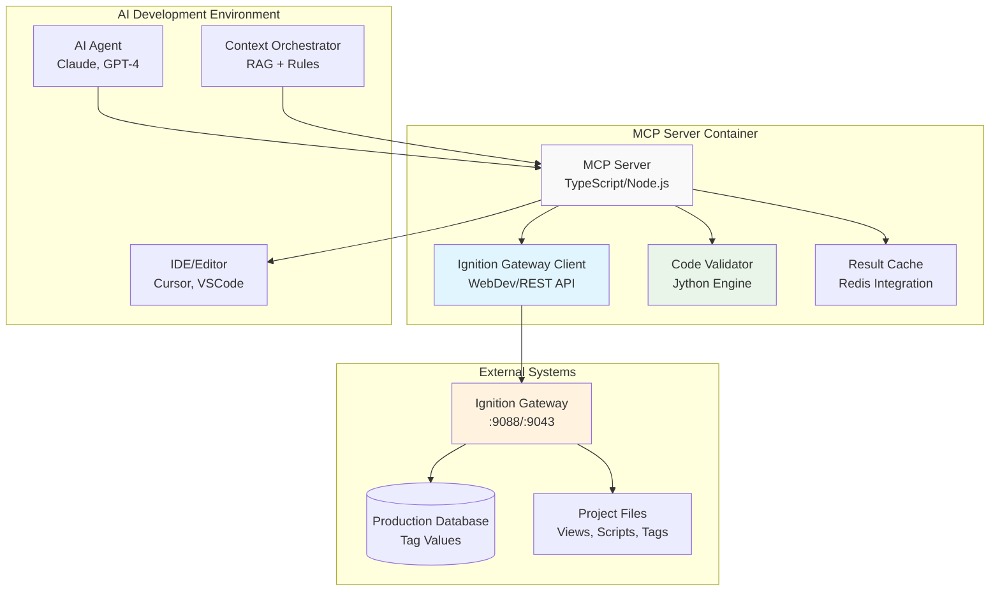

# MCP Tools Specification for Ignition Development

## Overview

This document specifies the Model Context Protocol (MCP) tools designed specifically for Ignition SCADA/HMI development. These tools provide real-time validation, testing, and code analysis capabilities by connecting directly to Ignition systems, ensuring generated code is syntactically correct, functionally valid, and performance-optimized.

## 🎯 MCP Tools Objectives

### Primary Goals
- **Real-Time Validation**: Validate generated code against live Ignition systems
- **Syntax Verification**: Ensure Jython scripts compile and execute without errors
- **Component Validation**: Verify Perspective component configurations are valid
- **Performance Analysis**: Identify potential performance bottlenecks before deployment
- **Security Compliance**: Enforce security best practices and access controls

### Integration Benefits
- **Immediate Feedback**: Catch errors before code reaches production
- **Context Awareness**: Understand current system state and constraints
- **Live Testing**: Test code against actual tag values and system conditions
- **Quality Assurance**: Maintain high code quality standards automatically

## 🔧 Tool Architecture

### MCP Server Structure



## 🛠️ Core Tool Specifications

### 1. Perspective Component Validator

```typescript
// mcp-tools/src/tools/perspective-validator.ts
interface PerspectiveComponentValidatorTool {
  name: "validate_perspective_component"
  description: "Validate Perspective component JSON structure and properties"
  
  inputSchema: {
    type: "object"
    properties: {
      component: {
        type: "object"
        description: "Complete component JSON structure"
        properties: {
          type: { type: "string" }
          props: { type: "object" }
          position: { type: "object" }
          meta: { type: "object" }
        }
        required: ["type", "props"]
      }
      context: {
        type: "object"
        description: "Validation context information"
        properties: {
          project_name: { type: "string" }
          view_name: { type: "string" }
          parent_container: { type: "string" }
          available_tags: { type: "array", items: { type: "string" } }
        }
      }
      validation_level: {
        type: "string"
        enum: ["basic", "comprehensive", "production"]
        default: "comprehensive"
      }
    }
    required: ["component"]
  }
  
  outputSchema: {
    type: "object"
    properties: {
      valid: { type: "boolean" }
      validation_results: {
        type: "object"
        properties: {
          component_exists: { type: "boolean" }
          properties_valid: { type: "boolean" }
          bindings_valid: { type: "boolean" }
          security_compliant: { type: "boolean" }
          performance_optimized: { type: "boolean" }
        }
      }
      errors: {
        type: "array"
        items: {
          type: "object"
          properties: {
            severity: { type: "string", enum: ["error", "warning", "info"] }
            message: { type: "string" }
            property_path: { type: "string" }
            suggested_fix: { type: "string" }
          }
        }
      }
      suggestions: {
        type: "array"
        items: {
          type: "object"
          properties: {
            type: { type: "string", enum: ["optimization", "best_practice", "security"] }
            description: { type: "string" }
            code_example: { type: "string" }
            impact: { type: "string", enum: ["high", "medium", "low"] }
          }
        }
      }
      performance_metrics: {
        type: "object"
        properties: {
          estimated_render_time: { type: "number" }
          memory_usage: { type: "number" }
          binding_count: { type: "number" }
          complexity_score: { type: "number" }
        }
      }
    }
  }
}

// Implementation class
export class PerspectiveComponentValidator implements MCPTool {
  constructor(
    private ignitionClient: IgnitionGatewayClient,
    private validationRules: ValidationRuleEngine
  ) {}
  
  async execute(params: ValidationParams): Promise<ValidationResult> {
    const { component, context, validation_level } = params;
    
    const results: ValidationResult = {
      valid: true,
      validation_results: {},
      errors: [],
      suggestions: [],
      performance_metrics: {}
    };
    
    try {
      // 1. Component Type Validation
      await this.validateComponentType(component, results);
      
      // 2. Properties Validation
      await this.validateProperties(component, context, results);
      
      // 3. Binding Validation
      await this.validateBindings(component, context, results);
      
      // 4. Security Validation
      if (validation_level !== 'basic') {
        await this.validateSecurity(component, context, results);
      }
      
      // 5. Performance Analysis
      if (validation_level === 'production') {
        await this.analyzePerformance(component, context, results);
      }
      
      // 6. Generate Suggestions
      await this.generateSuggestions(component, context, results);
      
      results.valid = results.errors.filter(e => e.severity === 'error').length === 0;
      
    } catch (error) {
      results.valid = false;
      results.errors.push({
        severity: 'error',
        message: `Validation failed: ${error.message}`,
        property_path: '',
        suggested_fix: 'Review component structure and try again'
      });
    }
    
    return results;
  }
  
  private async validateComponentType(component: any, results: ValidationResult): Promise<void> {
    const validComponents = await this.ignitionClient.getAvailableComponents();
    
    if (!validComponents.includes(component.type)) {
      results.errors.push({
        severity: 'error',
        message: `Unknown component type: ${component.type}`,
        property_path: 'type',
        suggested_fix: `Use one of: ${validComponents.slice(0, 5).join(', ')}`
      });
    }
    
    results.validation_results.component_exists = validComponents.includes(component.type);
  }
  
  private async validateProperties(component: any, context: any, results: ValidationResult): Promise<void> {
    const componentSpec = await this.ignitionClient.getComponentSpec(component.type);
    const requiredProps = componentSpec.requiredProperties || [];
    const validProps = componentSpec.properties || {};
    
    // Check required properties
    for (const requiredProp of requiredProps) {
      if (!(requiredProp in component.props)) {
        results.errors.push({
          severity: 'error',
          message: `Missing required property: ${requiredProp}`,
          property_path: `props.${requiredProp}`,
          suggested_fix: `Add "${requiredProp}": ${validProps[requiredProp]?.defaultValue || 'null'}`
        });
      }
    }
    
    // Validate property types and values
    for (const [propName, propValue] of Object.entries(component.props)) {
      const propSpec = validProps[propName];
      
      if (!propSpec) {
        results.errors.push({
          severity: 'warning',
          message: `Unknown property: ${propName}`,
          property_path: `props.${propName}`,
          suggested_fix: 'Remove unknown property or check component documentation'
        });
        continue;
      }
      
      // Type validation
      const typeValid = this.validatePropertyType(propValue, propSpec.type);
      if (!typeValid) {
        results.errors.push({
          severity: 'error',
          message: `Invalid type for property ${propName}. Expected ${propSpec.type}`,
          property_path: `props.${propName}`,
          suggested_fix: `Convert value to ${propSpec.type}`
        });
      }
    }
    
    results.validation_results.properties_valid = results.errors.filter(e => 
      e.property_path.startsWith('props.') && e.severity === 'error'
    ).length === 0;
  }
  
  private async validateBindings(component: any, context: any, results: ValidationResult): Promise<void> {
    const bindings = this.extractBindings(component);
    let validBindings = 0;
    
    for (const binding of bindings) {
      try {
        const validationResult = await this.validateBinding(binding, context);
        
        if (validationResult.valid) {
          validBindings++;
        } else {
          results.errors.push({
            severity: validationResult.severity || 'error',
            message: validationResult.message,
            property_path: binding.propertyPath,
            suggested_fix: validationResult.suggestedFix
          });
        }
        
        // Performance suggestions for bindings
        if (binding.type === 'tag' && !binding.indirect) {
          results.suggestions.push({
            type: 'optimization',
            description: 'Consider using indirect tag binding for dynamic tag paths',
            code_example: `{"binding": {"type": "tag", "config": {"indirect": true, "path": "..."}}}`,
            impact: 'medium'
          });
        }
        
      } catch (error) {
        results.errors.push({
          severity: 'error',
          message: `Binding validation failed: ${error.message}`,
          property_path: binding.propertyPath,
          suggested_fix: 'Review binding configuration'
        });
      }
    }
    
    results.validation_results.bindings_valid = validBindings === bindings.length;
    results.performance_metrics.binding_count = bindings.length;
  }
}
```

### 2. Jython Script Analyzer

```typescript
// mcp-tools/src/tools/jython-analyzer.ts
interface JythonScriptAnalyzerTool {
  name: "analyze_jython_script"
  description: "Analyze Jython script for Ignition compatibility and best practices"
  
  inputSchema: {
    type: "object"
    properties: {
      script: {
        type: "string"
        description: "Jython script content to analyze"
      }
      context: {
        type: "object"
        properties: {
          execution_context: { 
            type: "string"
            enum: ["gateway", "client", "perspective", "designer"]
            description: "Where the script will run"
          }
          available_variables: {
            type: "array"
            items: { type: "string" }
            description: "Variables available in execution context"
          }
          project_name: { type: "string" }
          trigger_type: {
            type: "string"
            enum: ["button_click", "tag_change", "timer", "startup", "message"]
          }
        }
        required: ["execution_context"]
      }
      analysis_depth: {
        type: "string"
        enum: ["syntax_only", "standard", "comprehensive"]
        default: "standard"
      }
    }
    required: ["script", "context"]
  }
  
  outputSchema: {
    type: "object"
    properties: {
      syntax_valid: { type: "boolean" }
      execution_analysis: {
        type: "object"
        properties: {
          can_execute: { type: "boolean" }
          estimated_runtime: { type: "number" }
          memory_usage: { type: "string" }
          performance_score: { type: "number" }
        }
      }
      compatibility_check: {
        type: "object"
        properties: {
          ignition_functions_valid: { type: "boolean" }
          context_appropriate: { type: "boolean" }
          security_compliant: { type: "boolean" }
          imports_available: { type: "boolean" }
        }
      }
      quality_metrics: {
        type: "object"
        properties: {
          error_handling_score: { type: "number" }
          logging_usage_score: { type: "number" }
          code_complexity: { type: "number" }
          maintainability_score: { type: "number" }
        }
      }
      issues: {
        type: "array"
        items: {
          type: "object"
          properties: {
            severity: { type: "string", enum: ["error", "warning", "info"] }
            line_number: { type: "number" }
            message: { type: "string" }
            rule_violated: { type: "string" }
            suggested_fix: { type: "string" }
            code_example: { type: "string" }
          }
        }
      }
      optimizations: {
        type: "array"
        items: {
          type: "object"
          properties: {
            type: { type: "string", enum: ["performance", "readability", "security", "best_practice"] }
            description: { type: "string" }
            original_code: { type: "string" }
            optimized_code: { type: "string" }
            impact: { type: "string", enum: ["high", "medium", "low"] }
          }
        }
      }
    }
  }
}

// Implementation
export class JythonScriptAnalyzer implements MCPTool {
  constructor(
    private jythonEngine: JythonValidationEngine,
    private ignitionAPI: IgnitionGatewayClient,
    private ruleEngine: ScriptValidationRules
  ) {}
  
  async execute(params: AnalysisParams): Promise<AnalysisResult> {
    const { script, context, analysis_depth } = params;
    
    const results: AnalysisResult = {
      syntax_valid: false,
      execution_analysis: {},
      compatibility_check: {},
      quality_metrics: {},
      issues: [],
      optimizations: []
    };
    
    try {
      // 1. Syntax Validation
      await this.validateSyntax(script, results);
      
      if (!results.syntax_valid && analysis_depth === 'syntax_only') {
        return results;
      }
      
      // 2. Compatibility Analysis
      await this.analyzeCompatibility(script, context, results);
      
      // 3. Quality Assessment
      await this.assessQuality(script, context, results);
      
      // 4. Performance Analysis
      if (analysis_depth === 'comprehensive') {
        await this.analyzePerformance(script, context, results);
      }
      
      // 5. Generate Optimizations
      await this.generateOptimizations(script, context, results);
      
    } catch (error) {
      results.issues.push({
        severity: 'error',
        line_number: 0,
        message: `Analysis failed: ${error.message}`,
        rule_violated: 'analysis_error',
        suggested_fix: 'Review script structure and syntax',
        code_example: ''
      });
    }
    
    return results;
  }
  
  private async validateSyntax(script: string, results: AnalysisResult): Promise<void> {
    try {
      // Use Jython engine to validate syntax
      const syntaxCheck = await this.jythonEngine.validateSyntax(script);
      results.syntax_valid = syntaxCheck.valid;
      
      if (!syntaxCheck.valid) {
        syntaxCheck.errors.forEach(error => {
          results.issues.push({
            severity: 'error',
            line_number: error.lineNumber,
            message: error.message,
            rule_violated: 'syntax_error',
            suggested_fix: error.suggestedFix,
            code_example: error.context
          });
        });
      }
    } catch (error) {
      results.syntax_valid = false;
      results.issues.push({
        severity: 'error',
        line_number: 0,
        message: `Syntax validation failed: ${error.message}`,
        rule_violated: 'validation_error',
        suggested_fix: 'Check script for basic Python/Jython syntax errors',
        code_example: ''
      });
    }
  }
  
  private async analyzeCompatibility(script: string, context: any, results: AnalysisResult): Promise<void> {
    // Check Ignition system function usage
    const systemFunctions = this.extractSystemFunctions(script);
    const availableFunctions = await this.ignitionAPI.getAvailableSystemFunctions(context.execution_context);
    
    let validFunctions = 0;
    for (const func of systemFunctions) {
      if (availableFunctions.includes(func)) {
        validFunctions++;
      } else {
        results.issues.push({
          severity: 'error',
          line_number: this.findFunctionLine(script, func),
          message: `Function ${func} not available in ${context.execution_context} context`,
          rule_violated: 'function_availability',
          suggested_fix: `Use alternative function available in ${context.execution_context} context`,
          code_example: this.getFunctionAlternative(func, context.execution_context)
        });
      }
    }
    
    results.compatibility_check.ignition_functions_valid = validFunctions === systemFunctions.length;
    
    // Check imports
    const imports = this.extractImports(script);
    const unavailableImports = await this.checkImportAvailability(imports, context);
    
    results.compatibility_check.imports_available = unavailableImports.length === 0;
    
    unavailableImports.forEach(imp => {
      results.issues.push({
        severity: 'error',
        line_number: imp.lineNumber,
        message: `Import not available: ${imp.module}`,
        rule_violated: 'import_availability',
        suggested_fix: `Use Ignition built-in alternative or verify module availability`,
        code_example: this.getImportAlternative(imp.module)
      });
    });
    
    // Context appropriateness
    results.compatibility_check.context_appropriate = this.validateContextUsage(script, context);
  }
  
  private async assessQuality(script: string, context: any, results: AnalysisResult): Promise<void> {
    // Error handling assessment
    const errorHandlingScore = this.assessErrorHandling(script);
    results.quality_metrics.error_handling_score = errorHandlingScore;
    
    if (errorHandlingScore < 0.7) {
      results.issues.push({
        severity: 'warning',
        line_number: 0,
        message: 'Script lacks proper error handling',
        rule_violated: 'error_handling',
        suggested_fix: 'Add try-except blocks around risky operations',
        code_example: this.generateErrorHandlingExample()
      });
    }
    
    // Logging assessment
    const loggingScore = this.assessLogging(script);
    results.quality_metrics.logging_usage_score = loggingScore;
    
    if (loggingScore < 0.5) {
      results.issues.push({
        severity: 'info',
        line_number: 0,
        message: 'Consider adding logging for debugging and monitoring',
        rule_violated: 'logging_best_practice',
        suggested_fix: 'Add logger statements for key operations',
        code_example: 'logger = system.util.getLogger("MyScript")\\nlogger.info("Operation completed")'
      });
    }
    
    // Code complexity
    const complexity = this.calculateComplexity(script);
    results.quality_metrics.code_complexity = complexity;
    
    if (complexity > 10) {
      results.issues.push({
        severity: 'warning',
        line_number: 0,
        message: 'High code complexity - consider refactoring into smaller functions',
        rule_violated: 'complexity',
        suggested_fix: 'Break down complex logic into smaller, focused functions',
        code_example: ''
      });
    }
  }
}
```

### 3. Tag Path Resolver & Validator

```typescript
// mcp-tools/src/tools/tag-resolver.ts
interface TagPathResolverTool {
  name: "resolve_tag_path"
  description: "Resolve and validate Ignition tag paths"
  
  inputSchema: {
    type: "object"
    properties: {
      tag_path: {
        type: "string"
        description: "Tag path to resolve (e.g., '[default]Tank1/Level')"
      }
      validation_options: {
        type: "object"
        properties: {
          check_existence: { type: "boolean", default: true }
          check_permissions: { type: "boolean", default: true }
          check_quality: { type: "boolean", default: false }
          resolve_udts: { type: "boolean", default: true }
        }
      }
      context: {
        type: "object"
        properties: {
          user_session: { type: "string" }
          project_name: { type: "string" }
          security_context: { type: "string" }
        }
      }
    }
    required: ["tag_path"]
  }
  
  outputSchema: {
    type: "object"
    properties: {
      valid: { type: "boolean" }
      resolution_results: {
        type: "object"
        properties: {
          exists: { type: "boolean" }
          resolved_path: { type: "string" }
          provider_name: { type: "string" }
          tag_type: { type: "string" }
          data_type: { type: "string" }
          access_rights: {
            type: "object"
            properties: {
              read: { type: "boolean" }
              write: { type: "boolean" }
            }
          }
        }
      }
      tag_metadata: {
        type: "object"
        properties: {
          description: { type: "string" }
          engineering_units: { type: "string" }
          min_value: { type: "number" }
          max_value: { type: "number" }
          alarm_config: { type: "object" }
          history_enabled: { type: "boolean" }
        }
      }
      current_value: {
        type: "object"
        properties: {
          value: { type: "any" }
          quality: { type: "string" }
          timestamp: { type: "string" }
        }
      }
      suggestions: {
        type: "array"
        items: {
          type: "object"
          properties: {
            type: { type: "string", enum: ["alternative_path", "optimization", "best_practice"] }
            message: { type: "string" }
            suggested_path: { type: "string" }
          }
        }
      }
    }
  }
}

// Implementation
export class TagPathResolver implements MCPTool {
  constructor(
    private ignitionClient: IgnitionGatewayClient,
    private securityManager: SecurityManager
  ) {}
  
  async execute(params: TagResolverParams): Promise<TagResolverResult> {
    const { tag_path, validation_options, context } = params;
    
    const results: TagResolverResult = {
      valid: false,
      resolution_results: {},
      tag_metadata: {},
      current_value: {},
      suggestions: []
    };
    
    try {
      // 1. Parse tag path
      const parsedPath = this.parseTagPath(tag_path);
      if (!parsedPath.valid) {
        results.suggestions.push({
          type: 'alternative_path',
          message: 'Invalid tag path format',
          suggested_path: this.suggestCorrectFormat(tag_path)
        });
        return results;
      }
      
      // 2. Check tag existence
      if (validation_options?.check_existence) {
        const exists = await this.checkTagExists(parsedPath);
        results.resolution_results.exists = exists;
        
        if (!exists) {
          // Suggest similar tags
          const similarTags = await this.findSimilarTags(parsedPath);
          similarTags.forEach(similarTag => {
            results.suggestions.push({
              type: 'alternative_path',
              message: `Tag not found. Did you mean: ${similarTag}?`,
              suggested_path: similarTag
            });
          });
          return results;
        }
      }
      
      // 3. Resolve tag metadata
      const tagInfo = await this.getTagInfo(parsedPath);
      results.resolution_results = {
        exists: true,
        resolved_path: tagInfo.fullPath,
        provider_name: tagInfo.provider,
        tag_type: tagInfo.tagType,
        data_type: tagInfo.dataType,
        access_rights: tagInfo.accessRights
      };
      
      results.tag_metadata = tagInfo.metadata;
      
      // 4. Check permissions
      if (validation_options?.check_permissions && context?.security_context) {
        const permissions = await this.checkPermissions(parsedPath, context.security_context);
        results.resolution_results.access_rights = permissions;
        
        if (!permissions.read) {
          results.suggestions.push({
            type: 'best_practice',
            message: 'Insufficient read permissions for this tag',
            suggested_path: ''
          });
        }
      }
      
      // 5. Get current value
      if (validation_options?.check_quality) {
        const currentValue = await this.getCurrentValue(parsedPath);
        results.current_value = currentValue;
        
        if (currentValue.quality !== 'Good') {
          results.suggestions.push({
            type: 'optimization',
            message: `Tag quality is ${currentValue.quality}. Check device connectivity.`,
            suggested_path: ''
          });
        }
      }
      
      // 6. Generate optimizations
      await this.generateOptimizations(tagInfo, results);
      
      results.valid = results.resolution_results.exists === true;
      
    } catch (error) {
      results.suggestions.push({
        type: 'alternative_path',
        message: `Tag resolution failed: ${error.message}`,
        suggested_path: ''
      });
    }
    
    return results;
  }
  
  private async generateOptimizations(tagInfo: any, results: TagResolverResult): Promise<void> {
    // Suggest indirect binding for dynamic paths
    if (tagInfo.fullPath.includes('/')) {
      results.suggestions.push({
        type: 'optimization',
        message: 'Consider using indirect tag binding for dynamic tag paths',
        suggested_path: `{root.tagPath}${tagInfo.fullPath.split('/').pop()}`
      });
    }
    
    // Suggest tag groups for related tags
    if (tagInfo.tagType === 'AtomicTag') {
      const relatedTags = await this.findRelatedTags(tagInfo.fullPath);
      if (relatedTags.length > 3) {
        results.suggestions.push({
          type: 'best_practice',
          message: 'Consider organizing related tags in a UDT for better performance',
          suggested_path: `UDT_${tagInfo.fullPath.split('/')[0]}`
        });
      }
    }
    
    // History optimization
    if (tagInfo.metadata.history_enabled && tagInfo.dataType === 'String') {
      results.suggestions.push({
        type: 'optimization',
        message: 'String tags with history enabled may impact performance',
        suggested_path: ''
      });
    }
  }
}
```

### 4. Binding Expression Validator

```typescript
// mcp-tools/src/tools/binding-validator.ts
interface BindingExpressionValidatorTool {
  name: "validate_binding_expression"
  description: "Validate Ignition expression language bindings"
  
  inputSchema: {
    type: "object"
    properties: {
      expression: {
        type: "string"
        description: "Expression to validate"
      }
      binding_type: {
        type: "string"
        enum: ["property", "tag", "expression", "transform"]
        description: "Type of binding"
      }
      context: {
        type: "object"
        properties: {
          component_type: { type: "string" }
          property_name: { type: "string" }
          expected_data_type: { type: "string" }
          available_tags: { type: "array", items: { type: "string" } }
          view_parameters: { type: "array", items: { type: "string" } }
        }
      }
      validation_mode: {
        type: "string"
        enum: ["syntax", "semantic", "performance"]
        default: "semantic"
      }
    }
    required: ["expression", "binding_type"]
  }
  
  outputSchema: {
    type: "object"
    properties: {
      valid: { type: "boolean" }
      validation_results: {
        type: "object"
        properties: {
          syntax_valid: { type: "boolean" }
          semantic_valid: { type: "boolean" }
          type_compatible: { type: "boolean" }
          performance_acceptable: { type: "boolean" }
        }
      }
      expression_analysis: {
        type: "object"
        properties: {
          return_type: { type: "string" }
          dependencies: { type: "array", items: { type: "string" } }
          complexity_score: { type: "number" }
          estimated_execution_time: { type: "number" }
        }
      }
      issues: {
        type: "array"
        items: {
          type: "object"
          properties: {
            severity: { type: "string", enum: ["error", "warning", "info"] }
            message: { type: "string" }
            position: { type: "number" }
            suggested_fix: { type: "string" }
          }
        }
      }
      optimizations: {
        type: "array"
        items: {
          type: "object"
          properties: {
            type: { type: "string" }
            description: { type: "string" }
            original_expression: { type: "string" }
            optimized_expression: { type: "string" }
            performance_gain: { type: "string" }
          }
        }
      }
    }
  }
}

// Implementation
export class BindingExpressionValidator implements MCPTool {
  constructor(
    private expressionEngine: IgnitionExpressionEngine,
    private tagResolver: TagPathResolver,
    private typeSystem: IgnitionTypeSystem
  ) {}
  
  async execute(params: BindingValidatorParams): Promise<BindingValidatorResult> {
    const { expression, binding_type, context, validation_mode } = params;
    
    const results: BindingValidatorResult = {
      valid: false,
      validation_results: {},
      expression_analysis: {},
      issues: [],
      optimizations: []
    };
    
    try {
      // 1. Syntax validation
      await this.validateSyntax(expression, binding_type, results);
      
      if (validation_mode === 'syntax') {
        results.valid = results.validation_results.syntax_valid === true;
        return results;
      }
      
      // 2. Semantic validation
      await this.validateSemantics(expression, binding_type, context, results);
      
      // 3. Type compatibility
      await this.validateTypeCompatibility(expression, context, results);
      
      // 4. Performance analysis
      if (validation_mode === 'performance') {
        await this.analyzePerformance(expression, binding_type, results);
      }
      
      // 5. Generate optimizations
      await this.generateOptimizations(expression, binding_type, context, results);
      
      results.valid = this.calculateOverallValidity(results);
      
    } catch (error) {
      results.issues.push({
        severity: 'error',
        message: `Validation failed: ${error.message}`,
        position: 0,
        suggested_fix: 'Review expression syntax and context'
      });
    }
    
    return results;
  }
  
  private async validateSyntax(expression: string, binding_type: string, results: BindingValidatorResult): Promise<void> {
    try {
      const syntaxCheck = await this.expressionEngine.validateSyntax(expression, binding_type);
      results.validation_results.syntax_valid = syntaxCheck.valid;
      
      if (!syntaxCheck.valid) {
        syntaxCheck.errors.forEach(error => {
          results.issues.push({
            severity: 'error',
            message: error.message,
            position: error.position,
            suggested_fix: error.suggestedFix
          });
        });
      }
    } catch (error) {
      results.validation_results.syntax_valid = false;
      results.issues.push({
        severity: 'error',
        message: `Syntax validation error: ${error.message}`,
        position: 0,
        suggested_fix: 'Check expression syntax for basic errors'
      });
    }
  }
  
  private async validateSemantics(expression: string, binding_type: string, context: any, results: BindingValidatorResult): Promise<void> {
    // Extract dependencies
    const dependencies = this.extractDependencies(expression);
    results.expression_analysis.dependencies = dependencies;
    
    // Validate tag references
    for (const dependency of dependencies) {
      if (dependency.type === 'tag') {
        const tagValidation = await this.tagResolver.execute({
          tag_path: dependency.path,
          validation_options: { check_existence: true }
        });
        
        if (!tagValidation.valid) {
          results.issues.push({
            severity: 'error',
            message: `Invalid tag reference: ${dependency.path}`,
            position: dependency.position,
            suggested_fix: 'Verify tag exists and path is correct'
          });
        }
      }
    }
    
    // Validate parameter references
    const paramRefs = this.extractParameterReferences(expression);
    const availableParams = context?.view_parameters || [];
    
    for (const paramRef of paramRefs) {
      if (!availableParams.includes(paramRef.name)) {
        results.issues.push({
          severity: 'warning',
          message: `Parameter ${paramRef.name} not defined in view`,
          position: paramRef.position,
          suggested_fix: `Add parameter ${paramRef.name} to view parameters`
        });
      }
    }
    
    results.validation_results.semantic_valid = results.issues.filter(i => i.severity === 'error').length === 0;
  }
  
  private async generateOptimizations(expression: string, binding_type: string, context: any, results: BindingValidatorResult): Promise<void> {
    // Tag grouping optimization
    const tagRefs = this.extractTagReferences(expression);
    if (tagRefs.length > 3) {
      results.optimizations.push({
        type: 'performance',
        description: 'Consider using readBlocking() in transform script for multiple tag reads',
        original_expression: expression,
        optimized_expression: this.generateOptimizedTagReading(tagRefs),
        performance_gain: 'Reduces tag polling overhead'
      });
    }
    
    // Expression simplification
    const simplified = this.simplifyExpression(expression);
    if (simplified !== expression) {
      results.optimizations.push({
        type: 'readability',
        description: 'Expression can be simplified',
        original_expression: expression,
        optimized_expression: simplified,
        performance_gain: 'Improved readability and maintenance'
      });
    }
    
    // Type conversion optimization
    if (context?.expected_data_type) {
      const typeOptimization = this.optimizeTypeConversions(expression, context.expected_data_type);
      if (typeOptimization) {
        results.optimizations.push(typeOptimization);
      }
    }
  }
}
```

## 🔧 MCP Server Implementation

### Server Architecture

```typescript
// mcp-tools/src/server.ts
import { Server } from '@modelcontextprotocol/sdk/server/index.js';
import { StdioServerTransport } from '@modelcontextprotocol/sdk/server/stdio.js';
import {
  CallToolRequestSchema,
  ErrorCode,
  ListToolsRequestSchema,
  McpError,
} from '@modelcontextprotocol/sdk/types.js';

// Tool imports
import { PerspectiveComponentValidator } from './tools/perspective-validator.js';
import { JythonScriptAnalyzer } from './tools/jython-analyzer.js';
import { TagPathResolver } from './tools/tag-resolver.js';
import { BindingExpressionValidator } from './tools/binding-validator.js';
import { PerformanceProfiler } from './tools/performance-profiler.js';

// Clients
import { IgnitionGatewayClient } from './clients/ignition-gateway-client.js';
import { ValidationRuleEngine } from './validation/rule-engine.js';

export class IgnitionMCPServer {
  private server: Server;
  private ignitionClient: IgnitionGatewayClient;
  private tools: Map<string, any>;
  
  constructor() {
    this.server = new Server(
      {
        name: 'ignition-mcp-server',
        version: '1.0.0',
      },
      {
        capabilities: {
          tools: {},
        },
      }
    );
    
    this.setupClients();
    this.setupTools();
    this.setupHandlers();
  }
  
  private setupClients(): void {
    this.ignitionClient = new IgnitionGatewayClient({
      gatewayUrl: process.env.IGNITION_GATEWAY_URL || 'http://ignition:9088',
      username: process.env.IGNITION_USERNAME || 'admin',
      password: process.env.IGNITION_PASSWORD || 'password',
      projectName: process.env.IGNITION_PROJECT || 'WHK-Global'
    });
  }
  
  private setupTools(): void {
    const ruleEngine = new ValidationRuleEngine('./rules');
    
    this.tools = new Map([
      ['validate_perspective_component', new PerspectiveComponentValidator(this.ignitionClient, ruleEngine)],
      ['analyze_jython_script', new JythonScriptAnalyzer(this.ignitionClient, ruleEngine)],
      ['resolve_tag_path', new TagPathResolver(this.ignitionClient)],
      ['validate_binding_expression', new BindingExpressionValidator(this.ignitionClient, ruleEngine)],
      ['profile_performance', new PerformanceProfiler(this.ignitionClient)]
    ]);
  }
  
  private setupHandlers(): void {
    this.server.setRequestHandler(ListToolsRequestSchema, async () => {
      return {
        tools: Array.from(this.tools.entries()).map(([name, tool]) => ({
          name,
          description: tool.description,
          inputSchema: tool.inputSchema
        }))
      };
    });
    
    this.server.setRequestHandler(CallToolRequestSchema, async (request) => {
      const { name, arguments: args } = request.params;
      
      const tool = this.tools.get(name);
      if (!tool) {
        throw new McpError(
          ErrorCode.MethodNotFound,
          `Tool ${name} not found`
        );
      }
      
      try {
        const result = await tool.execute(args);
        
        return {
          content: [
            {
              type: 'text',
              text: JSON.stringify(result, null, 2)
            }
          ]
        };
      } catch (error) {
        throw new McpError(
          ErrorCode.InternalError,
          `Tool execution failed: ${error.message}`
        );
      }
    });
  }
  
  async run(): Promise<void> {
    const transport = new StdioServerTransport();
    await this.server.connect(transport);
    console.error('Ignition MCP Server running on stdio');
  }
}

// Entry point
if (import.meta.url === `file://${process.argv[1]}`) {
  const server = new IgnitionMCPServer();
  server.run().catch(console.error);
}
```

## 🐳 Docker Configuration

### MCP Server Container

```dockerfile
# mcp-tools/Dockerfile
FROM node:18-alpine

WORKDIR /app

# Install system dependencies
RUN apk add --no-cache python3 py3-pip curl

# Install Python dependencies for Jython validation
RUN pip3 install jython-standalone

# Copy package files
COPY package*.json ./
RUN npm ci --only=production

# Copy application code
COPY . .

# Build TypeScript
RUN npm run build

# Health check
HEALTHCHECK --interval=30s --timeout=10s --retries=3 \
  CMD curl -f http://localhost:8080/health || exit 1

# Expose port
EXPOSE 8080

# Start server
CMD ["npm", "start"]
```

### Docker Compose Integration

```yaml
# Addition to docker-compose.yml
ignition-mcp:
  build: ./mcp-tools
  environment:
    - IGNITION_GATEWAY_URL=http://ignition:9088
    - IGNITION_USERNAME=admin
    - IGNITION_PASSWORD=${IGNITION_ADMIN_PASSWORD}
    - IGNITION_PROJECT=WHK-Global
    - VALIDATION_RULES_PATH=/app/rules
    - CACHE_REDIS_URL=redis://redis:6379
    - LOG_LEVEL=info
  volumes:
    - ./mcp-tools/rules:/app/rules:ro
  networks:
    - whk-network
  ports:
    - "8082:8080"
  depends_on:
    - ignition
    - redis
  healthcheck:
    test: ["CMD", "curl", "-f", "http://localhost:8080/health"]
    interval: 30s
    timeout: 10s
    retries: 3
  restart: unless-stopped
```

## 🚀 IDE Integration

### VSCode Extension Configuration

```json
{
  "ignition-ai.mcp": {
    "enabled": true,
    "serverUrl": "http://localhost:8082",
    "tools": {
      "validate_perspective_component": {
        "autoTrigger": true,
        "triggerOnSave": true
      },
      "analyze_jython_script": {
        "autoTrigger": true,
        "showInlineErrors": true
      },
      "resolve_tag_path": {
        "autoComplete": true,
        "validateOnType": true
      }
    },
    "validation": {
      "level": "comprehensive",
      "showPerformanceWarnings": true,
      "enableSuggestions": true
    }
  }
}
```

## 📊 Performance & Monitoring

### Metrics Collection

```typescript
// mcp-tools/src/monitoring/metrics.ts
import { register, Counter, Histogram, Gauge } from 'prom-client';

export class MCPMetrics {
  private static toolCallCounter = new Counter({
    name: 'mcp_tool_calls_total',
    help: 'Total number of MCP tool calls',
    labelNames: ['tool_name', 'status']
  });
  
  private static toolDuration = new Histogram({
    name: 'mcp_tool_duration_seconds',
    help: 'Duration of MCP tool calls',
    labelNames: ['tool_name']
  });
  
  private static validationAccuracy = new Gauge({
    name: 'mcp_validation_accuracy_ratio',
    help: 'Accuracy of validation tools',
    labelNames: ['tool_name', 'validation_type']
  });
  
  static recordToolCall(toolName: string, duration: number, success: boolean): void {
    this.toolCallCounter.inc({
      tool_name: toolName,
      status: success ? 'success' : 'error'
    });
    
    this.toolDuration.observe({ tool_name: toolName }, duration);
  }
  
  static updateValidationAccuracy(toolName: string, validationType: string, accuracy: number): void {
    this.validationAccuracy.set({
      tool_name: toolName,
      validation_type: validationType
    }, accuracy);
  }
  
  static getMetricsRegistry() {
    return register;
  }
}
```

This comprehensive MCP tools specification provides real-time validation and analysis capabilities that ensure AI-generated Ignition code meets production standards while offering immediate feedback and optimization suggestions.