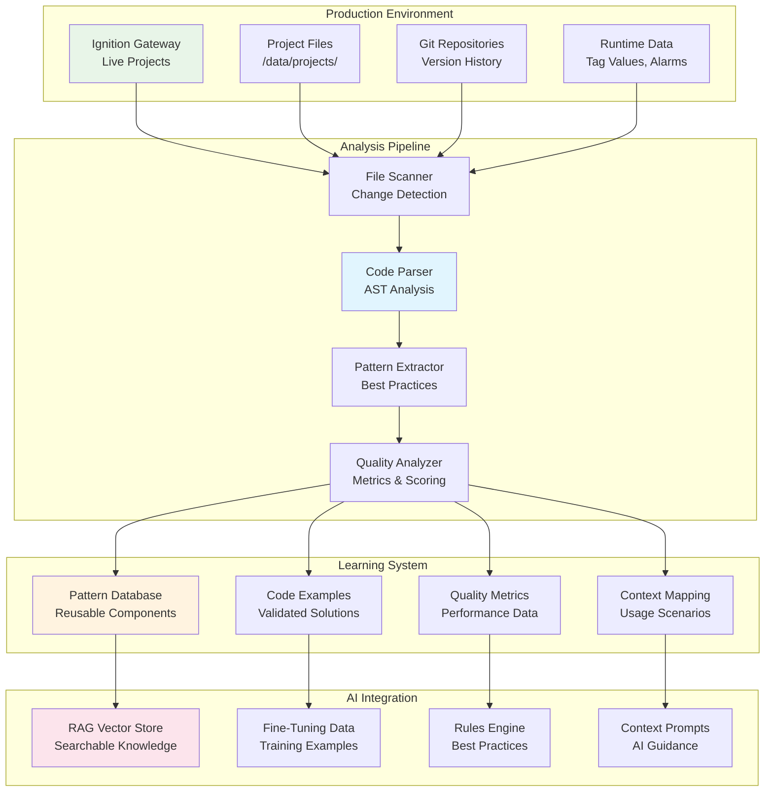

# Production Codebase Integration Guide

## Overview

This document outlines the comprehensive strategy for integrating production Ignition codebases into the AI context engineering system. By analyzing, learning from, and continuously monitoring actual production code, the AI system delivers contextually relevant, proven solutions that match your organization's specific patterns and quality standards.

## 🎯 Integration Objectives

### Primary Goals
- **Pattern Recognition**: Identify and learn from successful production patterns
- **Quality Standards**: Understand and replicate production-level code quality
- **Context Awareness**: Generate code that fits existing architectural decisions
- **Continuous Learning**: Evolve understanding based on production changes
- **Knowledge Preservation**: Capture institutional knowledge in code

### Strategic Benefits
- **Accelerated Onboarding**: New developers learn production patterns instantly
- **Consistency Enforcement**: Maintain architectural consistency across projects
- **Quality Assurance**: Generate code that meets production standards
- **Risk Reduction**: Learn from proven, tested implementations

## 🏗️ Production Analysis Architecture

### Integration Flow



## 📊 Production Code Analysis System

### 1. Continuous Monitoring & Change Detection

```python
# production-integration/analyzers/change_detector.py
from pathlib import Path
from typing import Dict, List, Set
import hashlib
import json
import time
from dataclasses import dataclass
from datetime import datetime

@dataclass
class FileChange:
    file_path: str
    change_type: str  # 'created', 'modified', 'deleted'
    old_hash: str
    new_hash: str
    timestamp: datetime
    git_commit: str = None

class ProductionChangeDetector:
    def __init__(self, project_paths: List[str], check_interval: int = 300):
        self.project_paths = [Path(p) for p in project_paths]
        self.check_interval = check_interval
        self.file_hashes: Dict[str, str] = {}
        self.last_scan: datetime = datetime.min
        
    def initialize_baseline(self):
        """Create initial baseline of all production files"""
        print("Creating production codebase baseline...")
        
        for project_path in self.project_paths:
            if not project_path.exists():
                print(f"Warning: Project path {project_path} does not exist")
                continue
                
            for file_path in self._get_ignition_files(project_path):
                file_hash = self._calculate_file_hash(file_path)
                self.file_hashes[str(file_path)] = file_hash
        
        self.last_scan = datetime.now()
        self._save_baseline()
        
        print(f"Baseline created with {len(self.file_hashes)} files")
    
    def scan_for_changes(self) -> List[FileChange]:
        """Scan for changes since last check"""
        changes = []
        current_files = set()
        
        for project_path in self.project_paths:
            if not project_path.exists():
                continue
                
            for file_path in self._get_ignition_files(project_path):
                current_files.add(str(file_path))
                current_hash = self._calculate_file_hash(file_path)
                file_path_str = str(file_path)
                
                if file_path_str not in self.file_hashes:
                    # New file
                    changes.append(FileChange(
                        file_path=file_path_str,
                        change_type='created',
                        old_hash='',
                        new_hash=current_hash,
                        timestamp=datetime.now()
                    ))
                    self.file_hashes[file_path_str] = current_hash
                    
                elif self.file_hashes[file_path_str] != current_hash:
                    # Modified file
                    changes.append(FileChange(
                        file_path=file_path_str,
                        change_type='modified',
                        old_hash=self.file_hashes[file_path_str],
                        new_hash=current_hash,
                        timestamp=datetime.now()
                    ))
                    self.file_hashes[file_path_str] = current_hash
        
        # Check for deleted files
        for file_path in list(self.file_hashes.keys()):
            if file_path not in current_files:
                changes.append(FileChange(
                    file_path=file_path,
                    change_type='deleted',
                    old_hash=self.file_hashes[file_path],
                    new_hash='',
                    timestamp=datetime.now()
                ))
                del self.file_hashes[file_path]
        
        self.last_scan = datetime.now()
        
        if changes:
            self._save_baseline()
            print(f"Detected {len(changes)} changes")
            
        return changes
    
    def _get_ignition_files(self, project_path: Path) -> List[Path]:
        """Get all relevant Ignition files from project directory"""
        ignition_files = []
        
        # Perspective views
        views_path = project_path / "com.inductiveautomation.perspective" / "views"
        if views_path.exists():
            ignition_files.extend(views_path.rglob("*.json"))
        
        # Scripts
        scripts_path = project_path / "scripts"
        if scripts_path.exists():
            ignition_files.extend(scripts_path.rglob("*.py"))
        
        # Tags
        tags_path = project_path / "tags"
        if tags_path.exists():
            ignition_files.extend(tags_path.rglob("*.json"))
        
        # Named queries
        queries_path = project_path / "namedQueries"
        if queries_path.exists():
            ignition_files.extend(queries_path.rglob("*.sql"))
        
        # Report templates
        reports_path = project_path / "reports"
        if reports_path.exists():
            ignition_files.extend(reports_path.rglob("*.json"))
        
        return ignition_files
    
    def _calculate_file_hash(self, file_path: Path) -> str:
        """Calculate SHA-256 hash of file content"""
        try:
            with open(file_path, 'rb') as f:
                return hashlib.sha256(f.read()).hexdigest()
        except Exception:
            return ""
    
    def _save_baseline(self):
        """Save current file hash baseline"""
        baseline_file = Path("./storage/production_baseline.json")
        baseline_file.parent.mkdir(parents=True, exist_ok=True)
        
        with open(baseline_file, 'w') as f:
            json.dump({
                'hashes': self.file_hashes,
                'last_scan': self.last_scan.isoformat(),
                'project_paths': [str(p) for p in self.project_paths]
            }, f, indent=2)
```

### 2. Advanced Code Pattern Extraction

```python
# production-integration/analyzers/pattern_extractor.py
from typing import Dict, List, Any, Tuple
import json
import ast
import re
from collections import defaultdict, Counter
from dataclasses import dataclass

@dataclass
class CodePattern:
    pattern_id: str
    pattern_type: str  # 'component', 'script', 'binding', 'architecture'
    name: str
    description: str
    usage_frequency: int
    quality_score: float
    examples: List[str]
    context_tags: List[str]
    anti_patterns: List[str] = None

class AdvancedPatternExtractor:
    def __init__(self):
        self.component_patterns = defaultdict(list)
        self.script_patterns = defaultdict(list)
        self.binding_patterns = defaultdict(list)
        self.architectural_patterns = defaultdict(list)
        
    def extract_all_patterns(self, production_data: Dict) -> List[CodePattern]:
        """Extract all types of patterns from production data"""
        patterns = []
        
        # Component patterns
        patterns.extend(self._extract_component_patterns(production_data))
        
        # Script patterns  
        patterns.extend(self._extract_script_patterns(production_data))
        
        # Binding patterns
        patterns.extend(self._extract_binding_patterns(production_data))
        
        # Architectural patterns
        patterns.extend(self._extract_architectural_patterns(production_data))
        
        # Quality filtering and scoring
        patterns = self._score_and_filter_patterns(patterns)
        
        return patterns
    
    def _extract_component_patterns(self, production_data: Dict) -> List[CodePattern]:
        """Extract reusable component patterns"""
        patterns = []
        component_usage = defaultdict(list)
        
        for view in production_data.get('perspective_views', []):
            components = view.get('metadata', {}).get('components_used', [])
            
            for component in components:
                # Group similar components
                comp_signature = self._create_component_signature(component)
                component_usage[comp_signature].append({
                    'view': view['name'],
                    'project': view['project'],
                    'component': component,
                    'context': self._extract_component_context(component, view)
                })
        
        # Identify common patterns
        for signature, usages in component_usage.items():
            if len(usages) >= 3:  # Used in at least 3 places
                pattern = self._create_component_pattern(signature, usages)
                if pattern:
                    patterns.append(pattern)
        
        return patterns
    
    def _extract_script_patterns(self, production_data: Dict) -> List[CodePattern]:
        """Extract common scripting patterns"""
        patterns = []
        function_patterns = defaultdict(list)
        error_handling_patterns = []
        performance_patterns = []
        
        for script in production_data.get('scripts', []):
            script_content = script['content']
            
            # Extract function patterns
            functions = self._extract_functions(script_content)
            for func_name, func_code in functions.items():
                pattern_key = self._classify_function_pattern(func_code)
                if pattern_key:
                    function_patterns[pattern_key].append({
                        'function_name': func_name,
                        'code': func_code,
                        'script': script['name'],
                        'project': script['project'],
                        'context': script.get('metadata', {})
                    })
            
            # Extract error handling patterns
            error_patterns = self._extract_error_handling_patterns(script_content)
            error_handling_patterns.extend(error_patterns)
            
            # Extract performance patterns
            perf_patterns = self._extract_performance_patterns(script_content)
            performance_patterns.extend(perf_patterns)
        
        # Create pattern objects
        for pattern_type, examples in function_patterns.items():
            if len(examples) >= 2:  # At least 2 examples
                patterns.append(CodePattern(
                    pattern_id=f"SCRIPT_{pattern_type.upper()}",
                    pattern_type="script",
                    name=f"{pattern_type.replace('_', ' ').title()} Pattern",
                    description=f"Common pattern for {pattern_type.replace('_', ' ')}",
                    usage_frequency=len(examples),
                    quality_score=self._calculate_pattern_quality(examples),
                    examples=[ex['code'] for ex in examples[:3]],
                    context_tags=self._extract_context_tags(examples)
                ))
        
        return patterns
    
    def _extract_binding_patterns(self, production_data: Dict) -> List[CodePattern]:
        """Extract common binding patterns"""
        patterns = []
        binding_types = defaultdict(list)
        
        for view in production_data.get('perspective_views', []):
            bindings = self._extract_all_bindings(view['content'])
            
            for binding in bindings:
                binding_key = self._classify_binding_pattern(binding)
                if binding_key:
                    binding_types[binding_key].append({
                        'binding': binding,
                        'view': view['name'],
                        'project': view['project'],
                        'component_type': binding.get('component_type'),
                        'property': binding.get('property')
                    })
        
        # Create binding patterns
        for pattern_type, examples in binding_types.items():
            if len(examples) >= 3:
                patterns.append(CodePattern(
                    pattern_id=f"BIND_{pattern_type.upper()}",
                    pattern_type="binding",
                    name=f"{pattern_type.replace('_', ' ').title()} Binding Pattern",
                    description=f"Common binding pattern for {pattern_type.replace('_', ' ')}",
                    usage_frequency=len(examples),
                    quality_score=self._calculate_binding_quality(examples),
                    examples=[self._format_binding_example(ex) for ex in examples[:3]],
                    context_tags=self._extract_binding_context_tags(examples)
                ))
        
        return patterns
    
    def _extract_architectural_patterns(self, production_data: Dict) -> List[CodePattern]:
        """Extract architectural and organizational patterns"""
        patterns = []
        
        # Project structure patterns
        structure_patterns = self._analyze_project_structures(production_data)
        patterns.extend(structure_patterns)
        
        # View hierarchy patterns
        hierarchy_patterns = self._analyze_view_hierarchies(production_data)
        patterns.extend(hierarchy_patterns)
        
        # Data flow patterns
        dataflow_patterns = self._analyze_data_flow_patterns(production_data)
        patterns.extend(dataflow_patterns)
        
        return patterns
    
    def _create_component_signature(self, component: Dict) -> str:
        """Create a signature for component pattern matching"""
        comp_type = component['type']
        
        # Look for common configuration patterns
        config_elements = []
        
        # Check for common property patterns
        if 'Button' in comp_type:
            config_elements.append('interactive')
        if 'display' in str(component).lower():
            config_elements.append('display')
        if 'input' in str(component).lower():
            config_elements.append('input')
        
        return f"{comp_type}_{('_'.join(config_elements) if config_elements else 'basic')}"
    
    def _classify_function_pattern(self, func_code: str) -> str:
        """Classify function into pattern categories"""
        code_lower = func_code.lower()
        
        if 'system.tag.read' in code_lower and 'system.tag.write' in code_lower:
            return "tag_read_write"
        elif 'system.tag.read' in code_lower:
            return "tag_read"
        elif 'system.tag.write' in code_lower:
            return "tag_write"
        elif 'system.db.' in code_lower:
            return "database_operation"
        elif 'system.alarm.' in code_lower:
            return "alarm_handling"
        elif 'try:' in code_lower and 'except' in code_lower:
            return "error_handling"
        elif 'for ' in code_lower and 'in ' in code_lower:
            return "data_processing"
        elif 'def ' in code_lower and 'return' in code_lower:
            return "utility_function"
        
        return None
    
    def _calculate_pattern_quality(self, examples: List[Dict]) -> float:
        """Calculate quality score for a pattern"""
        quality_factors = {
            'error_handling': 0.0,
            'logging': 0.0,
            'documentation': 0.0,
            'performance': 0.0,
            'consistency': 0.0
        }
        
        for example in examples:
            code = example.get('code', '')
            
            # Error handling
            if 'try:' in code and 'except' in code:
                quality_factors['error_handling'] += 1
            
            # Logging
            if 'logger' in code or 'system.util.getLogger' in code:
                quality_factors['logging'] += 1
            
            # Documentation
            if '"""' in code or "'''" in code:
                quality_factors['documentation'] += 1
            
            # Performance indicators
            if 'system.tag.readBlocking' in code:
                quality_factors['performance'] += 1
            elif 'system.tag.read(' in code:
                quality_factors['performance'] -= 0.5
        
        # Calculate consistency (how similar the examples are)
        quality_factors['consistency'] = self._calculate_consistency_score(examples)
        
        # Normalize by number of examples
        total_examples = len(examples)
        for factor in quality_factors:
            if factor != 'consistency':
                quality_factors[factor] /= total_examples
        
        # Weighted average
        weights = {
            'error_handling': 0.25,
            'logging': 0.15,
            'documentation': 0.20,
            'performance': 0.25,
            'consistency': 0.15
        }
        
        final_score = sum(quality_factors[factor] * weights[factor] 
                         for factor in quality_factors)
        
        return min(final_score, 1.0)
    
    def _score_and_filter_patterns(self, patterns: List[CodePattern]) -> List[CodePattern]:
        """Score and filter patterns based on quality and usefulness"""
        scored_patterns = []
        
        for pattern in patterns:
            # Boost score based on usage frequency
            frequency_boost = min(pattern.usage_frequency / 10, 0.2)
            pattern.quality_score = min(pattern.quality_score + frequency_boost, 1.0)
            
            # Filter out low-quality patterns
            if pattern.quality_score >= 0.6:
                scored_patterns.append(pattern)
        
        # Sort by quality score descending
        scored_patterns.sort(key=lambda p: p.quality_score, reverse=True)
        
        return scored_patterns
```

### 3. Real-Time Production Metrics Integration

```python
# production-integration/monitoring/production_monitor.py
from typing import Dict, List, Any, Optional
import asyncio
import aiohttp
import json
from datetime import datetime, timedelta
from dataclasses import dataclass

@dataclass
class ProductionMetric:
    metric_name: str
    value: float
    timestamp: datetime
    tags: Dict[str, str]
    project: str

class ProductionMetricsMonitor:
    def __init__(self, ignition_gateway_url: str, credentials: Dict[str, str]):
        self.gateway_url = ignition_gateway_url
        self.credentials = credentials
        self.session: Optional[aiohttp.ClientSession] = None
        
    async def start_monitoring(self):
        """Start monitoring production metrics"""
        self.session = aiohttp.ClientSession()
        
        # Start periodic monitoring tasks
        await asyncio.gather(
            self._monitor_performance_metrics(),
            self._monitor_tag_quality(),
            self._monitor_alarm_activity(),
            self._monitor_system_health()
        )
    
    async def _monitor_performance_metrics(self):
        """Monitor application performance metrics"""
        while True:
            try:
                metrics = await self._collect_performance_data()
                
                for metric in metrics:
                    await self._process_performance_metric(metric)
                
                await asyncio.sleep(60)  # Check every minute
                
            except Exception as e:
                print(f"Error monitoring performance: {e}")
                await asyncio.sleep(60)
    
    async def _collect_performance_data(self) -> List[ProductionMetric]:
        """Collect performance data from Ignition Gateway"""
        metrics = []
        
        # Gateway performance metrics
        gateway_stats = await self._get_gateway_statistics()
        if gateway_stats:
            metrics.extend([
                ProductionMetric(
                    metric_name="gateway_cpu_usage",
                    value=gateway_stats.get('cpuUsage', 0),
                    timestamp=datetime.now(),
                    tags={"type": "system"},
                    project="gateway"
                ),
                ProductionMetric(
                    metric_name="gateway_memory_usage",
                    value=gateway_stats.get('memoryUsage', 0),
                    timestamp=datetime.now(),
                    tags={"type": "system"},
                    project="gateway"
                )
            ])
        
        # Project-specific metrics
        for project_name in await self._get_project_names():
            project_metrics = await self._get_project_metrics(project_name)
            metrics.extend(project_metrics)
        
        return metrics
    
    async def _monitor_tag_quality(self):
        """Monitor tag quality and connectivity"""
        while True:
            try:
                quality_metrics = await self._collect_tag_quality_data()
                
                for metric in quality_metrics:
                    await self._process_quality_metric(metric)
                
                await asyncio.sleep(300)  # Check every 5 minutes
                
            except Exception as e:
                print(f"Error monitoring tag quality: {e}")
                await asyncio.sleep(300)
    
    async def _collect_tag_quality_data(self) -> List[ProductionMetric]:
        """Collect tag quality statistics"""
        metrics = []
        
        # Get quality statistics for critical tags
        critical_tags = await self._get_critical_tags()
        
        for tag_path in critical_tags:
            try:
                tag_info = await self._get_tag_quality(tag_path)
                
                metrics.append(ProductionMetric(
                    metric_name="tag_quality",
                    value=1.0 if tag_info.get('quality') == 'Good' else 0.0,
                    timestamp=datetime.now(),
                    tags={
                        "tag_path": tag_path,
                        "provider": tag_info.get('provider', 'unknown')
                    },
                    project=self._extract_project_from_tag(tag_path)
                ))
                
            except Exception as e:
                print(f"Error checking tag {tag_path}: {e}")
        
        return metrics
    
    async def _process_performance_metric(self, metric: ProductionMetric):
        """Process performance metric and update learning system"""
        
        # Store in metrics database
        await self._store_metric(metric)
        
        # Check for performance issues
        if metric.metric_name == "view_render_time" and metric.value > 2000:  # >2s
            await self._flag_performance_issue(metric)
        
        # Update pattern quality scores based on performance
        if metric.tags.get("pattern_id"):
            await self._update_pattern_performance_score(
                metric.tags["pattern_id"], 
                metric.value
            )
    
    async def _flag_performance_issue(self, metric: ProductionMetric):
        """Flag performance issues for pattern analysis"""
        issue_data = {
            'timestamp': metric.timestamp.isoformat(),
            'metric': metric.metric_name,
            'value': metric.value,
            'tags': metric.tags,
            'project': metric.project,
            'issue_type': 'performance_degradation'
        }
        
        # Store for pattern analysis
        await self._store_performance_issue(issue_data)
        
        # Trigger analysis if needed
        if metric.value > 5000:  # Very slow
            await self._trigger_immediate_analysis(issue_data)
```

### 4. Git History Mining System

```python
# production-integration/git/history_miner.py
import git
from typing import Dict, List, Tuple, Optional
from datetime import datetime, timedelta
import re
from dataclasses import dataclass

@dataclass
class GitLearningExample:
    commit_hash: str
    author: str
    timestamp: datetime
    message: str
    change_type: str  # 'bug_fix', 'feature', 'refactor', 'optimization'
    files_changed: List[str]
    diff_content: str
    learning_value: float

class GitHistoryMiner:
    def __init__(self, repo_paths: List[str]):
        self.repos = [git.Repo(path) for path in repo_paths]
        self.bug_fix_patterns = [
            r'\bfix\b', r'\bbug\b', r'\berror\b', r'\bissue\b',
            r'\bproblem\b', r'\bcorrect\b', r'\bresolve\b'
        ]
        self.feature_patterns = [
            r'\badd\b', r'\bimplement\b', r'\bfeature\b', r'\bnew\b',
            r'\bcreate\b', r'\benhance\b'
        ]
        self.optimization_patterns = [
            r'\boptimiz\b', r'\bperformance\b', r'\bimprove\b',
            r'\befficienc\b', r'\bspeed\b', r'\bfaster\b'
        ]
        
    def mine_learning_examples(self, 
                             days_back: int = 365, 
                             min_learning_value: float = 0.3) -> List[GitLearningExample]:
        """Mine git history for valuable learning examples"""
        
        examples = []
        cutoff_date = datetime.now() - timedelta(days=days_back)
        
        for repo in self.repos:
            try:
                commits = list(repo.iter_commits(since=cutoff_date))
                
                for commit in commits:
                    example = self._analyze_commit(commit)
                    
                    if example and example.learning_value >= min_learning_value:
                        examples.append(example)
                        
            except Exception as e:
                print(f"Error mining repository {repo.working_dir}: {e}")
                continue
        
        # Sort by learning value descending
        examples.sort(key=lambda x: x.learning_value, reverse=True)
        
        return examples
    
    def _analyze_commit(self, commit: git.Commit) -> Optional[GitLearningExample]:
        """Analyze a single commit for learning value"""
        
        message = commit.message.lower()
        files_changed = []
        total_diff = ""
        
        try:
            # Get changed files
            if commit.parents:  # Not initial commit
                parent = commit.parents[0]
                diff = parent.diff(commit, create_patch=True)
                
                for item in diff:
                    if item.a_path:
                        files_changed.append(item.a_path)
                    total_diff += str(item.diff.decode('utf-8', errors='ignore'))
            
            # Skip if no Ignition-related files
            ignition_files = self._filter_ignition_files(files_changed)
            if not ignition_files:
                return None
            
            # Classify change type
            change_type = self._classify_change_type(message)
            if not change_type:
                return None
            
            # Calculate learning value
            learning_value = self._calculate_learning_value(
                commit, message, ignition_files, total_diff
            )
            
            return GitLearningExample(
                commit_hash=commit.hexsha,
                author=commit.author.name,
                timestamp=datetime.fromtimestamp(commit.committed_date),
                message=commit.message,
                change_type=change_type,
                files_changed=ignition_files,
                diff_content=total_diff,
                learning_value=learning_value
            )
            
        except Exception as e:
            print(f"Error analyzing commit {commit.hexsha}: {e}")
            return None
    
    def _classify_change_type(self, message: str) -> Optional[str]:
        """Classify commit based on message"""
        
        if any(re.search(pattern, message, re.IGNORECASE) for pattern in self.bug_fix_patterns):
            return 'bug_fix'
        elif any(re.search(pattern, message, re.IGNORECASE) for pattern in self.feature_patterns):
            return 'feature'
        elif any(re.search(pattern, message, re.IGNORECASE) for pattern in self.optimization_patterns):
            return 'optimization'
        elif 'refactor' in message:
            return 'refactor'
        
        return None
    
    def _calculate_learning_value(self, 
                                commit: git.Commit, 
                                message: str, 
                                files: List[str], 
                                diff: str) -> float:
        """Calculate the learning value of a commit"""
        
        score = 0.0
        
        # Base score by change type
        if 'bug_fix' in message:
            score += 0.8  # Bug fixes are highly valuable
        elif 'feature' in message:
            score += 0.6
        elif 'optimization' in message:
            score += 0.7
        elif 'refactor' in message:
            score += 0.5
        
        # Bonus for complexity
        if len(files) > 1:
            score += 0.1  # Multi-file changes
        if len(diff.split('\n')) > 50:
            score += 0.1  # Substantial changes
        
        # Bonus for good practices in diff
        if 'try:' in diff and 'except' in diff:
            score += 0.15  # Added error handling
        if 'logger' in diff:
            score += 0.1   # Added logging
        if 'test' in diff.lower():
            score += 0.1   # Added tests
        
        # Penalty for poor practices
        if len(diff.split('\n')) > 500:
            score -= 0.2  # Very large changes are harder to learn from
        if 'TODO' in diff or 'FIXME' in diff:
            score -= 0.1  # Incomplete work
        
        # Bonus for documentation
        if '"""' in diff or "'''" in diff:
            score += 0.1
        
        return min(score, 1.0)
    
    def _filter_ignition_files(self, files: List[str]) -> List[str]:
        """Filter for Ignition-related files only"""
        ignition_extensions = ['.json', '.py', '.sql']
        ignition_paths = ['views/', 'scripts/', 'tags/', 'namedQueries/', 'reports/']
        
        filtered = []
        for file_path in files:
            # Check extension
            if any(file_path.endswith(ext) for ext in ignition_extensions):
                # Check if in Ignition directory structure
                if any(path in file_path for path in ignition_paths):
                    filtered.append(file_path)
        
        return filtered
    
    def extract_before_after_examples(self, examples: List[GitLearningExample]) -> List[Dict]:
        """Extract before/after code examples for training"""
        
        training_examples = []
        
        for example in examples:
            if example.change_type != 'bug_fix':
                continue
                
            # Parse diff to extract before/after code
            before_after_pairs = self._parse_diff_for_training(example.diff_content)
            
            for before_code, after_code in before_after_pairs:
                if self._is_meaningful_change(before_code, after_code):
                    training_examples.append({
                        'instruction': f"Fix this {example.change_type}: {example.message}",
                        'input': before_code,
                        'output': after_code,
                        'metadata': {
                            'commit_hash': example.commit_hash,
                            'change_type': example.change_type,
                            'author': example.author,
                            'learning_value': example.learning_value
                        }
                    })
        
        return training_examples
    
    def _parse_diff_for_training(self, diff_content: str) -> List[Tuple[str, str]]:
        """Parse git diff to extract before/after code pairs"""
        pairs = []
        
        # Simple diff parsing - can be enhanced
        lines = diff_content.split('\n')
        
        current_before = []
        current_after = []
        in_diff_block = False
        
        for line in lines:
            if line.startswith('@@'):
                if current_before and current_after:
                    pairs.append(('\n'.join(current_before), '\n'.join(current_after)))
                current_before = []
                current_after = []
                in_diff_block = True
            elif in_diff_block:
                if line.startswith('-') and not line.startswith('---'):
                    current_before.append(line[1:])
                elif line.startswith('+') and not line.startswith('+++'):
                    current_after.append(line[1:])
                elif not line.startswith(' '):
                    in_diff_block = False
        
        # Add final pair if exists
        if current_before and current_after:
            pairs.append(('\n'.join(current_before), '\n'.join(current_after)))
        
        return pairs
    
    def _is_meaningful_change(self, before: str, after: str) -> bool:
        """Determine if a before/after change is meaningful for training"""
        
        # Must have substantial content
        if len(before.strip()) < 10 or len(after.strip()) < 10:
            return False
        
        # Must contain Ignition-specific content
        ignition_keywords = ['system.', 'tag', 'perspective', 'component', 'binding']
        if not any(keyword in before.lower() or keyword in after.lower() 
                  for keyword in ignition_keywords):
            return False
        
        # Must be different enough to be interesting
        similarity = self._calculate_similarity(before, after)
        if similarity > 0.95 or similarity < 0.3:
            return False
        
        return True
```

## 🔄 Continuous Learning Integration

### Production Feedback Loop

```python
# production-integration/learning/feedback_loop.py
from typing import Dict, List, Any
import asyncio
from datetime import datetime, timedelta

class ProductionFeedbackLoop:
    def __init__(self, 
                 change_detector: ProductionChangeDetector,
                 pattern_extractor: AdvancedPatternExtractor,
                 metrics_monitor: ProductionMetricsMonitor,
                 git_miner: GitHistoryMiner):
        
        self.change_detector = change_detector
        self.pattern_extractor = pattern_extractor
        self.metrics_monitor = metrics_monitor
        self.git_miner = git_miner
        
        self.feedback_queue = asyncio.Queue()
        self.learning_triggers = {
            'significant_changes': 10,  # Number of changes to trigger learning
            'performance_degradation': 0.2,  # Threshold for performance issues
            'new_patterns_threshold': 5  # New patterns to trigger retraining
        }
    
    async def start_continuous_learning(self):
        """Start the continuous learning process"""
        
        # Start parallel monitoring processes
        await asyncio.gather(
            self._monitor_production_changes(),
            self._process_feedback_queue(),
            self._periodic_pattern_analysis(),
            self._monitor_ai_effectiveness()
        )
    
    async def _monitor_production_changes(self):
        """Monitor production changes and queue for analysis"""
        
        while True:
            try:
                changes = self.change_detector.scan_for_changes()
                
                if len(changes) >= self.learning_triggers['significant_changes']:
                    await self.feedback_queue.put({
                        'type': 'production_changes',
                        'data': changes,
                        'timestamp': datetime.now()
                    })
                
                # Check for performance-related changes
                perf_changes = [c for c in changes if self._affects_performance(c)]
                if perf_changes:
                    await self.feedback_queue.put({
                        'type': 'performance_changes',
                        'data': perf_changes,
                        'timestamp': datetime.now()
                    })
                
                await asyncio.sleep(300)  # Check every 5 minutes
                
            except Exception as e:
                print(f"Error monitoring changes: {e}")
                await asyncio.sleep(300)
    
    async def _process_feedback_queue(self):
        """Process feedback items and trigger learning updates"""
        
        while True:
            try:
                feedback_item = await self.feedback_queue.get()
                
                if feedback_item['type'] == 'production_changes':
                    await self._process_production_changes(feedback_item['data'])
                
                elif feedback_item['type'] == 'performance_changes':
                    await self._process_performance_changes(feedback_item['data'])
                
                elif feedback_item['type'] == 'pattern_update':
                    await self._process_pattern_update(feedback_item['data'])
                
                self.feedback_queue.task_done()
                
            except Exception as e:
                print(f"Error processing feedback: {e}")
                await asyncio.sleep(10)
    
    async def _process_production_changes(self, changes: List[FileChange]):
        """Process production code changes for learning"""
        
        # Analyze changes for new patterns
        change_analysis = await self._analyze_changes_for_patterns(changes)
        
        # Update pattern database
        if change_analysis['new_patterns']:
            await self._update_pattern_database(change_analysis['new_patterns'])
        
        # Check for anti-patterns
        if change_analysis['anti_patterns']:
            await self._flag_anti_patterns(change_analysis['anti_patterns'])
        
        # Trigger retraining if needed
        if len(change_analysis['new_patterns']) >= self.learning_triggers['new_patterns_threshold']:
            await self._trigger_model_retraining(change_analysis)
    
    async def _analyze_changes_for_patterns(self, changes: List[FileChange]) -> Dict[str, Any]:
        """Analyze code changes for new patterns and anti-patterns"""
        
        analysis = {
            'new_patterns': [],
            'anti_patterns': [],
            'quality_improvements': [],
            'performance_changes': []
        }
        
        for change in changes:
            if change.change_type == 'created':
                # New file - analyze for patterns
                new_patterns = await self._extract_patterns_from_new_file(change.file_path)
                analysis['new_patterns'].extend(new_patterns)
            
            elif change.change_type == 'modified':
                # Modified file - analyze diff
                diff_analysis = await self._analyze_modification_diff(change)
                
                if diff_analysis['introduces_pattern']:
                    analysis['new_patterns'].append(diff_analysis['pattern'])
                
                if diff_analysis['introduces_anti_pattern']:
                    analysis['anti_patterns'].append(diff_analysis['anti_pattern'])
                
                if diff_analysis['performance_impact']:
                    analysis['performance_changes'].append(diff_analysis)
        
        return analysis
    
    async def _trigger_model_retraining(self, analysis: Dict[str, Any]):
        """Trigger incremental model retraining with new patterns"""
        
        retraining_data = {
            'trigger_reason': 'production_pattern_changes',
            'new_patterns': analysis['new_patterns'],
            'timestamp': datetime.now(),
            'confidence_threshold': 0.8,
            'validation_required': True
        }
        
        # Queue for retraining service
        await self._queue_retraining_job(retraining_data)
        
        print(f"Triggered model retraining due to {len(analysis['new_patterns'])} new patterns")
    
    async def _monitor_ai_effectiveness(self):
        """Monitor AI-generated code effectiveness in production"""
        
        while True:
            try:
                # Check recent AI-generated code performance
                effectiveness_data = await self._collect_ai_effectiveness_metrics()
                
                # Identify underperforming patterns
                underperforming = [
                    pattern for pattern in effectiveness_data
                    if pattern['success_rate'] < 0.7
                ]
                
                if underperforming:
                    await self.feedback_queue.put({
                        'type': 'ai_effectiveness_issue',
                        'data': underperforming,
                        'timestamp': datetime.now()
                    })
                
                await asyncio.sleep(3600)  # Check every hour
                
            except Exception as e:
                print(f"Error monitoring AI effectiveness: {e}")
                await asyncio.sleep(3600)
```

## 📊 Production Quality Metrics

### Comprehensive Quality Assessment

```python
# production-integration/quality/quality_assessor.py
from typing import Dict, List, Any, Tuple
from dataclasses import dataclass

@dataclass
class QualityMetric:
    metric_name: str
    score: float
    weight: float
    details: Dict[str, Any]

class ProductionQualityAssessor:
    def __init__(self):
        self.quality_weights = {
            'error_handling': 0.25,
            'performance': 0.20,
            'maintainability': 0.15,
            'security': 0.15,
            'documentation': 0.10,
            'consistency': 0.15
        }
    
    def assess_comprehensive_quality(self, production_data: Dict[str, Any]) -> Dict[str, Any]:
        """Perform comprehensive quality assessment of production code"""
        
        quality_report = {
            'overall_score': 0.0,
            'category_scores': {},
            'recommendations': [],
            'best_practices_found': [],
            'areas_for_improvement': [],
            'quality_trends': {}
        }
        
        # Assess each quality category
        for category, weight in self.quality_weights.items():
            metric = self._assess_quality_category(category, production_data)
            quality_report['category_scores'][category] = {
                'score': metric.score,
                'weight': weight,
                'weighted_score': metric.score * weight,
                'details': metric.details
            }
            
            quality_report['overall_score'] += metric.score * weight
        
        # Generate recommendations
        quality_report['recommendations'] = self._generate_quality_recommendations(
            quality_report['category_scores']
        )
        
        # Identify best practices
        quality_report['best_practices_found'] = self._identify_best_practices(production_data)
        
        return quality_report
    
    def _assess_quality_category(self, category: str, production_data: Dict[str, Any]) -> QualityMetric:
        """Assess a specific quality category"""
        
        if category == 'error_handling':
            return self._assess_error_handling(production_data)
        elif category == 'performance':
            return self._assess_performance(production_data)
        elif category == 'maintainability':
            return self._assess_maintainability(production_data)
        elif category == 'security':
            return self._assess_security(production_data)
        elif category == 'documentation':
            return self._assess_documentation(production_data)
        elif category == 'consistency':
            return self._assess_consistency(production_data)
        else:
            return QualityMetric(category, 0.0, 0.0, {})
    
    def _assess_error_handling(self, production_data: Dict[str, Any]) -> QualityMetric:
        """Assess error handling quality"""
        
        total_scripts = len(production_data.get('scripts', []))
        scripts_with_error_handling = 0
        error_handling_patterns = []
        
        for script in production_data.get('scripts', []):
            content = script.get('content', '')
            
            has_try_except = 'try:' in content and 'except' in content
            has_logging = 'logger' in content or 'system.util.getLogger' in content
            has_specific_exceptions = len([line for line in content.split('\n') 
                                          if 'except ' in line and ' as ' in line]) > 0
            
            if has_try_except:
                scripts_with_error_handling += 1
                
                pattern_score = 0
                if has_logging:
                    pattern_score += 0.4
                if has_specific_exceptions:
                    pattern_score += 0.3
                if 'finally:' in content:
                    pattern_score += 0.3
                
                error_handling_patterns.append({
                    'script': script.get('name'),
                    'score': pattern_score,
                    'has_logging': has_logging,
                    'has_specific_exceptions': has_specific_exceptions
                })
        
        score = scripts_with_error_handling / total_scripts if total_scripts > 0 else 0
        avg_pattern_quality = sum(p['score'] for p in error_handling_patterns) / len(error_handling_patterns) if error_handling_patterns else 0
        
        final_score = (score + avg_pattern_quality) / 2
        
        return QualityMetric(
            metric_name='error_handling',
            score=final_score,
            weight=self.quality_weights['error_handling'],
            details={
                'scripts_with_error_handling': scripts_with_error_handling,
                'total_scripts': total_scripts,
                'coverage_percentage': score * 100,
                'average_pattern_quality': avg_pattern_quality * 100,
                'patterns': error_handling_patterns
            }
        )
    
    def _identify_best_practices(self, production_data: Dict[str, Any]) -> List[Dict[str, Any]]:
        """Identify best practices found in production code"""
        
        best_practices = []
        
        # Identify excellent error handling examples
        for script in production_data.get('scripts', []):
            content = script.get('content', '')
            
            if (self._has_comprehensive_error_handling(content) and 
                self._has_good_logging_practices(content) and
                self._has_proper_documentation(content)):
                
                best_practices.append({
                    'type': 'comprehensive_script_structure',
                    'example': script.get('name'),
                    'project': script.get('project'),
                    'description': 'Excellent example of error handling, logging, and documentation',
                    'code_snippet': self._extract_representative_snippet(content)
                })
        
        # Identify efficient component patterns
        for view in production_data.get('perspective_views', []):
            if self._has_efficient_binding_patterns(view):
                best_practices.append({
                    'type': 'efficient_binding_pattern',
                    'example': view.get('name'),
                    'project': view.get('project'),
                    'description': 'Efficient use of indirect bindings and minimal polling',
                    'pattern_details': self._extract_binding_pattern_details(view)
                })
        
        return best_practices
```

This comprehensive Production Integration system ensures that AI models learn continuously from real production code, maintaining relevance and improving quality over time while preserving institutional knowledge and best practices.