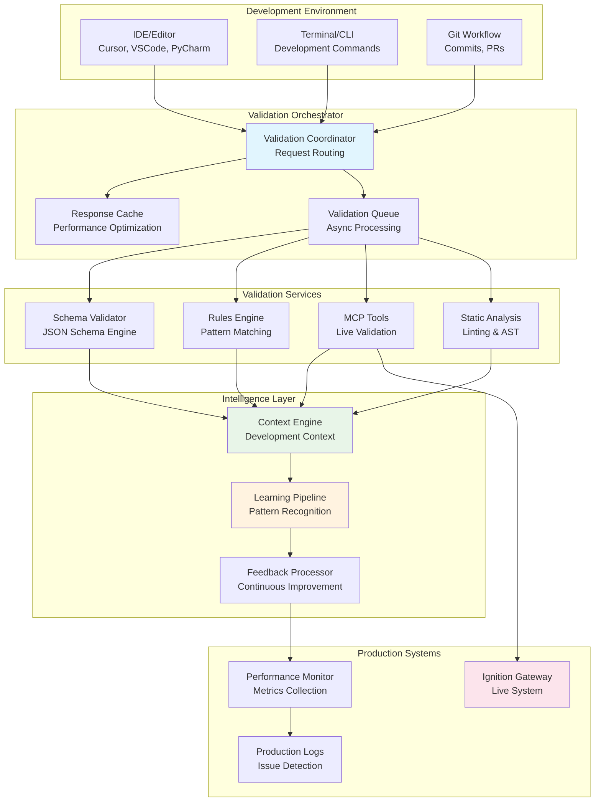

# Validation Tool Integration Patterns

## Overview

This document defines comprehensive integration patterns for validation tools within the AI Context Engineering system. It establishes how different validation layers (static analysis, real-time checking, and production learning) integrate with development workflows, IDE environments, and CI/CD pipelines to ensure seamless, automated code quality assurance.

## 🎯 Integration Objectives

### Primary Goals
- **Seamless Workflow Integration**: Validation tools work invisibly within existing development workflows
- **Real-Time Feedback**: Immediate validation during coding without interrupting flow
- **Progressive Enhancement**: Multiple validation layers with increasing sophistication
- **Context Awareness**: Validation adapts to development context and project requirements
- **Continuous Learning**: Integration enables feedback loops for system improvement

### Success Metrics
- **Zero Friction**: No additional steps required from developers
- **Sub-Second Response**: Real-time validation completes in <1s
- **95% Accuracy**: Validation correctly identifies issues 95% of the time
- **Developer Satisfaction**: Positive feedback on development experience enhancement

## 🏗️ Integration Architecture

### Multi-Layer Integration Model



## 🔌 IDE Integration Patterns

### 1. Language Server Protocol (LSP) Integration

#### Custom Ignition Language Server

```typescript
// validation/ignition-language-server.ts
import {
  createConnection,
  TextDocuments,
  ProposedFeatures,
  InitializeParams,
  DidChangeConfigurationNotification,
  CompletionItem,
  TextDocumentPositionParams,
  TextDocumentSyncKind,
  InitializeResult,
  Diagnostic,
  DiagnosticSeverity
} from 'vscode-languageserver/node';

import { TextDocument } from 'vscode-languageserver-textdocument';

export class IgnitionLanguageServer {
  private connection = createConnection(ProposedFeatures.all);
  private documents = new TextDocuments(TextDocument);
  private validationCoordinator: ValidationCoordinator;
  
  constructor() {
    this.setupServerCapabilities();
    this.setupDocumentHandlers();
    this.setupValidationHandlers();
  }
  
  private setupServerCapabilities(): void {
    this.connection.onInitialize((params: InitializeParams): InitializeResult => {
      return {
        capabilities: {
          textDocumentSync: TextDocumentSyncKind.Incremental,
          completionProvider: {
            resolveProvider: true,
            triggerCharacters: ['.', '[', '{', '"']
          },
          hoverProvider: true,
          definitionProvider: true,
          diagnosticProvider: {
            interFileDependencies: false,
            workspaceDiagnostics: false
          },
          codeActionProvider: true
        }
      };
    });
  }
  
  private setupDocumentHandlers(): void {
    this.documents.onDidChangeContent(change => {
      this.validateDocument(change.document);
    });
    
    this.documents.onDidSave(save => {
      this.validateDocumentComprehensive(save.document);
    });
  }
  
  private async validateDocument(textDocument: TextDocument): Promise<void> {
    const diagnostics: Diagnostic[] = [];
    const content = textDocument.getText();
    const documentType = this.detectDocumentType(textDocument.uri, content);
    
    try {
      // Real-time validation (fast, basic checks)
      const validationResult = await this.validationCoordinator.validateRealTime({
        content,
        documentType,
        context: {
          file_path: textDocument.uri,
          project_context: await this.getProjectContext(textDocument.uri)
        }
      });
      
      // Convert validation results to LSP diagnostics
      for (const issue of validationResult.issues) {
        diagnostics.push({
          severity: this.mapSeverity(issue.severity),
          range: this.calculateRange(textDocument, issue.line, issue.column),
          message: issue.message,
          code: issue.rule_id,
          source: 'ignition-validator',
          data: {
            suggested_fix: issue.suggested_fix,
            code_example: issue.code_example
          }
        });
      }
      
      // Send diagnostics to client
      this.connection.sendDiagnostics({
        uri: textDocument.uri,
        diagnostics
      });
      
    } catch (error) {
      console.error('Validation error:', error);
    }
  }
  
  private async validateDocumentComprehensive(textDocument: TextDocument): Promise<void> {
    const content = textDocument.getText();
    const documentType = this.detectDocumentType(textDocument.uri, content);
    
    // Comprehensive validation (slower, thorough checks)
    const validationResult = await this.validationCoordinator.validateComprehensive({
      content,
      documentType,
      context: {
        file_path: textDocument.uri,
        project_context: await this.getProjectContext(textDocument.uri),
        validation_level: 'production'
      }
    });
    
    // Update diagnostics with comprehensive results
    this.updateDiagnostics(textDocument, validationResult);
    
    // Trigger learning pipeline for saved content
    this.validationCoordinator.submitForLearning(content, validationResult);
  }
  
  private detectDocumentType(uri: string, content: string): string {
    if (uri.endsWith('.json') && content.includes('"type": "ia.')) {
      return 'perspective_component';
    } else if (uri.endsWith('.py') || content.includes('system.')) {
      return 'jython_script';
    } else if (content.includes('[default]') || content.includes('tag')) {
      return 'tag_configuration';
    }
    return 'unknown';
  }
}
```

#### IDE Extension Configuration

```json
// .vscode/settings.json
{
  "ignition-ai.validation": {
    "enabled": true,
    "realTimeValidation": true,
    "comprehensiveOnSave": true,
    "showInlineErrors": true,
    "showPerformanceWarnings": true,
    "autoFixOnSave": false
  },
  "ignition-ai.languageServer": {
    "host": "localhost",
    "port": 8084,
    "timeout": 5000
  },
  "ignition-ai.contextEngineering": {
    "ragEndpoint": "http://localhost:8001",
    "rulesEndpoint": "http://localhost:8002",
    "mcpEndpoint": "http://localhost:8003"
  },
  "ignition-ai.projectSettings": {
    "projectName": "WHK-Global",
    "validationLevel": "production",
    "customRules": ["whk-standards", "fda-compliance"],
    "performanceThresholds": {
      "maxTagReads": 10,
      "maxExecutionTime": "5s",
      "complexityThreshold": 15
    }
  }
}
```

### 2. Real-Time Validation Integration

#### Validation Coordinator Service

```python
# validation/coordinator.py
import asyncio
import json
from typing import Dict, List, Any, Optional
from dataclasses import dataclass
from enum import Enum
import aioredis
import aiohttp

class ValidationLevel(Enum):
    BASIC = "basic"
    STANDARD = "standard"
    COMPREHENSIVE = "comprehensive"
    PRODUCTION = "production"

@dataclass
class ValidationRequest:
    content: str
    document_type: str
    context: Dict[str, Any]
    validation_level: ValidationLevel = ValidationLevel.STANDARD
    request_id: Optional[str] = None

@dataclass
class ValidationResult:
    valid: bool
    issues: List[Dict[str, Any]]
    suggestions: List[Dict[str, Any]]
    performance_metrics: Dict[str, Any]
    processing_time: float
    cached: bool = False

class ValidationCoordinator:
    def __init__(self, config: Dict[str, Any]):
        self.config = config
        self.cache = None
        self.session = None
        self.validation_services = {}
        
    async def initialize(self):
        """Initialize coordinator services"""
        # Redis cache for performance
        self.cache = await aioredis.from_url(
            self.config['redis_url'],
            encoding="utf-8",
            decode_responses=True
        )
        
        # HTTP session for service calls
        self.session = aiohttp.ClientSession(
            timeout=aiohttp.ClientTimeout(total=30)
        )
        
        # Register validation services
        self.validation_services = {
            'schema': SchemaValidationService(self.session, self.config['schema_service']),
            'rules': RulesValidationService(self.session, self.config['rules_service']),
            'mcp': MCPValidationService(self.session, self.config['mcp_service']),
            'static': StaticAnalysisService(self.session, self.config['static_service'])
        }
        
    async def validate_real_time(self, request: ValidationRequest) -> ValidationResult:
        """Fast validation for real-time feedback"""
        start_time = asyncio.get_event_loop().time()
        
        # Check cache first
        cache_key = self._generate_cache_key(request)
        cached_result = await self._get_cached_result(cache_key)
        
        if cached_result:
            cached_result.cached = True
            return cached_result
        
        # Parallel validation (fast checks only)
        validation_tasks = []
        
        if request.document_type == 'perspective_component':
            validation_tasks.extend([
                self.validation_services['schema'].validate_fast(request),
                self.validation_services['rules'].validate_patterns(request)
            ])
        elif request.document_type == 'jython_script':
            validation_tasks.extend([
                self.validation_services['static'].validate_syntax(request),
                self.validation_services['rules'].validate_jython_patterns(request)
            ])
        
        # Execute validations in parallel
        results = await asyncio.gather(*validation_tasks, return_exceptions=True)
        
        # Combine results
        combined_result = self._combine_validation_results(results, start_time)
        
        # Cache result for 5 minutes
        await self._cache_result(cache_key, combined_result, ttl=300)
        
        return combined_result
    
    async def validate_comprehensive(self, request: ValidationRequest) -> ValidationResult:
        """Comprehensive validation for save/commit operations"""
        start_time = asyncio.get_event_loop().time()
        
        # All validation services
        validation_tasks = []
        
        # Schema validation
        validation_tasks.append(
            self.validation_services['schema'].validate_comprehensive(request)
        )
        
        # Rules engine validation
        validation_tasks.append(
            self.validation_services['rules'].validate_comprehensive(request)
        )
        
        # MCP tools validation (if live system available)
        if await self._is_mcp_available():
            validation_tasks.append(
                self.validation_services['mcp'].validate_live(request)
            )
        
        # Static analysis
        validation_tasks.append(
            self.validation_services['static'].validate_comprehensive(request)
        )
        
        # Execute all validations
        results = await asyncio.gather(*validation_tasks, return_exceptions=True)
        
        # Combine and analyze results
        combined_result = self._combine_validation_results(results, start_time)
        
        # Enhanced analysis for comprehensive validation
        enhanced_result = await self._enhance_validation_result(combined_result, request)
        
        return enhanced_result
    
    async def _enhance_validation_result(self, result: ValidationResult, request: ValidationRequest) -> ValidationResult:
        """Enhance validation result with additional analysis"""
        
        # Performance analysis
        if request.document_type == 'perspective_component':
            performance_analysis = await self._analyze_component_performance(request.content)
            result.performance_metrics.update(performance_analysis)
        
        # Security analysis
        security_analysis = await self._analyze_security_implications(request.content, request.context)
        if security_analysis['issues']:
            result.issues.extend(security_analysis['issues'])
        
        # Best practices suggestions
        best_practices = await self._generate_best_practice_suggestions(request.content, request.document_type)
        result.suggestions.extend(best_practices)
        
        return result
    
    def _combine_validation_results(self, results: List[Any], start_time: float) -> ValidationResult:
        """Combine multiple validation results into single result"""
        combined_issues = []
        combined_suggestions = []
        combined_metrics = {}
        
        for result in results:
            if isinstance(result, Exception):
                # Log exception but continue
                print(f"Validation service error: {result}")
                continue
                
            if hasattr(result, 'issues'):
                combined_issues.extend(result.issues)
            if hasattr(result, 'suggestions'):
                combined_suggestions.extend(result.suggestions)
            if hasattr(result, 'metrics'):
                combined_metrics.update(result.metrics)
        
        # Remove duplicates and sort by severity
        unique_issues = self._deduplicate_issues(combined_issues)
        sorted_issues = sorted(unique_issues, key=lambda x: self._severity_weight(x.get('severity', 'info')))
        
        processing_time = asyncio.get_event_loop().time() - start_time
        
        return ValidationResult(
            valid=len([i for i in sorted_issues if i.get('severity') == 'error']) == 0,
            issues=sorted_issues,
            suggestions=combined_suggestions,
            performance_metrics=combined_metrics,
            processing_time=processing_time
        )
    
    async def submit_for_learning(self, content: str, validation_result: ValidationResult):
        """Submit content and validation results to learning pipeline"""
        learning_data = {
            'content': content,
            'validation_result': validation_result.__dict__,
            'timestamp': asyncio.get_event_loop().time(),
            'success': validation_result.valid
        }
        
        # Send to learning pipeline asynchronously
        asyncio.create_task(self._send_to_learning_pipeline(learning_data))
    
    async def _send_to_learning_pipeline(self, data: Dict[str, Any]):
        """Send data to learning pipeline"""
        try:
            async with self.session.post(
                f"{self.config['learning_service']}/submit",
                json=data
            ) as response:
                if response.status != 200:
                    print(f"Learning pipeline submission failed: {response.status}")
        except Exception as e:
            print(f"Error submitting to learning pipeline: {e}")
```

### 3. Development Workflow Integration

#### Pre-Commit Hook Integration

```python
# scripts/pre-commit-validation.py
#!/usr/bin/env python3
"""
Pre-commit hook for Ignition code validation
"""
import subprocess
import sys
import json
from pathlib import Path
from typing import List, Dict, Any

class PreCommitValidator:
    def __init__(self):
        self.validation_endpoint = "http://localhost:8080/validate"
        self.failed_files = []
        self.warnings = []
        
    def run_validation(self) -> int:
        """Run validation on staged files"""
        staged_files = self.get_staged_files()
        
        if not staged_files:
            print("No relevant files to validate")
            return 0
        
        print(f"Validating {len(staged_files)} staged files...")
        
        for file_path in staged_files:
            try:
                result = self.validate_file(file_path)
                if not result['valid']:
                    self.failed_files.append((file_path, result))
                elif result.get('warnings'):
                    self.warnings.append((file_path, result['warnings']))
                    
            except Exception as e:
                print(f"Validation failed for {file_path}: {e}")
                self.failed_files.append((file_path, {'errors': [str(e)]}))
        
        return self.report_results()
    
    def get_staged_files(self) -> List[str]:
        """Get list of staged files relevant to Ignition"""
        try:
            result = subprocess.run(
                ['git', 'diff', '--cached', '--name-only'],
                capture_output=True,
                text=True,
                check=True
            )
            
            all_files = result.stdout.strip().split('\n')
            
            # Filter for Ignition-related files
            relevant_files = []
            for file_path in all_files:
                if self.is_ignition_file(file_path):
                    relevant_files.append(file_path)
            
            return relevant_files
            
        except subprocess.CalledProcessError:
            print("Error getting staged files")
            return []
    
    def is_ignition_file(self, file_path: str) -> bool:
        """Check if file is Ignition-related"""
        path = Path(file_path)
        
        # Perspective components (JSON files with ia. components)
        if path.suffix == '.json':
            try:
                with open(path, 'r') as f:
                    content = f.read()
                    return '"type": "ia.' in content
            except:
                return False
        
        # Jython scripts
        if path.suffix == '.py':
            try:
                with open(path, 'r') as f:
                    content = f.read()
                    return 'system.' in content or 'ignition' in path.parts
            except:
                return False
        
        # Tag configuration files
        if 'tags' in path.parts or 'tag-config' in path.name:
            return True
        
        return False
    
    def validate_file(self, file_path: str) -> Dict[str, Any]:
        """Validate individual file"""
        import requests
        
        with open(file_path, 'r') as f:
            content = f.read()
        
        validation_request = {
            'content': content,
            'file_path': file_path,
            'validation_level': 'comprehensive',
            'context': {
                'commit_validation': True,
                'project_name': self.get_project_name()
            }
        }
        
        response = requests.post(
            self.validation_endpoint,
            json=validation_request,
            timeout=30
        )
        
        if response.status_code != 200:
            raise Exception(f"Validation service error: {response.status_code}")
        
        return response.json()
    
    def report_results(self) -> int:
        """Report validation results and return exit code"""
        if self.failed_files:
            print("\n❌ VALIDATION FAILED")
            print("=" * 50)
            
            for file_path, result in self.failed_files:
                print(f"\n📄 {file_path}")
                
                errors = result.get('errors', result.get('issues', []))
                for error in errors:
                    if isinstance(error, dict):
                        print(f"  ❌ {error.get('message', str(error))}")
                        if error.get('suggested_fix'):
                            print(f"     💡 {error['suggested_fix']}")
                    else:
                        print(f"  ❌ {error}")
            
            print(f"\nCommit blocked due to {len(self.failed_files)} file(s) with validation errors.")
            print("Fix the errors above and try committing again.")
            return 1
        
        elif self.warnings:
            print("\n⚠️  VALIDATION WARNINGS")
            print("=" * 50)
            
            for file_path, warnings in self.warnings:
                print(f"\n📄 {file_path}")
                for warning in warnings:
                    if isinstance(warning, dict):
                        print(f"  ⚠️  {warning.get('message', str(warning))}")
                    else:
                        print(f"  ⚠️  {warning}")
            
            print(f"\nCommit proceeding with {len(self.warnings)} warning(s).")
            print("Consider addressing these warnings to improve code quality.")
        
        else:
            print("✅ All files passed validation")
        
        return 0
    
    def get_project_name(self) -> str:
        """Get project name from git config or directory"""
        try:
            # Try git config first
            result = subprocess.run(
                ['git', 'config', '--get', 'ignition.project'],
                capture_output=True,
                text=True
            )
            if result.returncode == 0:
                return result.stdout.strip()
        except:
            pass
        
        # Fallback to directory name
        return Path.cwd().name

if __name__ == "__main__":
    validator = PreCommitValidator()
    exit_code = validator.run_validation()
    sys.exit(exit_code)
```

#### CI/CD Pipeline Integration

```yaml
# .github/workflows/ignition-validation.yml
name: Ignition Code Validation

on:
  push:
    branches: [ main, develop ]
  pull_request:
    branches: [ main ]

jobs:
  validate:
    runs-on: ubuntu-latest
    
    services:
      postgres:
        image: postgres:15
        env:
          POSTGRES_PASSWORD: postgres
        options: >-
          --health-cmd pg_isready
          --health-interval 10s
          --health-timeout 5s
          --health-retries 5
      
      redis:
        image: redis:7
        options: >-
          --health-cmd "redis-cli ping"
          --health-interval 10s
          --health-timeout 5s
          --health-retries 5
    
    steps:
    - uses: actions/checkout@v3
      with:
        fetch-depth: 0
    
    - name: Set up Python
      uses: actions/setup-python@v4
      with:
        python-version: '3.11'
    
    - name: Set up Node.js
      uses: actions/setup-node@v3
      with:
        node-version: '18'
    
    - name: Install dependencies
      run: |
        pip install -r requirements.txt
        npm install
    
    - name: Start validation services
      run: |
        docker-compose up -d ai-context-db rag-service rules-engine mcp-tools
        
        # Wait for services to be ready
        ./scripts/wait-for-services.sh
    
    - name: Run comprehensive validation
      run: |
        python scripts/ci-validation.py --comprehensive --report-format=junit
      env:
        VALIDATION_ENDPOINT: http://localhost:8080
        PROJECT_NAME: ${{ github.repository }}
        COMMIT_SHA: ${{ github.sha }}
    
    - name: Upload validation report
      uses: actions/upload-artifact@v3
      if: always()
      with:
        name: validation-report
        path: validation-report.xml
    
    - name: Publish validation results
      uses: EnricoMi/publish-unit-test-result-action@v2
      if: always()
      with:
        files: validation-report.xml
        check_name: "Ignition Validation Results"
    
    - name: Performance benchmark
      if: github.event_name == 'pull_request'
      run: |
        python scripts/performance-benchmark.py \
          --baseline=origin/main \
          --current=HEAD \
          --report-file=performance-report.json
    
    - name: Comment PR with results
      if: github.event_name == 'pull_request'
      uses: actions/github-script@v6
      with:
        script: |
          const fs = require('fs');
          const reportPath = 'validation-summary.md';
          
          if (fs.existsSync(reportPath)) {
            const report = fs.readFileSync(reportPath, 'utf8');
            
            github.rest.issues.createComment({
              issue_number: context.issue.number,
              owner: context.repo.owner,
              repo: context.repo.repo,
              body: report
            });
          }
```

### 4. Performance Optimization Patterns

#### Caching Strategy

```python
# validation/cache_manager.py
import asyncio
import hashlib
import json
import pickle
from typing import Any, Optional, Dict
from dataclasses import dataclass
from datetime import datetime, timedelta

@dataclass
class CacheEntry:
    data: Any
    timestamp: datetime
    ttl: int
    hit_count: int = 0
    
class ValidationCacheManager:
    def __init__(self, redis_client, config: Dict[str, Any]):
        self.redis = redis_client
        self.config = config
        self.local_cache = {}
        self.cache_stats = {
            'hits': 0,
            'misses': 0,
            'evictions': 0
        }
    
    def generate_cache_key(self, content: str, context: Dict[str, Any]) -> str:
        """Generate cache key from content and context"""
        # Create deterministic hash from content and relevant context
        cache_data = {
            'content_hash': hashlib.sha256(content.encode()).hexdigest(),
            'document_type': context.get('document_type'),
            'validation_level': context.get('validation_level'),
            'project_name': context.get('project_name'),
            'rules_version': context.get('rules_version', 'latest')
        }
        
        cache_string = json.dumps(cache_data, sort_keys=True)
        return hashlib.md5(cache_string.encode()).hexdigest()
    
    async def get_cached_result(self, cache_key: str) -> Optional[Any]:
        """Get cached validation result"""
        try:
            # Try local cache first (fastest)
            if cache_key in self.local_cache:
                entry = self.local_cache[cache_key]
                if self._is_cache_valid(entry):
                    entry.hit_count += 1
                    self.cache_stats['hits'] += 1
                    return entry.data
                else:
                    del self.local_cache[cache_key]
            
            # Try Redis cache
            cached_data = await self.redis.get(f"validation:{cache_key}")
            if cached_data:
                try:
                    result = pickle.loads(cached_data)
                    
                    # Store in local cache for faster access
                    self.local_cache[cache_key] = CacheEntry(
                        data=result,
                        timestamp=datetime.now(),
                        ttl=300  # 5 minutes for local cache
                    )
                    
                    self.cache_stats['hits'] += 1
                    return result
                except Exception as e:
                    print(f"Cache deserialization error: {e}")
            
            self.cache_stats['misses'] += 1
            return None
            
        except Exception as e:
            print(f"Cache retrieval error: {e}")
            self.cache_stats['misses'] += 1
            return None
    
    async def cache_result(self, cache_key: str, result: Any, ttl: int = 300):
        """Cache validation result"""
        try:
            # Store in Redis with TTL
            serialized_data = pickle.dumps(result)
            await self.redis.setex(
                f"validation:{cache_key}",
                ttl,
                serialized_data
            )
            
            # Store in local cache
            self.local_cache[cache_key] = CacheEntry(
                data=result,
                timestamp=datetime.now(),
                ttl=min(ttl, 300)  # Max 5 minutes for local cache
            )
            
            # Cleanup local cache if it gets too large
            if len(self.local_cache) > self.config.get('max_local_cache_size', 1000):
                await self._cleanup_local_cache()
                
        except Exception as e:
            print(f"Cache storage error: {e}")
    
    async def invalidate_cache_pattern(self, pattern: str):
        """Invalidate cache entries matching pattern"""
        try:
            # Invalidate Redis cache
            keys = await self.redis.keys(f"validation:{pattern}")
            if keys:
                await self.redis.delete(*keys)
            
            # Invalidate local cache
            keys_to_remove = [k for k in self.local_cache.keys() if pattern in k]
            for key in keys_to_remove:
                del self.local_cache[key]
                self.cache_stats['evictions'] += 1
                
        except Exception as e:
            print(f"Cache invalidation error: {e}")
    
    def _is_cache_valid(self, entry: CacheEntry) -> bool:
        """Check if cache entry is still valid"""
        age = (datetime.now() - entry.timestamp).total_seconds()
        return age < entry.ttl
    
    async def _cleanup_local_cache(self):
        """Clean up local cache by removing old entries"""
        # Sort by hit count and age, remove least used old entries
        sorted_entries = sorted(
            self.local_cache.items(),
            key=lambda x: (x[1].hit_count, x[1].timestamp),
            reverse=False
        )
        
        # Remove bottom 25%
        remove_count = len(sorted_entries) // 4
        for key, _ in sorted_entries[:remove_count]:
            del self.local_cache[key]
            self.cache_stats['evictions'] += 1
    
    def get_cache_stats(self) -> Dict[str, Any]:
        """Get cache performance statistics"""
        total_requests = self.cache_stats['hits'] + self.cache_stats['misses']
        hit_rate = self.cache_stats['hits'] / total_requests if total_requests > 0 else 0
        
        return {
            'hit_rate': hit_rate,
            'total_requests': total_requests,
            'cache_size': len(self.local_cache),
            **self.cache_stats
        }
```

#### Request Batching and Queuing

```python
# validation/batch_processor.py
import asyncio
from typing import List, Dict, Any, Callable
from dataclasses import dataclass
from datetime import datetime
import uuid

@dataclass
class ValidationJob:
    job_id: str
    request: Dict[str, Any]
    callback: Callable
    priority: int = 1
    created_at: datetime = None
    
    def __post_init__(self):
        if self.created_at is None:
            self.created_at = datetime.now()

class BatchValidationProcessor:
    def __init__(self, max_batch_size: int = 10, max_wait_time: float = 0.5):
        self.max_batch_size = max_batch_size
        self.max_wait_time = max_wait_time
        self.pending_jobs = []
        self.processing = False
        self.batch_timer = None
        
    async def submit_validation(self, request: Dict[str, Any], callback: Callable, priority: int = 1) -> str:
        """Submit validation request for batch processing"""
        job = ValidationJob(
            job_id=str(uuid.uuid4()),
            request=request,
            callback=callback,
            priority=priority
        )
        
        self.pending_jobs.append(job)
        
        # Sort by priority (higher number = higher priority)
        self.pending_jobs.sort(key=lambda x: x.priority, reverse=True)
        
        # Start batch timer if not already running
        if not self.processing and self.batch_timer is None:
            self.batch_timer = asyncio.create_task(self._batch_timer())
        
        # Process immediately if batch is full
        if len(self.pending_jobs) >= self.max_batch_size:
            await self._process_batch()
        
        return job.job_id
    
    async def _batch_timer(self):
        """Timer to process batch after max wait time"""
        try:
            await asyncio.sleep(self.max_wait_time)
            if self.pending_jobs and not self.processing:
                await self._process_batch()
        finally:
            self.batch_timer = None
    
    async def _process_batch(self):
        """Process current batch of validation requests"""
        if self.processing or not self.pending_jobs:
            return
        
        self.processing = True
        
        try:
            # Cancel timer if running
            if self.batch_timer:
                self.batch_timer.cancel()
                self.batch_timer = None
            
            # Get current batch
            batch = self.pending_jobs[:self.max_batch_size]
            self.pending_jobs = self.pending_jobs[self.max_batch_size:]
            
            # Group similar requests for optimization
            grouped_requests = self._group_similar_requests(batch)
            
            # Process each group
            for group_type, jobs in grouped_requests.items():
                await self._process_job_group(group_type, jobs)
            
        finally:
            self.processing = False
            
            # Start new timer if there are pending jobs
            if self.pending_jobs and self.batch_timer is None:
                self.batch_timer = asyncio.create_task(self._batch_timer())
    
    def _group_similar_requests(self, jobs: List[ValidationJob]) -> Dict[str, List[ValidationJob]]:
        """Group similar validation requests for batch processing"""
        groups = {
            'perspective_components': [],
            'jython_scripts': [],
            'mixed': []
        }
        
        for job in jobs:
            request = job.request
            document_type = request.get('document_type', 'unknown')
            
            if document_type == 'perspective_component':
                groups['perspective_components'].append(job)
            elif document_type == 'jython_script':
                groups['jython_scripts'].append(job)
            else:
                groups['mixed'].append(job)
        
        # Remove empty groups
        return {k: v for k, v in groups.items() if v}
    
    async def _process_job_group(self, group_type: str, jobs: List[ValidationJob]):
        """Process a group of similar validation jobs"""
        try:
            if group_type == 'perspective_components':
                await self._process_perspective_batch(jobs)
            elif group_type == 'jython_scripts':
                await self._process_jython_batch(jobs)
            else:
                # Process individually
                for job in jobs:
                    await self._process_individual_job(job)
                    
        except Exception as e:
            print(f"Batch processing error for {group_type}: {e}")
            # Fallback to individual processing
            for job in jobs:
                try:
                    await self._process_individual_job(job)
                except Exception as job_error:
                    await job.callback({
                        'valid': False,
                        'error': str(job_error),
                        'job_id': job.job_id
                    })
    
    async def _process_perspective_batch(self, jobs: List[ValidationJob]):
        """Batch process Perspective components"""
        # Extract all components for batch validation
        components = [job.request['content'] for job in jobs]
        
        # Batch schema validation
        schema_results = await self._batch_schema_validation(components)
        
        # Batch rules validation
        rules_results = await self._batch_rules_validation(components, 'perspective')
        
        # Combine results and send callbacks
        for i, job in enumerate(jobs):
            combined_result = self._combine_job_results(
                schema_results[i] if i < len(schema_results) else None,
                rules_results[i] if i < len(rules_results) else None
            )
            combined_result['job_id'] = job.job_id
            
            await job.callback(combined_result)
    
    async def _batch_schema_validation(self, components: List[str]) -> List[Dict[str, Any]]:
        """Batch validate components against schemas"""
        # Implementation would batch multiple schema validations
        # This is a placeholder for the actual batch validation logic
        return [{'schema_valid': True} for _ in components]
    
    async def _batch_rules_validation(self, components: List[str], component_type: str) -> List[Dict[str, Any]]:
        """Batch validate components against rules"""
        # Implementation would batch multiple rules validations
        return [{'rules_valid': True} for _ in components]
    
    def _combine_job_results(self, schema_result: Dict, rules_result: Dict) -> Dict[str, Any]:
        """Combine results from different validation services"""
        return {
            'valid': (schema_result or {}).get('schema_valid', False) and 
                    (rules_result or {}).get('rules_valid', False),
            'schema_result': schema_result,
            'rules_result': rules_result,
            'processing_time': 0.0  # Would be calculated
        }
    
    async def _process_individual_job(self, job: ValidationJob):
        """Process single validation job"""
        # Fallback to individual processing
        result = {
            'valid': True,
            'job_id': job.job_id,
            'processed_individually': True
        }
        await job.callback(result)
```

This comprehensive integration pattern ensures seamless validation across all development workflows while maintaining high performance and developer productivity.