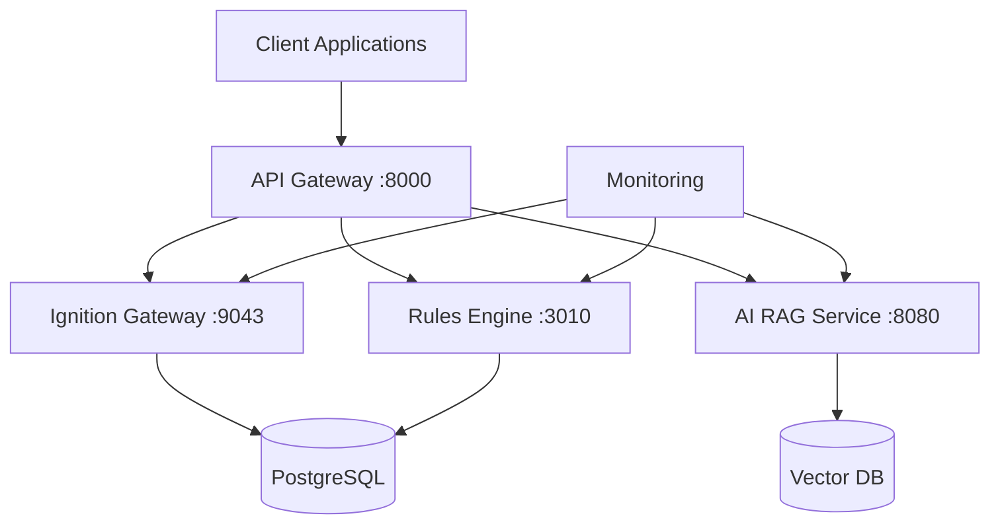

# Platform Services

Core microservices that power the AI in Manufacturing 2025 demo platform.

## Service Overview

| Service | Purpose | Port | Status | Documentation |
|---------|---------|------|--------|---------------|
| **Ignition** | SCADA/HMI system for industrial automation | 9043 | ✅ Active | [`ignition/README.md`](ignition/README.md) |
| **Llama Index** | AI RAG service for natural language queries | 8080 | ✅ Active | [`llama-index/README.md`](llama-index/README.md) |
| **Rules Engine** | Automated validation and quality control | 3010 | ✅ Active | [`rules-engine/README.md`](rules-engine/README.md) |
| **Monitoring** | Observability stack (Grafana, Prometheus) | 3001, 9090 | ✅ Active | [`monitoring/README.md`](monitoring/README.md) |

## Architecture



## Quick Start

### Start All Services
```bash
# From repository root
docker compose up -d

# Verify all services are running
docker compose ps
./scripts/demo-preflight.sh
```

### Access Services
- **Ignition Gateway**: https://localhost:9043 (admin/password from secrets)
- **RAG Service API**: http://localhost:8080/docs
- **Rules Engine**: http://localhost:3010/health
- **Grafana Dashboard**: http://localhost:3001

## Service Details

### Ignition Gateway
Industrial automation platform providing:
- SCADA/HMI interfaces
- Real-time data visualization
- Git-based project management
- MQTT connectivity
- Manufacturing execution workflows

**Key Files**:
- [`ignition/gw-init/`](ignition/gw-init/) - Gateway initialization configs
- [`ignition/ignition-config/`](ignition/ignition-config/) - Runtime configurations
- [`ignition/ignition-projects/`](ignition/ignition-projects/) - Ignition project files

### AI RAG Service
Retrieval-Augmented Generation service providing:
- Natural language querying of manufacturing data
- Vector embeddings and semantic search
- OpenAI integration for intelligent responses
- Manufacturing context understanding

**Key Files**:
- [`llama-index/app/`](llama-index/app/) - FastAPI application
- [`llama-index/app/core/index_manager.py`](llama-index/app/core/index_manager.py) - Vector index management
- [`llama-index/tests/`](llama-index/tests/) - Comprehensive test suite

### Rules Engine
Validation and quality control engine providing:
- Automated rule validation
- Manufacturing process verification
- Real-time quality checks
- Integration with Ignition workflows

**Key Files**:
- [`rules-engine/rules-engine-service.py`](rules-engine/rules-engine-service.py) - Main service
- [`rules-engine/validation_rules.json`](rules-engine/validation_rules.json) - Rule definitions

### Monitoring Stack
Observability and monitoring services:
- **Grafana**: Dashboards and visualization
- **Prometheus**: Metrics collection and alerting
- **Node Exporter**: System metrics
- **cAdvisor**: Container metrics

**Key Files**:
- [`monitoring/grafana/`](monitoring/grafana/) - Dashboard configurations
- [`monitoring/prometheus.yml`](monitoring/prometheus.yml) - Prometheus configuration

## Development

### Working with Services

#### Ignition Development
```bash
# Access the Designer
open https://localhost:9043

# Exec into container
docker exec -it $(docker compose ps -q ignition) bash

# View logs
docker compose logs -f ignition
```

#### RAG Service Development
```bash
cd services/llama-index

# Run tests
python -m pytest

# Start development server
uvicorn app.main:app --reload --port 8080
```

#### Rules Engine Development
```bash
cd services/rules-engine

# Test the service
python rules-engine-service.py --test

# Add new validation rules
vim validation_rules.json
```

### Adding New Services

1. **Create service directory**: `services/your-service/`
2. **Add to docker-compose.yml**: Define service configuration
3. **Create documentation**: Service-specific README.md
4. **Add health checks**: Implement `/health` endpoint
5. **Update this README**: Add to service overview table

## Configuration

### Environment Variables
Services use environment variables for configuration:
- **Database connections**: PostgreSQL, Redis, MongoDB
- **External APIs**: OpenAI, GitHub tokens
- **Service ports**: Customizable port assignments
- **Feature flags**: Enable/disable functionality

### Secrets Management
Sensitive data stored in `secrets/` directory:
- `GIT_USER_TOKEN` - GitHub access
- `POSTGRES_PASSWORD` - Database password
- `GATEWAY_ADMIN_PASSWORD` - Ignition admin password
- `OPENAI_API_KEY` - AI service access

## Monitoring and Health

### Health Checks
All services implement health check endpoints:
```bash
# Check all services
./scripts/demo-preflight.sh

# Individual service checks
curl http://localhost:8080/health  # RAG Service
curl http://localhost:3010/health  # Rules Engine
curl https://localhost:9043/health # Ignition (if available)
```

### Logs and Debugging
```bash
# View all service logs
docker compose logs -f

# Specific service logs
docker compose logs -f ignition
docker compose logs -f llama-index-service
docker compose logs -f rules-engine

# Follow logs with filtering
docker compose logs -f | grep ERROR
```

### Performance Monitoring
- **Grafana Dashboards**: http://localhost:3001
- **Prometheus Metrics**: http://localhost:9090
- **Container Stats**: `docker stats`

## Troubleshooting

### Common Issues

#### Port Conflicts
```bash
# Check port usage
lsof -i :9043  # Ignition
lsof -i :8080  # RAG Service
lsof -i :3001  # Grafana

# See full resolution guide
cat ../docs/troubleshooting/CONFLICT-RESOLUTION-GUIDE.md
```

#### Service Dependencies
Services start in dependency order:
1. Databases (PostgreSQL, Redis, MongoDB)
2. Message brokers (RabbitMQ, MQTT)
3. Core services (Ignition, RAG, Rules Engine)
4. Monitoring services

#### Resource Issues
```bash
# Check Docker resource usage
docker stats

# Clean up unused resources
docker system prune -f

# Restart specific service
docker compose restart service-name
```

## Contributing

See the main [`CONTRIBUTING.md`](../CONTRIBUTING.md) guide for:
- Development workflow
- Code quality standards
- Testing requirements
- Pull request process

### Service-Specific Guidelines
- **Ignition**: Follow existing project patterns, include resource.json files
- **Python Services**: Use type hints, comprehensive tests, proper error handling
- **Configuration**: Document all environment variables and secrets
- **Documentation**: Update service READMEs for any changes

## Next Steps

- **New to development?** → [`../docs/development/GETTING-STARTED.md`](../docs/development/GETTING-STARTED.md)
- **Understanding architecture?** → [`../ARCHITECTURE.md`](../ARCHITECTURE.md)
- **Need troubleshooting?** → [`../docs/troubleshooting/`](../docs/troubleshooting/)
- **Want to run demos?** → [`../demos/README.md`](../demos/README.md)